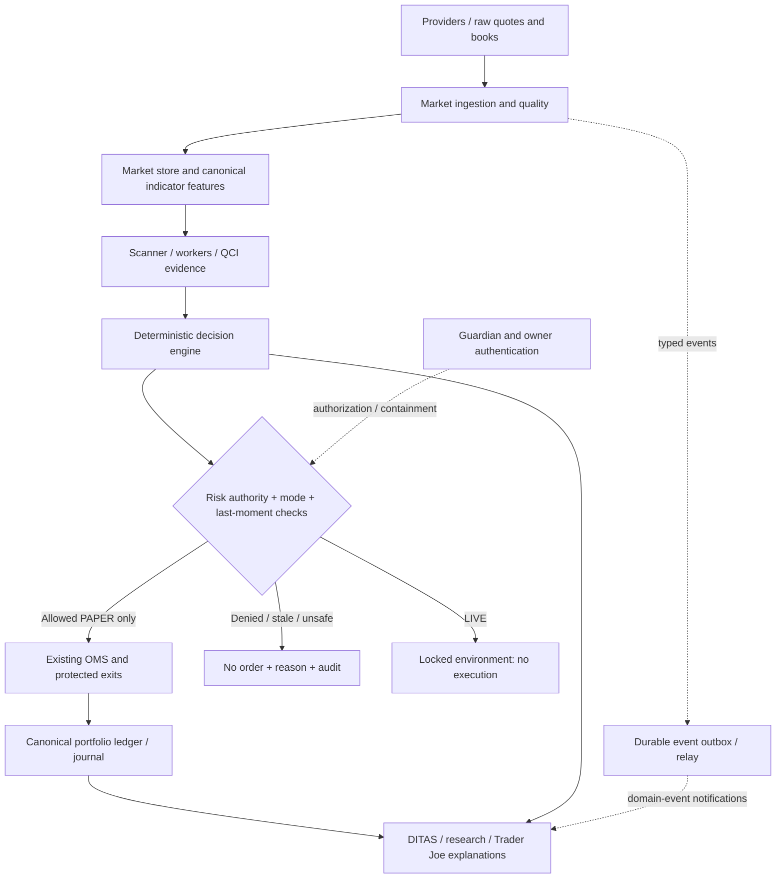

# MIA repository organization and non-duplicating merge plan — 2026-11-21

**Status:** Evidence-based system inventory and Codex handoff. This document changes no trading runtime or database schema. **Branch audited:** `claude/mia-unified-01` at `dd331466c11647cde26c663b9f31dfb0c883d487`; default `main` at `6476391f4d7e8f8884c76ac4e31bb3779c444d77`. The unified branch is unmerged [PR #45](https://github.com/Naokiri5/naokiri/pull/45).

## Executive decision

**Keep the existing domain boundaries and enforce one owner per actual behavior.** Do not flatten MIA into one TypeScript file, create a competing AI-trading engine, or import unverified PDF code directly into the runtime. Group changes by feature ownership, not by superficial similarity or filename. Retain original source evidence; implement only confirmed gaps inside canonical modules.

Audit scope: retrieved full, non-truncated repository tree (493 file/blob entries), the canonical engineering guide, architecture/backlog, prior duplication and defect reports, representative core source imports/exports, the current PR graph, and a completed GitHub Actions run. This is **not** a claim that all 493 files were line-by-line reviewed or every external/live integration was run.

## 1. Current repository map (existing paths: prefer these over new folders)

| Domain / grouped system | Canonical owner(s) | Responsibilities / merge placement |
|---|---|---|
| Market connectors | `server/src/providers/`, `server/src/market/fabric.ts`, `market/store.ts`, `market/quality.ts`, `market/depthStream.ts` | HTTP/WebSocket ingestion, symbol universe, data provenance, freshness, executable depth, market state |
| Durable event fabric | `server/src/fabric/contracts.ts`, `catalog.ts`, `outbox.ts`, `relay.ts`; `core/bus.ts` | Typed domain events, reliable relay/outbox and local event dispatch. **Distinct from** market data ingestion `market/fabric.ts` |
| Indicators and charts | `server/src/features/indicators.ts`, `chart/`, `regime/` | Single indicator calculation engine; closed-bar chart analysis and replay |
| Scanners and intelligence workers | `server/src/market/scanner.ts`, `discover.ts`, `workers/registry.ts`, `runtime.ts`, `indicators.ts`, `qci/` | Candidates, worker evidence, indicator adapters, challenge and consensus. Evidence is not order permission |
| Decision and learning evidence | `server/src/decision/`, `ditas/`, `knowledge/`, `lab/`, `research/` | Deterministic decision; calibration/replay, knowledge, backtests, controlled research, read-only analysis |
| Risk and policy | `server/src/risk/gate.ts`, `risk/policy.ts`, `safety/safety.ts` | **One** risk authority; portfolio exposures, provider quality, token safeguards, thresholds |
| Execution and exits | `server/src/exec/environment.ts`, `exec/oms.ts`, `exec/incidents.ts`, `lab/exits.ts`, `core/mode.ts` | Environment adapter, protected PAPER orders and exit state. LIVE adapter is locked |
| Positions and funds | `server/src/portfolio/ledger.ts`, `calendar.ts`, `correlation.ts`, `stress.ts` | Financial ledger/positions, accounting and portfolio diagnostics. Do not add a parallel position ledger |
| Persistence and operations | `server/src/db/`, `ops/`, `core/` | SQLite transactions, append-only migrations, leases, backups, readiness, audit and cross-domain primitives |
| Security and owner identity | `server/src/security/`, `security/guardian/`, `api/auth.ts` | Privy/TOTP/step-up, defensive monitoring and containment. Do not duplicate authorization logic |
| Research integration / special markets | `server/src/research/`, `prediction/`, `fundamentals/`, `hunt/`, `whales/` | External intelligence and opt-in research; never create an unreviewed route around risk/OMS |
| Trader Joe and notifications | `server/src/joe/`, `joe/live/`, `notify/`, `journal/` | Read-only explanations, action narration, journal and bounded risk-reducing commands |
| HTTP/API composition | `server/src/api/routes.ts`, `server/src/api/sse.ts`, plus each existing domain's `routes.ts` | Authentication, validation, HTTP routes and SSE. Business rules stay in domain services |
| React terminal and landing | `web/src/api.ts`, `ui.tsx`, `App.tsx`, `Landing.tsx`, `pages/`, `auth/`, `privy/` | One API/stream client, shared primitives and route-level pages; per-feature UI stays local |
| Test and QA | `server/test/`, `web/src/*.test.ts`, `e2e/`, `.github/workflows/` | Unit/integration, web, end-to-end, security and CI gates |

## 2. Runtime responsibility flow

The two fabric concepts are **not duplicates**: `market/fabric.ts` handles market ingestion; `fabric/*` handles durable application events. The indicator specialist adapter intentionally reads `FeatureSnapshot` and must not independently recalculate or vote identical market signals twice.

## 3. Confirmed overlap findings and what to do

| Candidate | Evidence / classification | Decision |
|---|---|---|
| Lot-step rounding (`oms.ts` vs risk gate) | Historical duplicate, already consolidated as `core/util.ts:floorToStep` in the 2026-11-18 audit | **KEEP existing fix; no second helper** |
| Consensus expiry (`oms.ts` and QCI) | Historical duplicate, already consolidated to a fail-closed common utility | **KEEP existing fix** |
| Indicators engine vs worker readouts | Adapter by design: `features/indicators.ts` computes; `workers/indicators.ts` interprets | **DO NOT merge** |
| Market data fabric vs durable domain fabric | Different producers, durability, semantics and consumers | **DO NOT merge** |
| Round-trip cost in R (`risk/gate.ts`, `qci/challenge.ts`, `workers/registry.ts`) | Historical audit says entry basis, invalid-input behavior and policy thresholds differ | **REVIEW WITH TRADING-RISK TESTS**; no mechanical extraction |
| Candle request schemas (`ditas/routes.ts`, `api/routes.ts`) | Historical audit found differing timestamp rules | **DEFER** until API parity/invalid-input tests demonstrate safe shared contract |
| Data-freshness display (`api/routes.ts`, `market/bubbles.ts`) | UI presentation overlaps canonical `market/quality.ts` | **LOW-RISK CANDIDATE**, but validate display semantics and thresholds |
| Client chart EMA vs server EMA (`web/src/pages/Markets.tsx`, `features/indicators.ts`) | Different seeding/warm-up; same name does not mean identical values | **PLAN A CONTRACT MIGRATION**, not an untested function swap |
| Day aggregation (`portfolio/ledger.ts` vs `portfolio/calendar.ts`) | UTC accounting vs owner-local calendar interpretation | **KEEP semantics distinct**; document timezone boundaries |
| Existing PDF's alternate ledgers, OMS, risk governors, event fabrics and Live adapters | Canonical comparison and unedited source text exist in `docs/engineering/MIA_5_0_PDF_TYPESCRIPT_MANUAL_INTEGRATION_REVIEW.md` and `docs/engineering/sources/` | **REUSE/ENHANCE canonical owner; do not paste second implementations** |

Historical findings must be refreshed against the PR head before changing code. The existing [duplication audit](MIA_DUPLICATION_AUDIT.md) and [refactoring backlog](../planning/REFACTORING_BACKLOG.md) remain primary detailed evidence; this report is their *integration map*, not a replacement.

## 4. Prioritize cleanup without breaking behavior

| Order | Work package | Existing module(s) to enhance | Required proof |
|---|---|---|---|
| P0 | Reconcile open PRs and pick one baseline for each subsystem; document path ownership before importing new code | PR #45 + active feature PRs | Diff overlap review, no lost commits/source archives, stable baseline SHA |
| P1 | Thin the large HTTP route composer by moving one cohesive group at a time into existing domain route modules, rather than cloning handlers | `server/src/api/routes.ts` (~51 KB, ~598 lines) | Route/method/response, auth, CSRF, schema, status and error parity |
| P2 | Extract feature-owned React components only where actually reused or independently testable; maintain route shell and data hooks | `web/src/pages/Trading.tsx` (~34 KB), `Intel.tsx`; `web/src/api.ts`, `ui.tsx` remain canonical | Browser navigation, loading/error states, auth, SSE, mobile and accessibility checks |
| P3 | Organize 100-worker catalog by evidence domain one batch at a time, leaving registry as stable aggregate | `server/src/workers/registry.ts`, `runtime.ts` | Same worker IDs/count, weights, dependency groups, signatures, timeouts, deterministic packets |
| P4 | Standardize feature-local API response types and actual runtime validation; migrate one consumer at a time | `web/src/api.ts`, affected pages, corresponding Fastify routes | Typecheck and runtime schema/error contract tests |
| P5 | Audit explicit shared read-only utilities; start with display-only freshness after checking semantics | `market/quality.ts`, selected read-only routes/pages | No change in trading gates or historical outputs |
| P6 | Re-evaluate safety-sensitive research gaps behind separate approval gates | `risk/`, `ditas/`, `lab/`, `exec/` | Characterization tests, trading-risk review, simulation, idempotency and owner release approval |

**Never start P1–P6 as a single mass rewrite.** One domain, one behavioral boundary and a focused PR per pass. Preserve exported symbols while migrating callers. Keep old implementation until new callers and regression tests prove parity; then remove only the confirmed duplicate.

## 5. Where future incoming feature code should go

| Incoming feature type | Merge into existing owner (rather than create a competing subsystem) |
|---|---|
| Solana scanner, token quality, honeypot evidence | `providers/`, `market/discover.ts`, `market/scanner.ts`, `safety/safety.ts`, and separate research-only `hunt/` as appropriate |
| Additional quantitative indicators / MIA-100 analysis | `features/indicators.ts`, `workers/indicators.ts`, `qci/`, `ditas/`; do not duplicate mathematical calculations |
| Whale/copy-trade intelligence | `whales/`, `providers/`, `ditas/`, `research/`; evidence only until independent risk approval |
| Risk protection or Guardian shield | `risk/gate.ts` / `risk/policy.ts` and `security/guardian/` respectively; do not allow security telemetry to become unchecked order authority |
| Advanced stops, markouts, backtests | `lab/exits.ts` for validated exit definitions, `exec/oms.ts` for protected PAPER execution, `ditas/` for observed outcomes and research |
| Wallet and live trading proposals | `wallet/`, `exec/environment.ts`, `core/mode.ts`, `qa/gates.ts`; LIVE remains **LOCKED** pending separate owner approval and certification |
| Portfolio and accounting | `portfolio/ledger.ts`, `portfolio/stress.ts`; do not introduce a second balance or fills journal |
| Trader Joe assistant/animation | `joe/`, `joe/live/`, `notify/`, `web/src/pages/Joe.tsx` and shared UI; narration only, not an order bypass |
| New dashboard features | Domain-specific page/feature UI, use `web/src/api.ts` and `web/src/ui.tsx` |

**Source preservation:** The existing 49-page, 104-page and 59-page PDF transcriptions and exact extracted TypeScript are already separated under `docs/engineering/sources/`; treat them as reference archives. Other incoming files require explicit identification and byte-for-byte source archiving *before* any selective feature import. An attached filename alone does not prove code has been installed or tested.

## 6. Open pull-request dependency / collision review

The following were observed **open on 2026-11-21**. They are not all merged to `main` and not all share the same base:

| PR | Area | Base / integration caution |
|---|---|---|
| [#45](https://github.com/Naokiri5/naokiri/pull/45) | Combined unified core / security / API / trading / frontend | **Open against main**; 363 changed files. Treat it as staging baseline, not deployed code |
| [#85](https://github.com/Naokiri5/naokiri/pull/85) | Five-sleeve PDF preservation and gap coverage | Targets unified branch; review with source archive and subsystem ownership |
| [#84](https://github.com/Naokiri5/naokiri/pull/84) | 5-second execution markout research | Targets unified branch; integrate within DITAS, not an execution engine |
| [#82](https://github.com/Naokiri5/naokiri/pull/82) | Opt-in Chandelier exit | Targets unified branch; check `lab/exits.ts` semantics and OMS exits |
| [#80](https://github.com/Naokiri5/naokiri/pull/80) | CodeRabbit fixes | Targets unified branch; prioritize regression-safe fixes before structural moves |
| [#75](https://github.com/Naokiri5/naokiri/pull/75) | Guardian Shield | Targets unified branch; security boundary review required |
| [#71](https://github.com/Naokiri5/naokiri/pull/71) | PAPER/LIVE capability state | Targets unified branch; parity visibility does not enable LIVE |
| [#79](https://github.com/Naokiri5/naokiri/pull/79) | Obsidian Palazzo II web | Targets `main`, not unified branch; rebase/reconcile frontend before combining |
| [#81](https://github.com/Naokiri5/naokiri/pull/81) | Paper exit, backtest and CodeRabbit repairs | Targets `claude/mia-omega-01-solana-hunter`; must reconcile against unified work |
| [#67](https://github.com/Naokiri5/naokiri/pull/67) | Macro risk and shadow Kelly research | Targets a different feature branch; reject duplicate risk-gate owners |

Do not cherry-pick every branch blindly. First compare ancestry and changed paths, then classify: already incorporated, complementary, conflicting or superseded. Keep a no-loss manifest of source commits, files and tests. Do not merge PR #45 (or stacked PRs) automatically.

## 7. Functionality and CI evidence — precise scope

- The unified branch head **`dd331466c116`** has a completed successful [CI workflow run #44850138971](https://github.com/Naokiri5/naokiri/actions/runs/44850138971), including separate green jobs for typecheck/production build, server unit/integration tests, web tests, Playwright E2E, secret scan and dependency audit.
- This evidence verifies those jobs on **that commit**, not the current external data providers, 24/7 uptime, profit, live-money execution, any unmerged child PR, or a later branch head.
- This review did not run a local checkout: outbound GitHub access from the execution container was unavailable. Tests should run again on every affected PR head and on the final integration candidate.
- Existing [critical defect register](MIA_CRITICAL_DEFECTS.md) reports no S0/S1 on its historical 2026-11-18 snapshot, while recording remaining S2 items. Do not treat an older snapshot as a fresh security certification.

## 8. Acceptance gates for Codex

1. Identify baseline branch/SHA and track pre-existing PR differences and owner decisions.
2. Produce **feature -> canonical files -> exact symbols -> tests -> decision** inventory before editing.
3. Preserve all API paths, sessions, CSRF, order permissions, persisted event/ledger invariants, schema histories and security fail-closed defaults.
4. For risky code, add tests against old behavior first: stale/invalid market data; order entry/exit, partial fills, idempotency and accounting; missing consensus/approval; step-up; backup recovery.
5. Run `npm ci`, `npm run typecheck`, `npm run build`, `npm test`, `npm run test:e2e`, `npm run scan:secrets`, `npm audit --audit-level=high` (and opt-in live-provider tests only with authorized network/credentials).
6. Confirm with a diff that there are no unintended new execution paths, risk threshold changes, unreviewed dependencies, duplicate services or deleted source archives.
7. Record each moved function's original path, destination, import updates, tests, and behavioral parity. Deliver a dedicated draft PR with no auto-merge.

## 9. PAPER / LIVE design requirement without unsafe activation

Design reusable evaluation, risk policy, position and telemetry interfaces for both environments, so future capability is not hidden behind PAPER-only UI code. **Current implementation remains PAPER-only:** `server/src/exec/environment.ts` supplies a locked LIVE adapter. Do not claim live production readiness or enable a signer, private exchange requests, withdrawals or autonomous real-capital trading without separate release authorization, security review, matching account-scoped reconciliation and certification.

## 10. Immediate deliverable and unresolved work

**Delivered by this documentation PR:** Codex entry-point `AGENTS.md` and this single system map/reconciliation plan. These make the existing codebase navigable without cloning its engines or editing trading behavior.

**Not yet performed:** Source-file moves, merging of the open feature PRs, importing an unspecified new attachment, running live-network integrations, or runtime verification of this documentation-only branch. Those are separate, testable implementation tasks requiring the actual input file or approved PR scope.
