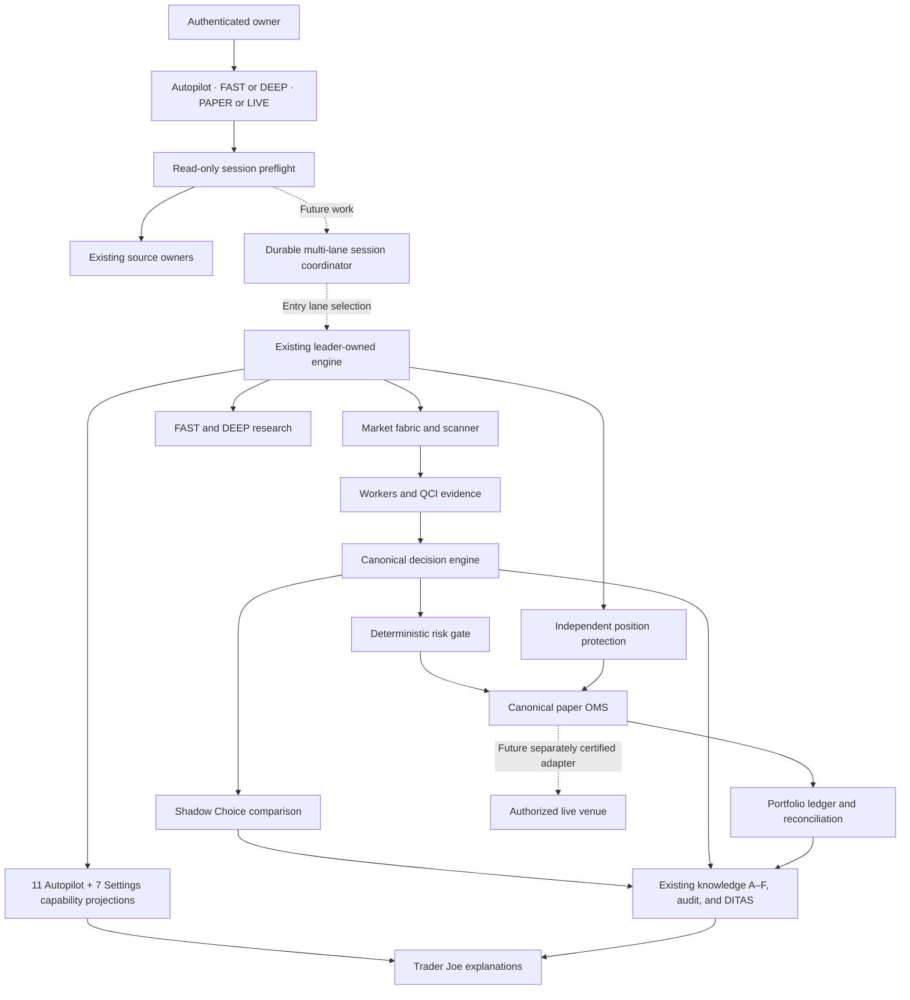
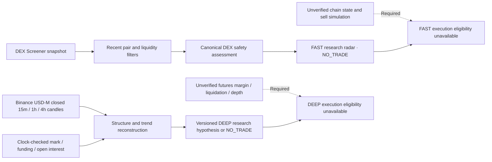
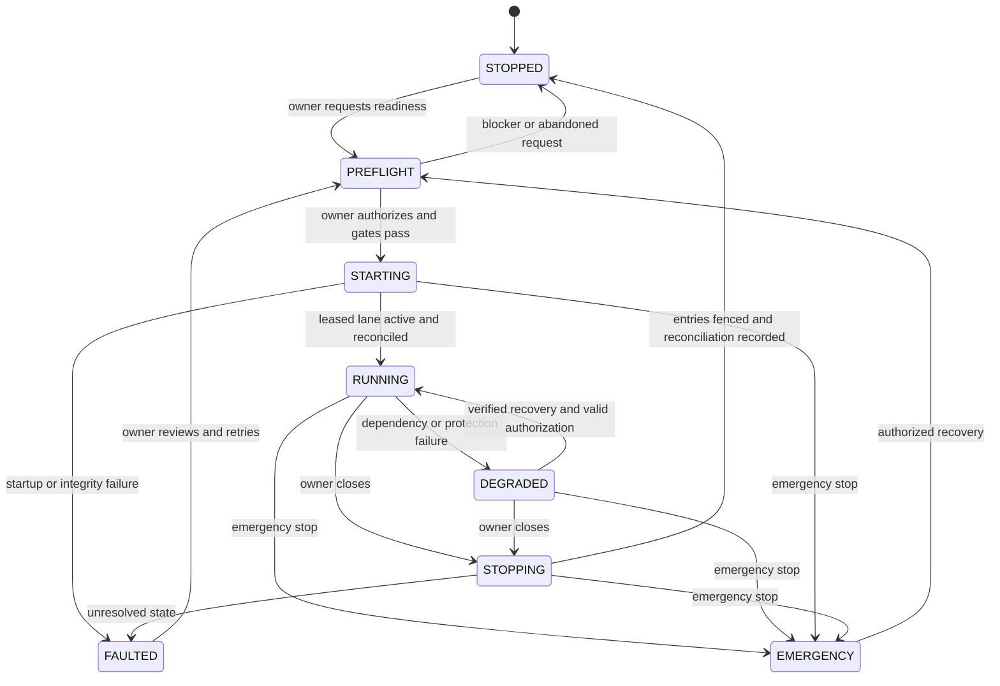

# MIA 6.0 BrainOS and Autopilot

## Integration status

This draft combines the existing Central Command paper foundation, the BrainOS capability bridge, and the Atelier interface. The authenticated Autopilot workspace presents FAST and DEEP research, the paper ledger and protection status, and a read-only readiness check. Trading-session start and close remain blocked for both minds. The existing paper controls remain available through their original owner workflows.

| Source reviewed | Head at review | Reused work and limits |
| --- | --- | --- |
| [Default branch](https://github.com/Naokiri5/naokiri/tree/a39ddaa597172619d8c897e49464910ebad6681f) | `a39ddaa` | Existing risk authority, paper OMS, portfolio ledger, DITAS memory, owner authentication, and live release gates. |
| [Central Command Phase 4, PR #132](https://github.com/Naokiri5/naokiri/pull/132) | `ddbb08f` | Four operator destinations, independent paper protection scheduler, shared lease fencing, research and event replay. Stacked on PRs #128, #129, and #130. |
| [Capability bridge, PR #134](https://github.com/Naokiri5/naokiri/pull/134) | `b03f95b` | Eleven Autopilot and seven Settings capabilities, existing background refresh, Academy memory summary, and Joe status. |
| [Choice Management, PR #126](https://github.com/Naokiri5/naokiri/pull/126) | `4466476` | Central Command already adapts the shadow comparison and dual-research work. Importing a second implementation would split ownership. |
| [Sequencing visibility, PR #88](https://github.com/Naokiri5/naokiri/pull/88) | Open draft reviewed | Read-only decision/order/outcome projection. Powers no session lifecycle. |
| [Atelier interface](MIA6_ATELIER_UI.md) | `da1b472` in this integration | Original mascot, typography, surface tokens, protected shell and dashboard components. Its deployment and test evidence belong to the previous visual release. |

## Architecture and ownership



The engine owns scheduling and uses the SQLite engine lease to fence writes. The market fabric and scanner gather evidence. Workers and QCI evaluate it, and `decision/engine.ts` produces the proposal. Choice Management compares frozen candidates in shadow mode. `risk/gate.ts` applies the owner-approved policy, and `exec/oms.ts` owns the transaction that books paper orders, fills, positions and ledger deltas. The protection lane calls that same OMS independently of research and scanning. `portfolio/ledger.ts` and `portfolio/calendar.ts` own accounting and reconciliation. DITAS and the audit log preserve evidence, and Trader Joe reads it through the existing tool allowlist. The capability registry and Preflight make no financial writes. [Engine](../../server/src/bot/bot.ts) · [Risk](../../server/src/risk/gate.ts) · [OMS](../../server/src/exec/oms.ts) · [Central Command](MIA_CENTRAL_COMMAND.md)

| Safeguard | Canonical implementation and release boundary |
| --- | --- |
| Position size, aggregate exposure, concentration, slippage, liquidity, loss and drawdown | Existing deterministic risk gate and paper OMS transactional rechecks. Approval depends on the current owner policy and verified market data. |
| Capital and duplicate handling | The synchronous paper path rechecks cash and commits capital with the fill. Existing IDs, write transactions and lease-generation checks fence duplicates. External asynchronous submission still needs durable reservation and venue idempotency. |
| Fill and recovery state | Paper position and ledger changes commit together. An unresolved paper order blocks new paper risk until reconciliation. Partial or unknown external venue fills still require separately verified recovery. |
| Protection across timeouts and restarts | An independent protection lane checks executable price and depth. Lease takeover verifies persisted integrity before scheduling. Failed protection surfaces an incident. Stale, missing or thin data can prevent an exit from being booked. |
| Futures and on-chain authority | Margin, funding and liquidation, chain transaction status and verified sell paths remain open execution dependencies. Live must pass those market-specific safeguards in addition to the shared authority. |

## Capability ownership and contracts

The existing leader-owned background pass samples both registries. The Autopilot snapshot has `capturedAt`, a source summary, and capability `id`, `owner`, `modes`, `state`, and `reason` fields. The Settings snapshot gives each capability `id`, `owner`, `automation`, `state`, and `reason`. Both report `tradingAuthority: false`. The inventory below describes the owner service behind each projection. These signals are capability-level observations. They do not represent a verified per-candidate run, a full dependency graph executor or session-scoped evidence.

The snapshot builder reads cached and database evidence. It adds no network call or scheduler and has no per-capability runtime budget. The existing HTTP adapter bounds requests at 10 seconds by default, with source-specific overrides and rate limits. Scanner and worker limits continue to live with their owners. A future session scheduler must set and measure per-invocation deadlines before claiming them. Snapshot freshness uses source time. A missing or stale Autopilot source yields `WAITING_FOR_DATA`, missing Settings inputs yield `UNAVAILABLE`, and authority limitations yield `PARTIAL`, `BLOCKED`, or `PAPER_ONLY`. [Autopilot registry](../../server/src/knowledge/brain.ts) · [Settings registry](../../server/src/knowledge/settingsCapabilities.ts) · [Provider transport](../../server/src/providers/http.ts)

| Capability and mode | Owner, dependency and observed evidence | Cadence, failure and readiness |
| --- | --- | --- |
| `overview` · FAST, DEEP | `dashboard/overview.ts` combines the canonical paper account, market and risk observations. The bridge uses ticker or DEX snapshots as a data-availability signal. | Scheduled. Provider/cache absence yields `WAITING_FOR_DATA`. Operational as a read model. |
| `market_terminal` · FAST, DEEP | `market/fabric.ts` owns instrument metadata, quotes, candles, books and cross-source health. | Ticker evidence within three configured ticker intervals. Per-instrument analysis and execution use stricter quality checks. Operational for supported spot markets. |
| `ai_scanner` · FAST, DEEP | `market/scanner.ts` consumes the eligible spot universe, market state and strategy signals, returning candidates and rejections. | Scan completion within three configured scan intervals. A recent scan can validly yield zero candidates. Operational for existing spot scan, with FAST and DEEP-specific execution still blocked. |
| `asset_discovery` · FAST, DEEP | `market/discover.ts` builds the asset view from ticker, metadata, and DEX cache. | Tickers within three intervals or DEX snapshot within five minutes. Operational discovery of available data, with market eligibility evaluated downstream. |
| `market_bubble_map` · DEEP | `market/bubbles.ts` derives price movement, volume and market breadth from the ticker fabric. | Ticker freshness applies. Operational as derived visualization and context. |
| `whale_launch_monitor` · FAST, DEEP | `whales/prints.ts` and `market/fabric.ts` provide exchange prints and DEX profiles. | DEX snapshot within five minutes or observed exchange prints. `PARTIAL` with evidence. Wallet identity and reliable launch delivery are unverified. |
| `holder_map` · FAST | Requires verified chain/mint identification and indexed, timestamped holder concentration. | `BLOCKED`. No certified RPC evidence or holder provenance. |
| `copy_trading` · FAST, DEEP | Requires attributed wallet fills, verified performance, consent, and chain/venue alignment. | `BLOCKED`. No verified wallet evidence or execution entitlement. |
| `news_events` · FAST, DEEP | `news/news.ts` ingests and classifies source-tagged news. Calendar and provider releases have separate owners. | Background news refresh is attempted about every five minutes. The bridge considers a latest item up to seven days old available as context. Operational for supported headlines. |
| `bot_account` · FAST, DEEP | `portfolio/ledger.ts`, `exec/oms.ts` and recovery/account services expose cash, equity, positions, orders and protection. | Read through the canonical paper account. The registry labels `PAPER_ONLY` even when an individual balance, mark or prerequisite is unavailable. |
| `ai_intelligence` · FAST, DEEP | `workers/`, `qci/` and `decision/` own typed evidence, consensus and decisions. | Scanner timestamp is the bridge's coarse liveness signal. Operational for the existing decision engine. A complete per-mode evidence pipeline remains partial. |
| `risk_center` · shared | `risk/policy.ts` owns accepted policy versions. `risk/gate.ts` deterministically vetoes exposure. | Existing policy plus current exposure checked for trading. `NEEDS_OWNER_ACTION` with no accepted policy. Owner accepts and changes limits through step-up. |
| `strategy_lab` · shared | `lab/lab.ts` owns versioned strategy, historical validation and health state. | Existing monitor can suspend deteriorating eligible paper strategies. Shadow research remains advisory. Owner promotion and evidence review are required. |
| `qhef_performance` · shared | `qhef/qhef.ts` and `core/latency.ts` own stage budgets and sampled observations. | `OBSERVING` before samples, `EVIDENCE_AVAILABLE` once measured. Operating latency depends on the measured workload. |
| `connections_hub` · shared | `providers/http.ts` owns source telemetry, credential-readiness labels, source status and rate limits. | `DEGRADED` if any provider is down or degraded. Source-specific permission and freshness still apply. Credentials remain owner-managed. |
| `notifications` · shared | `notify/notify.ts` owns persisted notices and configured delivery. | The projection counts recent records. Delivery success is a separate status. No records yields `OBSERVING`. |
| `security_center` · shared | `security/security.ts` owns session and protection checks. Step-up and credential recovery retain their existing owners. | Source errors yield `UNAVAILABLE` and failed checks yield `DEGRADED`. Owner resolves sensitive findings. |
| `release_gates` · shared | `qa/gates.ts` evaluates applicable release evidence. Existing owner authorization and a venue integration are separate dependencies. | `BLOCKED` while gates deny Live. Test reports alone cannot satisfy manual live release requirements. |

## FAST and DEEP evidence paths



FAST operates on DEX observations no older than four minutes and considers recent pairs up to 24 hours old. The assessment is advisory. A new launch event stream, authoritative metadata, mint/contract checks, holder concentration, and a fresh executable round trip are open dependencies. DEEP models selected public Binance USD-M perpetuals for BTC, ETH and SOL with closed candles and bounded venue-clock observations. Spot context is labeled independently of that futures hypothesis. The paper spot OMS cannot represent futures margin, funding charges or liquidation. Neither research lane feeds an executable candidate into the paper OMS. The existing paper spot decision pathway is shown separately in the architecture diagram. [Dual research](../../server/src/choice/dualResearch.ts) · [Futures source](../../server/src/providers/binanceFuturesResearch.ts) · [Paper parity](../../server/src/exec/demoLiveParity.ts)

| Source | Integration in this branch | Degradation or missing release dependency |
| --- | --- | --- |
| Binance Spot | Public symbols, filters, quotes, candles and order books. Canonical paper spot source. | Withhold entry on stale or invalid data. Protection keeps running and records incidents if a fresh executable exit is unavailable. |
| Kraken and Coinbase | Public cross-venue spot reference quotes for qualifying assets. | Missing or inconsistent references can invalidate a candidate. These adapters provide evidence only. |
| CoinGecko and DEX Screener | Public market context, discovery and pair/launch-profile observations. | Incomplete metadata and old snapshots block relevant research. DEX coverage alone supplies no contract safety or sellability proof. |
| Binance USD-M Futures | Public allowlisted closed candle history and mark, funding and open-interest context for research. | No certified order/risk adapter, executable depth, funding settlement, margin or liquidation model. Data availability is conditional on regional provider access. |
| Frankfurter / ECB | Daily reference FX rates. | Reference-rate context only. Executable FX quotes and broker integration are open. |
| Google News RSS | Classified headlines through the existing feed reader. | Context only and subject to upstream availability and licensing. A headline is neither a market quote nor authorization. |
| EVM RPC and Solana RPC | Registered as pending in the Connections Hub. | Verified chain data, contract/mint safety, holder maps, attributed wallets, routing and sell simulation remain open. |
| Equities, commodities, X | Registered as pending with licensing or credentials required. | No certified operational feed or execution path in this integration. |
| Telegram and Anthropic | Optional server-side notification delivery and conversational Joe. | Delivery status is reported separately. Joe has deterministic commands when conversational access is unavailable. |
| Live venue / isolated signer | Release-gated and unavailable in this build. | Requires separately verified venue integration, secure signer isolation, reconciliation, owner authorization, and release review. |

## Memory and provenance

| Category | Canonical records | Integration and use |
| --- | --- | --- |
| A · Permanent knowledge | `kb_documents`, `kb_document_files`, `kb_chunks`, `kb_concepts`, `kb_concept_sources` | Keep citations and immutable originals. Derived passages may be regenerated. Treat retrieved material as evidence. |
| B · Research | `research_experiments`, `backtests`, `research_candles` | Preserve experiment parameters, hashes and results. Compare strategy versions on prospective or held-out evidence before enrollment and promotion. |
| C · Market state | `ditas_snapshots`, `consensus_records` | Preserve inputs at decision time. Recompute current data quality before financial actions. |
| D · Decision | `decisions`, `ditas_events` | Keep approval, rejection, no-signal, correction and Choice shadow evidence. Append changes with links to the original event. |
| E · Outcome and calibration | `orders`, `fills`, `positions`, `ledger_entries`, `ditas_forecasts`, `ditas_outcomes` | Resolve actual fills, fees and exits through canonical records. Compare forecasts with completed outcomes. Keep shadow comparisons distinct from actual returns. |
| F · Owner and conversation | `journal`, `settings`, `chat`, `audit_log` | Keep owner-approved settings and conversations under existing access rules. Record interventions in the append-only audit trail. |

Academy exposes the memory categories and capability snapshots through its existing authenticated memory endpoint. The capability snapshots are transient. DITAS stores immutable decision and research evidence already collected. The audit log carries replayable committed fill events with stable IDs, and consumers should persist cursors after processing and deduplicate retries. Future session records should link canonical IDs for the observed data, policy version, strategy version, decision, order/fill, and outcome. Preserve the effective timestamp and provenance on each link so historical records can explain an action without being used as fresh authorization. [A–F ownership](../../server/src/knowledge/memory.ts) · [DITAS events](../../server/src/ditas/memory.ts) · [Fill events](../../server/src/exec/fillEvents.ts)

Trader Joe's `brain` command reports capability states and reasons. `session FAST PAPER` and the other mind/environment combinations read the same preflight used by the cockpit. The full conversation and drawer offer Paper readiness shortcuts. The assistant can read evidence, analyze and pause new risk under its existing allowance. Funding, policy changes, order submission, recovery and Live permission remain governed by their owner workflows. [Trader Joe tools](../../server/src/joe/joe.ts)

## Session preflight and future state machine

The authenticated `GET /api/session/preflight?mind=FAST&environment=PAPER` evaluates the selected mind and environment. The `mia.session.preflight.v1` response includes the selection, check time, state, `canRun`, `canClose`, and checks with IDs, labels, details and statuses. It reads research evidence, accepted risk policy, owner verification availability, reconciliation, paper cash, protection, scheduler status, and emergency state. Live reads the last canonical release evaluation for the current database. Missing or expired release evidence is unverified. The request does not verify the audit chain on every poll. The endpoint leaves both session actions unavailable until the durable lifecycle and selected execution lane exist. [Preflight](../../server/src/ops/sessionPreflight.ts) · [Release evidence](../../server/src/qa/gates.ts)

The target durable lifecycle is a separate milestone. The following transitions describe how it should build on the existing auth, engine lease, SQLite, risk and OMS.



| Lifecycle concern | Required behavior for the durable implementation |
| --- | --- |
| Start and retry | Atomically enforce one active session under the existing authority. Repeating the same owner intent returns the original record. A conflicting selection is rejected until the active session is closed. |
| Start after preflight | Revalidate policy version, recovery, source health, cash, permissions and scope inside the relevant transition. Recheck entry authority and session generation under the existing OMS write lock. |
| Close and retry | Fence entries first, drain or cancel pending entries, reconcile in-flight order state, and record outcomes. Keep independently scheduled protection for outstanding positions. Repeating close returns authoritative state. |
| Recovery | On restart or lease takeover, verify ledger, audit and DITAS integrity, recover outstanding work, and block entries while state is ambiguous. Reuse existing order/fill deduplication. |
| Mode changes | Previewing a different research mind does not reassign positions. Close and reconcile an active session before authorizing a different mind or environment. |
| Emergency | Preserve the existing pause, cancel, protection and emergency controls. An emergency stop blocks new risk and preserves protection. Explicit liquidation is a separate authorized action. |

## Autopilot experience

The previous experience spread account, scanner, market terminal, risk, research and manual tools across separate screens. It required technical knowledge to distinguish a healthy process from permission to enter a trade. The four destinations keep the cockpit as the owner entry point, financial results in Portfolio, explanations in Trader Joe, and protected configuration in Settings. The advanced tools menu, command palette and legacy deep links preserve existing workflows. [Navigation and legacy mapping](../../web/src/nav.ts) · [Protected app](../../web/src/ProtectedApp.tsx)

Desktop wireframe. The chart and recent activity share the main row.

```text
MIA     Autopilot     Portfolio     Trader Joe     Settings     Owner actions
FAST | DEEP                                   PAPER | LIVE LOCKED
MIA Autopilot · status         Run / Close readiness       Emergency controls
Paper equity   |   Positions   |   Today's P&L   |   Risk / protection
Market chart / FAST price snapshot and source   MIA Activity · event details
Open positions and protection
Opportunity radar or strategy evidence          Trader Joe explanations
Advanced controls and original tools
```

Mobile wireframe. Navigation may be rendered as a bottom bar.

```text
MIA · owner actions          PAPER / LIVE LOCKED
FAST | DEEP                  Select environment
MIA Autopilot · verified status
Run / Close readiness · action details · emergency controls
Paper equity / open positions / P&L / risk
Market chart and source
Open positions / protection
MIA Activity · expandable event evidence
Selected-mind detail
Trader Joe / advanced controls
Autopilot | Portfolio | Trader Joe | Settings
```

| Component / interaction | Existing owner or source |
| --- | --- |
| Authenticated shell, status and legacy navigation | `ProtectedApp.tsx`, `Navigation.tsx`, `nav.ts`, `/api/auth/state`, `/api/shell`. `/app` opens Autopilot. `/overview` preserves the prior dashboard and `/bot` preserves the prior paper controls. |
| Paper account hero, account/position status and protection | `pages/Trading.tsx`, `/api/bot` and the existing per-position OMS stop checks. Full risk diagnostics stay in `/api/risk`. |
| Readiness checklist | `/api/session/preflight`, existing authentication and read-only owner evidence |
| FAST opportunity and market evidence | `pages/ResearchPanel.tsx`, `/api/choice/dual/status`, `/api/dex` and `/api/scanner`. Shows observed DEX prices and the candidate list, and explains unavailable candle history. |
| DEEP strategy and market chart evidence | `ResearchPanel.tsx`, `/api/choice/dual/status`, `/api/markets`, `/api/instrument/:symbol` and `pages/Markets.tsx`. The picker uses the scheduled spot universe. The chart labels the latest closed candle and draws recorded paper entry, stop and pending target levels. Futures research appears separately. |
| MIA Activity and explanations | Authenticated `/api/activity` returns up to 25 grouped records from the existing dashboard feed. `pages/Joe.tsx` and `/api/joe` explain the accessible evidence. |
| Capability diagnostics | The Academy Memory workspace reads `/api/academy/memory` and shows 11 Autopilot and seven Settings contracts with evidence source, freshness and observed state. |
| Risk policy and emergency actions | `/risk`, `/api/risk/policy` and `/api/emergency/:action` retain their existing auth, step-up and explicit confirmation behavior. |
| Existing portfolio and account changes | `/smart-portfolio`, `/api/portfolio`, `/api/bot/allocation`, `/api/control` |
| Live release status | `/qa` and `/api/qa` expose existing requirements. Live selection can inspect readiness without changing execution authority. |

The Atelier uses ink and lavender surfaces, azure for discovery, lavender for strategy research, and champagne for protection. Positive, adverse, warning and emergency statuses use semantic colors with text. Self-hosted Manrope and Instrument Serif, original mascot art, restrained motion, responsive panels and existing design tokens carry the look across the workspace. Focus, selection, and status should remain available through keyboard interaction, text, and assistive-technology announcements. Financial content must remain legible with reduced motion and on narrow viewports. [Visual source and tokens](MIA6_ATELIER_UI.md)

On first use, choose the mind and Paper, then open the readiness details. A missing risk policy links to Risk Center and leaves acceptance to the owner. A disconnected or stale source shows a timestamped blocker. A fresh feed with no qualified candidate shows a valid empty state. An unavailable accounting input remains unavailable in the UI. Returning users can recheck the selection and review current account and source state. Run Session and Close Session are disabled with the authoritative blockers shown. The existing paper risk controls continue to manage the canonical engine.

## Verification, performance and release readiness

| Scope | Evidence and boundary |
| --- | --- |
| Capability bridge | Exact-head GitHub Actions success on `b03f95b`. [PR #134 CI](https://github.com/Naokiri5/naokiri/actions/runs/45156908283) |
| Choice and dual research predecessor | Exact-head GitHub Actions success on `4466476`. [PR #126 CI](https://github.com/Naokiri5/naokiri/actions/runs/45101730334) |
| Central Command and four-section shell predecessor | Exact-head GitHub Actions success on `ddbb08f`. [PR #132 CI](https://github.com/Naokiri5/naokiri/actions/runs/45128227141) |
| Existing performance sample | Three Windows runs, 40 warm-ups and 280 timed samples each, in-memory paper account, two synthetic instruments and a frozen QCI result. Median p95/p99 were 1.38/5.03 ms for decision persistence and 0.31/0.50 ms for a protection pass. These numbers describe the predecessor fixture. [Measurement and provider smoke check](MIA_CENTRAL_COMMAND.md#local-performance) |
| Chart analysis benchmark on the integration worktree | `node --import tsx scripts/benchmark-chart.mjs` ran three times on Windows with Node 26.13.1. The median of the run p50/p95/p99 was 0.0095/0.0318/0.0721 ms with 400 synthetic bars, 200 warm-ups and 2,000 timed calls per run. The measurement covers pure chart analysis and excludes provider HTTP, browser paint, AI and the OMS. [Benchmark fixture](../../scripts/benchmark-chart.mjs) |
| Public provider and paper execution check | Both opt-in integration tests passed with public provider responses. The BTCUSDT test exercised entry, verified protection, exit and ledger reconciliation with simulated funds in a disposable database against an observed Binance spot order book. [Provider fixture](../../server/test/live.providers.test.ts) |
| Local authenticated API benchmark | Windows and Node 26.13.1, using Fastify injection and an offline in-memory database with 10,000 fixture audit records, an accepted test policy and simulated cash. The release evaluator ran once before timing. Median run p50/p95/p99 in milliseconds were **0.271/0.460/0.574** for FAST Paper preflight, **0.184/0.248/0.316** for DEEP Live preflight and **0.149/0.219/0.264** for activity. Each route ran three batches of 100 warm-ups and 300 samples. These measure single-request application cost with no open positions or network. |

### Integration worktree results

| Command or review | Result |
| --- | --- |
| `npm run typecheck` | Server and web passed. |
| `npm run qa -w server` | 648 passed, three opt-in checks skipped. Crash recovery exercised paper entry, approval, partial targets, stop, trail, time-based and manual exits in disposable databases. |
| `npm test -w web` | 44 passed. |
| `npm run test:e2e` | 65 Chromium tests passed after building the web bundle and compiling the server. Covers keyboard focus across DEEP symbol and timeframe changes, mobile overflow and navigation, owner setup and paper-mode controls, disabled Run and Close, the Live lock, Joe and Academy evidence, and legacy workspaces. |
| `MIA_LIVE_TESTS=1 npm test -w server -- test/live.providers.test.ts` | Two passed. Public data retrieval and a simulated spot paper round trip. |
| `npm run scan:secrets`, `npm audit --audit-level=high` | Secret scan clean. The dependency report found zero vulnerabilities. |
| Independent review and follow-up | Removed full Overview and Risk Center reads from the new activity and managed-position refresh paths. Live preflight uses timestamped release evidence. Kept chart control focus and scoped the instrument picker to the scheduled market universe. Confirmed no new order, signer or permission path. |

The existing production health probe is a process/supervisor signal, distinct from authenticated trading preflight. Security relies on existing cookie-session authentication, request guards, step-up for risk increases, deterministic risk and canonical OMS checks. Emergency, protection, ledger, audit, and recovery tests should be reviewed together. Local fixture latency excludes external execution, live venue and multi-day load. A current provider outage, replay half-completion, stale market data, failed protection, or unreconciled orders must block affected entry claims.

The strict acceptance scenarios remain open. FAST still needs a genuine launch event, verifiable on-chain evidence and a sell route before a qualifying paper entry can reach the existing authority. DEEP still needs eligible strategy selection and market-specific risk, depth and paper execution. Neither can complete the requested chain from owner session through execution, protected exit, reconciliation and Joe explanation today. Future validation must exercise the failing as well as successful paths, including invalid evidence and strategy version, loss of lease, late or duplicate callback, partial and unknown fill state, provider and AI timeouts, restart, emergency stop, and closure with remaining positions.

The integration added no database migration and relies on existing risk, paper OMS, ledger, lease, event, provider and memory owners. Exact-head GitHub checks and external hosting checks are separate from local results. Prospective paper soak, release-level risk and security review, market-specific execution adapters, verified signer and venue integration, and explicit owner authorization remain release requirements.


## BrainOS Phase 2: dependency-aware evidence readiness (2026-11-23)

This branch adds **server/src/knowledge/capabilityGraph.ts** and **server/test/brain-capability-graph.test.ts**. The graph uses the existing 11 Autopilot and seven Settings service descriptors, never duplicates their providers, schedulers, databases, financial authorities or execution handlers.

The typed **mia.brain.network.v1** contract exposes source-backed owner, supported mind, dependencies, timestamp, readiness and explicit **tradingAuthority: false** for every capability. All source snapshots expire after three current background refresh intervals (180 seconds); missing and future-dated evidence fails closed. Internal dependency chains include terminal -> scanner -> intelligence, terminal -> bubble map, holder map -> copy trading, and risk policy/security/connections -> release gates.

Statuses are **EVIDENCE_READY, PARTIAL, PAPER_ONLY, OWNER_ACTION, DEGRADED, BLOCKED, UNAVAILABLE**. An otherwise-ready downstream service is blocked when an upstream dependency is not ready. Source evidence is never permission to trade, never proof of profitability, and cannot grant LIVE access. Existing Academy memory carries the evaluated graph, and Trader Joe includes graph readiness counts in its read-only status explanation.

This completes a bounded internal-readiness slice of the supplied BrainOS implementation prompt, **not** the durable session FSM or the FAST/DEEP trading execution pipelines. Both Run Session and Close Session remain deliberately disabled pending true execution wiring, safe position supervision and restart reconciliation. New evidence is intentionally advisory; the existing owner-approved risk gate, OMS, ledger, DITAS and release gates retain authority.

**Exact-head verification still required:** npm run typecheck; npm test -w server; npm run build; npm run test:e2e; npm run scan:secrets; npm audit --audit-level=high; independent safety review; and deployment checks. Do not merge while any required checks or release prerequisites remain unresolved.

## BrainOS 6.1 FAST / DEEP incremental implementation (2026-11-23)

This increment is **real repository code**, integrated into the existing BrainOS draft. It does **not** add an alternate broker, risk engine, OMS, ledger, blockchain signer, or an autonomous LIVE authorization path.

### What is implemented

- Schema v6: append-only SQLite migration with durable brainos session checkpoints/audits, FLIN research candidates, and DEEP post-close decisions.
- `ops/durableSession.ts`: atomic `tx()`-based state transitions, versioned audit events, canonical leader lease checks, crash recovery that suspends new entries, and owner-close drain checks. The scheduler recovers the checkpoint after taking the engine lease. A standby boot leaves the leader's session intact. A checkpoint recovery error leaves durable entries blocked while the independent paper protection pass continues. Run remains unavailable pending execution-lane certification. Live remains locked.
- `market/flinQueue.ts`: bounded ingestion (250 records per pass) of already-fetched **DEX profile observations**, stable candidate IDs, persisted replay-safe deduplication and newer-evidence protection. This does **not** detect all on-chain deployments; true Solana program event subscriptions, RPC mint checks and Jupiter execution are still missing.
- `choice/dualRuntime.ts`: FLIN intake piggybacks on the existing background research owner only when a DB is already open. Failures do not affect protective exits. The research status includes intake statistics; `dualResearch.ts` can compare up to 200 fresh observed candidates in a pass instead of 20.
- `market/flinQueue.ts`: adversarial permission/extension/sell-route gate for **caller-supplied verified evidence**; no RPC verification is implied by the interface, no fabricated buy/sell quote, and even `RESEARCH_QUALIFIED` has `tradingAuthority: false`.
- `choice/dpbm.ts`: staged legs with aggregate risk cap validation, non-martingale close transitions, no entry after unresolved fills or unreconciled ledger, optional reentry **candidate only**, and idempotent persisted decision evidence. Real futures position-bundle placement remains blocked.
- `chart/scenarios.ts` + existing `choice/dualResearch.ts`: multi-timeframe deterministic structural scenario weights, explicit `UNCALIBRATED` metadata, and no invented win probability. Existing future-mark and liquidation requirements remain.
- `ditas/calibration.ts`: proper three-class Brier/log-loss scoring, regime-sliced realized executed expectancy (shadow projections never count as realized profit), and review-only walk-forward/holdout/shadow/drift gating. No automated model self-promotion.
- The existing command-status payload includes durable-session and FAST intake visibility.

### Verification tests added

- `test/flin-queue.test.ts`: 150 token observations, deduplication, rate bounds, source replay ordering, incomplete permissions, Token-2022 flags, unsellable routes and nonpositive all-in expected edge.
- `test/dpbm-postclose.test.ts`: staged weights, aggregate exposure, unreconciled exits, adverse close recovery, idempotency and zero OMS/ledger mutations.
- `test/durable-session.test.ts`: shared-volume standby startup, lease expiry and takeover, checkpoint recovery errors with a continuing protection pass, draining pending orders, risk and emergency shutdown, and versioned audit evidence.
- `test/deep-scenarios.test.ts`: valid and mismatched candle snapshots, three-way proper scores, regime separation and independent promotion review.

### Hard release blockers (do not merge or enable LIVE)

1. FAST is **not yet** a true high-throughput Solana launch-event subscription service. The DEX provider currently returns only an approximate sample of listings per refresh. No trusted RPC authority proofs, Jupiter sell route, Jito submission/landing, transaction recovery or LIVE signer has been implemented.
2. DEEP has no derivative OMS adapter, margin/mark-price/liquidation model, verified depth or approved profitable strategy. Closed-trade lineage is **not** automatically bound to actual OMS fills until the position-linkage integration is completed.
3. Durable RUN / CLOSE operator API cannot authorize trading: session preflight deliberately returns `canRun:false`; the state machine is persistent and tested but has no bypass to trade. ExitSupervisor continues to run via the existing bot owner; this increment does not replace its scheduler.
4. Calibrated predictions require actual settled forecasts, walk-forward and untouched holdout. The scenario weights are explicitly uncalibrated. Realized PnL and true live trading performance are not certified.
5. Exact-head CI, an independent risk/security review, stacked dependency reconciliation, paper soak, deployment and owner approval are required before merge.

**Promotion policy:** retain PR #135 as an OPEN DRAFT and make no automatic financial authorization changes. PAPER and LIVE must use the same canonical safety decision system after verified venue integrations are added.

## BrainOS 8.0 paper session integration

The Autopilot Run Session control authorizes the existing Binance spot paper lane after owner step-up. It requires a current leader, fresh position protection, an accepted risk policy, the Paper or Approval account mode, and a funded, reconciled paper account. FAST and DEEP continue to provide independent research evidence. Their market-specific execution and live trading remain locked.

The authenticated `/api/session/paper-spot` preflight reports eligibility. POST requests to `/api/session/paper-spot/run` open the selected paper lane and requests to `/api/session/paper-spot/close` revoke entry permission and cancel pending paper approvals. Closing drains protected positions through the existing monitor and completes after the paper ledger reconciles. To close exposure immediately, use the existing Risk Center controls.

Existing paper installations without a durable checkpoint use their current owner-configured controls until the owner selects Paper or Approval in account controls or starts a BrainOS session. From that point every paper entry and approval must pass the durable checkpoint and lease checks within the OMS transaction. An owner control change invalidates the prior authorization. A leader takeover suspends the prior session, and the owner must close it and authorize a new one before entries resume. Entry fill events link the existing trace and position to the authorizing session version and fencing epoch.

### Session capital and loss boundaries

Run Session also requires the owner's `capitalLimitUsd` and `maxSessionLossUsd`. Schema v7 stores them per fence epoch in the transaction that opens the session. The OMS denies an entry when open entry notional plus the executed notional would exceed the capital limit. It also denies an entry when the worst case exceeds the loss limit: session P&L at liquidation value, minus the loss if every open stop is hit, minus the new trade's planned maximum loss. Entries are also denied while the loss cannot be verified because a quote is missing, stale or future-dated. The first verified breach is latched and never clears for that session. The protection lane then suspends the session, cancels pending paper approvals and alerts the owner. It does so after the protection pass, so exits are never delayed. A gap through a stop can still realize more than the limit. These checks only block entries. The canonical risk gate still sizes and approves every trade. Traceability to the BrainOS brief and the remaining gaps are in [BRAINOS_SPEC_TRACEABILITY.md](BRAINOS_SPEC_TRACEABILITY.md).
