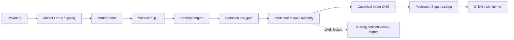

# MIA critical autonomy audit — first P0 control-authority repair

**Assessment date:** 2026-11-22  
**Inspected baseline:** `main@a39ddaa597172619d8c897e49464910ebad6681f`  
**Scope:** A strictly bounded first implementation increment of the owner's *MIA 5.0 Autonomous Trading System: Critical Debugging, Integration Audit, Backtesting & Repair Master Prompt*.  
**Security verdict:** LIVE is **not certified**; all real-money authorization remains locked.  
**Execution evidence:** Source review plus newly committed regression tests; full CI and runtime reproduction are **pending** unless separately linked from the PR checks.

## A. Critical health report: evidence-grounded findings

| ID | Priority | Status | Evidence | Recommended next action |
|---|---|---|---|---|
| MIA-P0-CTRL-001 | P0 | CONFIRMED_FROM_SOURCE / PATCHED_PENDING_CI | `server/src/core/mode.ts`: an owner-context `updateControl({mode:'BOUNDED_LIVE'})` could omit `gateCheck`; `gateCheck?.(...) ?? {ok:true}` treated the missing authorization check as approval. The HTTP controller separately checks G01–G14 but could not protect other internal callers. | Keep core fail-closed assertion; run direct regression and HTTP tests, independent review. |
| MIA-P0-LIVE-002 | P0 live-release blocker | DOCUMENTED_MISSING | `server/src/qa/gates.ts` documents G12 as not implemented; `README.md` says no certified live adapter or signer. | Do not enable LIVE. Independent venue/credential/signing/reconciliation certification track required. |
| MIA-P1-PARITY-003 | P1 | IMPLEMENTED_UNVERIFIED / UNWIRED | `server/src/exec/demoLiveParity.ts` identifies itself as a standalone, non-production-wired contract. | Do not route actual orders through it; first implement durable per-account intent and recovery in the canonical OMS. |
| MIA-P1-PR-004 | P1 | UNMERGED_CONFLICT_RISK | PR #114 explicitly identifies Market Fabric overlap with #45 and #71; PR #45 changes `core/mode.ts` and many canonical financial files. | Compare exact HEADs, merge bases, migrations and file hunks before integration. |
| MIA-P1-MARKET-005 | P1 | DOCUMENTED_LIMITATION / NEEDS_REFRESH | `docs/KNOWN_LIMITATIONS.md` describes older polling/fill-model constraints and missing provider rights. It is not proof of current deployed runtime. | Verify fresh actual feeds, broker licensing, book freshness, data ingress, network/host failures. |
| MIA-P1-QUANT-006 | P1 | DOCUMENTED_LIMITATION / NEEDS_REFRESH | `docs/KNOWN_LIMITATIONS.md` reports weak out-of-sample outcomes for three built-in strategies with small samples. | Re-run Strategy Lab on independently sourced history and paper outcomes; do not infer profitability from old fixtures. |
| MIA-P1-OPS-007 | P1 | UNVERIFIED | Repository documentation describes durable backend requirements; this review did not observe production containers, traffic, persistent volumes, or a supervised live deployment. | Trace actual DNS→proxy→frontend→API→engine path, run restart/recovery/restore drills. |

Priority labels indicate consequence *if the condition affects execution*. They do not prove funds were ever at risk: real-money order execution remains unavailable in the inspected system.

## B. Architecture / trust boundaries

The proposed change lives *only* in `core/mode.ts`; it does not create a risk engine, venue adapter, signer, ledger, or separate execution authority.

## C. Confirmed defect, minimal repair, and tests

**Root cause:** `updateControl` originally fell back to `{ok:true}` when `gateCheck` was absent. Non-HTTP callers running in an owner context could persist `BOUNDED_LIVE` even though HTTP callers were correctly denied. The absence of a live venue adapter means this is an **authorization-state bypass**, not evidence of real trades.

**Patch:** Unconditionally reject any attempt to set `patch.mode === 'BOUNDED_LIVE'` at the canonical mode authority until an independently certified, non-optional server-controlled authorization mechanism exists. No caller-provided callback can grant LIVE. Preserve ordinary OBSERVE/PAPER/APPROVAL behavior and permit risk-reducing pauses even if an obsolete LIVE value was previously persisted.

**Regression:** `server/test/mode-live-lock.test.ts` covers direct calls with no gate, permissive gate, preservation of existing PAPER behavior, and safe pause of a previously persisted LIVE state. Existing `server/test/api.test.ts` covers HTTP LIVE denial and owner step-up.

**Remaining caveat:** This is a defense-in-depth repair, not full LIVE certification or a proof that no other privileged persisted-settings caller exists. Audit all direct `setSetting('control', ...)` and restart handling paths before any live-readiness promotion.

## D. PR dependency / overlap map (initial, not exhaustive)

| PR | Domain | Integration decision |
|---|---|---|
| #115 | Live-readiness safeguards, merged into inspected main | Reuse baseline; do not re-apply |
| #45 | Large unmerged unified branch touching `core/mode.ts`, OMS, risk, migrations | Reconcile core mode change before merging #45 |
| #92 → #95 → #97 | Stacked environment/provider/readiness drafts | Review contracts and branch ancestry; no live authority |
| #41 → #43 | Typed events / durable outbox | Examine operational durability before reuse |
| #106 / #109 / #112 | OMS bundle, whale memory, DITAS learning branches | Cross-check overlapping migrations and OMS ownership |
| #114 and #71 | Market Fabric changes | Reconcile exact overlapping hunks with #45 |

This focused P0 fix is isolated on its own branch because the relevant LIVE proposals are stacked on unfinished integration PRs and must not be force-merged.

## E. Test and operational evidence checklist

- [x] Read canonical source and locate the missing gate fallback
- [x] Compare relevant PR file ownership
- [x] Add minimal core-authority patch
- [x] Add targeted regression tests
- [ ] Execute exact-HEAD targeted tests in GitHub CI
- [ ] Execute `npm ci`, `npm run typecheck`, `npm run build`, `npm test`, `npm run test:e2e`, `npm run scan:secrets`, and `npm audit --audit-level=high`
- [ ] Run deterministic failure injection, replay and ledger integrity suite
- [ ] Run statistically valid backtests on independent historical market data
- [ ] Verify production traffic, container readiness, backup restore, and persistent monitoring
- [ ] Obtain independent trading-risk/security review
- [ ] Merge only after exact-head CI and review, with no material conflicts

## F. Autonomous operations readiness

| Capability | Evidence | Verdict |
|---|---|---|
| Live market observations | Canonical code exists; deployed uptime not tested here | PARTIAL / UNVERIFIED |
| QCI → decision → risk | Existing canonical services and tests | SOURCE_PRESENT / NEEDS_END_TO_END_VERIFICATION |
| PAPER OMS and ledger | Main's canonical paper paths | SOURCE_PRESENT / NO_NEW_REGRESSION_CLAIM |
| LIVE execution | Venue/signing and G12 lack certification | LOCKED |
| Crash-safe external venue intent | No certified persisted production LIVE adapter | BLOCKED |
| Backtests and learning | Research code exists; independent performance evidence not reproduced here | UNVERIFIED |
| Website / hosted backend | Actual production traffic not observed | UNVERIFIED |

**Release decision for this increment: NO-GO for LIVE and NO MERGE until exact-HEAD CI and independent P0 review.**

## G. Prioritized next two actions

1. Complete the P0 control-authority PR review and CI, then reconcile the same-mode hunk with PR #45; preserve its other changes.
2. Run a staged crash/recovery + PAPER OMS/ledger replay of the actual full market-data-to-exit flow, then audit deployment traffic and independently sourced Strategy Lab backtests.

**No credentials, signer, live orders, funded accounts, new database migrations or deployment were used in this patch.**
