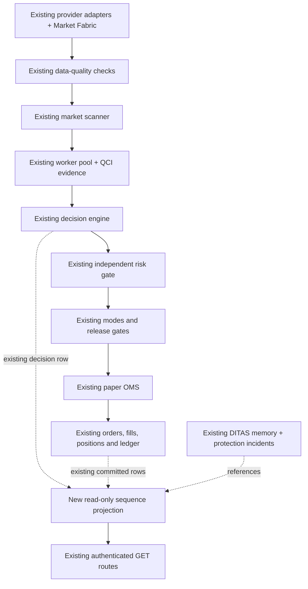

# MIA — Unified Sequencing, Reliability & Recovery Integration (v2.0)

**Repository:** https://github.com/Naokiri5/naokiri  
**Baseline reviewed:** `main` @ `6476391f4d7e8f8884c76ac4e31bb3779c444d77`  
**Change type:** Additive, read-only, paper-only; production financial authority unchanged  
**Status:** Review candidate — no claim that tests, certification or live execution are complete

> **Canonical rule:** Enhance MIA by connecting what already exists. Never install a second scanner, scheduler, QCI, risk gate, OMS, account ledger, DITAS event store or execution agent. Preserve all existing strategies, worker evaluators, independent deterministic risk checks, owner controls, paper trading functionality and safety restrictions.

## 1. Goal

Trace **decision → existing OMS order → committed fill → actual position → durable protection incident**, with original DITAS memory references, while minimizing code changes. This is *observability* rather than a new trading state machine. It is not a new strategy, profit forecast or autonomous execution capability.

The earlier sequencing blueprint remains useful conceptually, but the first implementation must not require duplicate storage, synthetic events or new execution control.

## 2. Inventory and single-owner rule

| Existing system | Canonical code | Enhancement strategy |
|---|---|---|
| Hot/scan/background lanes; takeover lease | `server/src/bot/bot.ts`, `server/src/ops/lease.ts` | Keep, later test failure classification and recovery |
| Market timestamps, books, candles/gaps/rebuild | `server/src/market/fabric.ts`, `market/quality.ts` | Keep; later certify *real* numbered WebSocket feeds only |
| Scanner/candidate trace | `server/src/market/scanner.ts` | Reuse IDs, don't add scanner |
| 100 workers / 50 indicator specialists | `workers/runtime.ts`, `workers/registry.ts`, `workers/indicators.ts` | Preserve bounded dispatch, deadlines and quarantine |
| QCI evidence | `qci/coordinator.ts` | Reuse consensus IDs, no second consensus authority |
| Decision and risk authority | `decision/engine.ts`, `risk/gate.ts` | Remain sole decision and deterministic veto |
| Trade execution and approval | `exec/oms.ts` | Remain sole paper OMS; last-moment risk stays mandatory |
| Ledger and reconciliation | `portfolio/ledger.ts`, `portfolio/calendar.ts` | Reuse authoritative rows, no copied balances |
| Protection incidents | `exec/incidents.ts` | Reuse OPEN/RECOVERED/ACKNOWLEDGED lifecycle |
| DITAS immutable memory | `ditas/memory.ts`, migration 2 | Reference existing decision-linked immutable events |
| Database/migrations | `db/db.ts`, `db/migrations.ts` | No migration in Phase A; future migrations append only |
| Release gates | `qa/gates.ts` | Keep live adapter and signing permanently locked until separate certification and owner approval |

The existing `BOUNDED_LIVE` name is a permission vocabulary item, **not** evidence that real-money trading is enabled. Current execution stays paper-only.

## 3. Canonical execution flow



**The projection is not in the hot execution path.** A projection failure must not change OMS state or trade authorization. No event loops, timer changes or order retries are added.

## 4. Exactly what Phase A changes

```text
server/src/sequence/projection.ts     NEW: bounded, read-only queries
server/src/api/routes.ts             ADD ONLY: GET /api/sequence, GET /api/sequence/:id
server/test/sequence.test.ts         NEW: no-writes, anomaly and protection tests
server/test/api.test.ts              ADD ONLY: auth/validation/endpoint tests
docs/engineering/MIA_SEQUENCE_UNIFIED_IMPLEMENTATION.md   NEW: this guide
```

Everything else remains unchanged in Phase A: `bot.ts`, `fabric.ts`, `scanner.ts`, worker/QCI/decision/risk/OMS, ledger, DITAS, migrations, runtime leases, incidents, safety and live release gates.

### 4.1 API contract

- `GET /api/sequence?limit=25` returns a bounded recent list (limit 1–50) with `advisoryOnly: true`.
- `GET /api/sequence/:id` returns one decision's evidence; missing ID returns HTTP 404.
- Existing `routes(app)` onRequest cookie-session authentication applies to both.
- Invalid, repeated or out-of-range query values produce HTTP 400 through the existing Zod validation handler.
- No `POST`, `PATCH`, or mutating endpoints are introduced.

### 4.2 Source of truth and classification

The projection reads canonical `decisions`, `orders`, `fills`, `positions`, `protection_incidents`, and `ditas_events`, joining through existing decision/position/order IDs.

Status is **observed**, not orchestrated:
`DECISION_ONLY`, `AWAITING_APPROVAL`, `ORDER_RECORDED`,
`ORDER_REJECTED`, `ORDER_CANCELLED`, `POSITION_OPEN`,
`POSITION_CLOSED`, `PROTECTION_UNVERIFIED`, `REVIEW_REQUIRED`.

A `FILLED` order is not proof of a valid fill if no committed `fills` record is present. An open position without entry evidence or its active protective stop is flagged, not repaired. An `OPEN` protection incident is reported without changing the underlying open position. If bounded row limits are reached, report incomplete evidence; never claim a complete history.

`observedAt` is query time, not exchange acknowledgement or decision time. The observer must not return raw private configuration or claim profitability.

### 4.3 Forbidden new authority

`projection.ts` must not import or invoke:
- `submitEntry`, `executeExit`, `decideApproval`, `queueForApproval`
- `evaluateRisk` to override a persisted decision, `updateControl`, `acceptPolicy`
- `ledger`, `run`, `tx`, signer functions, venue order APIs
- A second DB transaction store or new leader scheduler

## 5. Later enhancements — separate PRs and evidence

**Phase B: Missing event evidence.** Review OMS + DITAS history for true gaps. Add a narrowly typed immutable event through the *existing* DITAS writer only when the fact cannot be reconstructed. Preserve dedupe key, hash chain, atomicity, original snapshot, privacy and chronology; append migrations only when justified.

**Phase C: Exchange sequencing.** Preserve current REST timestamp guards, candle integrity and validated rebuild. For a future numbered streaming venue, validate venue-specific snapshot alignment, delta continuity, gap detection, out-of-order frames, checksums when available, reconnect and resync. Block execution on uncertified books. Never invent sequence numbers for REST data.

**Phase D: Recovery.** Reuse `ops/lease.ts`, `bot.ts`, `exec/incidents.ts`, `risk/gate.ts`, `core/mode.ts`, and reconciliation; build only risk-reducing diagnostics/alerts. Never resubmit an ambiguous order, synthesize a fill, auto-approve a proposal, alter the ledger, or resume without owner authorization.

**Phase E: UI/operations.** Reuse `web/src/api.ts` and `web/src/ui.tsx`; show read-only lifecycle and health, measure p50/p95/p99 and run multi-process crash tests. Avoid dashboard logic that bypasses authenticated server validation.

## 6. Acceptance and safety gates

- Unauthenticated GET → 401; invalid or repeated query → 400; unknown ID → 404.
- Existing decision without OMS record → no invented order.
- Existing approval remains pending until the owner acts or it expires.
- Filled order without fill → `REVIEW_REQUIRED`; no synthetic entry/fill.
- Valid committed entry + open position + stop → `POSITION_OPEN`.
- Stale/unprotected position → existing persistent incident; no manufactured closing trade.
- Repeated projection reads must not change the count of orders, fills, positions, ledger entries, DITAS events, incidents or audit entries.
- Preserve hot-path latency, worker deadlines, independent risk veto, paper OMS idempotency, account conservation, lease, auth and all release gates.
- Current live execution remains disabled.

Run before proposing merge (and report actual exit results):

```bash
npm ci
npm run typecheck
npm test
npm run build
npm run test:e2e
npm run scan:secrets
npm audit --audit-level=high
```

Review the PR's complete diff against current `main`. Inspect `docs/ARCHITECTURE.md`, `CLAUDE.md`, `docs/SECURITY.md`, the affected caller paths, and the test report. Do not assume an offline fixture certifies live-provider correctness or profitable trading.

## 7. Rollout, rollback and owner approval

Phase A is **additive, query-only and schema-neutral**. Revert its route import, two GET handlers, projection module, tests and this documentation to roll back. No existing financial records or migrations need restoration because the observer has no write path.

**Merge only after CI, security review, trading-risk review, regression evidence and explicit owner approval.** Do not auto-merge, force-push, reset another feature branch or change main invisibly.

## 8. Master instruction for Claude Code and Codex

> Inspect `Naokiri5/naokiri`, current main and this review branch. Read `CLAUDE.md`, `docs/ARCHITECTURE.md`, `docs/SECURITY.md`, the single-owner inventory above, and all affected callers. Verify Phase A is strictly read-only and reuses the existing DB and global API authentication. Avoid duplicated scanners, indicator engines, consensus logic, risk gates, OMS, ledgers, memories, agents and schedulers. Run strict typecheck, integration, unit, browser, crash and security checks. Fix only verified bugs, preserve all live-execution restrictions, and report precise before/after test and performance evidence. Make no new financial authority. Leave changes in a draft PR for owner approval; implement Phases B–E as separate reviewed increments.

**Definition of done:** The owner can inspect the canonical decision→order→fill→position→incident/DITAS chain, with discrepancies clearly identified, and no change to trading strategy, order behavior, execution authorization, ledger, risk policy or private-wallet permissions.
