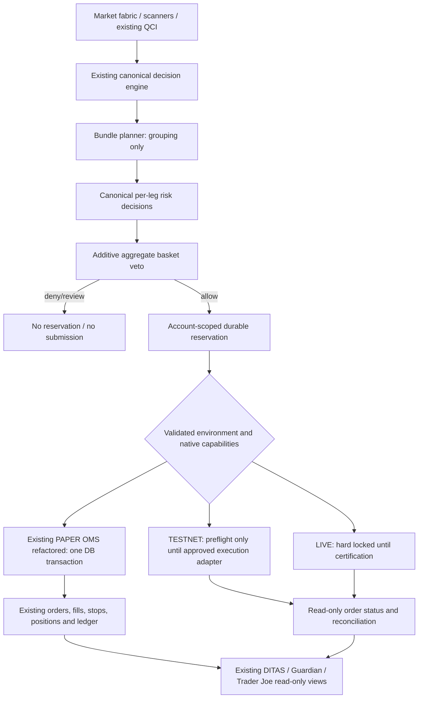

<!-- Original generated master prompt and source design, archived for traceability. Runtime implementation status is documented separately in MIA_BUNDLE_INTEGRATION.md. -->

# MIA 5.0 — Unified Bundle Trading Enhancement Specification

**Status:** OFFLINE ENGINEERING PROPOSAL — NO GITHUB WRITE, NO DEPLOYMENT, NO REAL ORDERS  
**Prepared:** 2026-11-21 (Asia/Manila)  
**Target repository:** [Naokiri5/naokiri](https://github.com/Naokiri5/naokiri)  
**Baseline inspected:** `main` tree `455fc4d7f6d4cf32f024bd051e81f6b1cd4e721b` and selected unmerged PRs  
**Artifact:** one unified Markdown specification plus the full independent TypeScript and test harness.  
**Original source:** `MIA_BUNDLE_SOURCE_VERBATIM.txt` (exact uploaded text, SHA-256 `a901906c3dcb8ccf90638b2171f8e4fb979fd9f2eb9b19db27fe9adf68fa7b5c`). The full original is included unchanged as Appendix D.  
**Execution guarantee:** this proposal never places an order or authorizes LIVE; `canSubmit` is literally `false`.

## 0. Executive decision

Create **one Bundle Order Coordinator** as an additive component of the **existing** MIA trading architecture. It shall group existing approved decisions; perform full-basket preflight; obtain authoritative, account-scoped reservations; delegate every actual paper order/fill/stop/ledger write to the existing canonical OMS; and eventually route through independently certified TESTNET/LIVE venue adapters. Do not introduce another scanner, risk gate, database, financial ledger, copy of the 100-worker intelligence system, sign-in provider or signer.

**Key distinction:** a PAPER atomic group means one SQLite financial transaction committed or rolled back together. A real exchange batch is generally **not** an atomic basket, and a Jito Solana bundle is atomic only under its own protocol within one supported bundle. The system must never silently downgrade an atomic request into best-effort submission.

The supplied audit and the repository both identify missing bundle execution and a paper/live capability gap. The standalone code below implements **only pure preflight and event projection**; persistent reservations, OMS integration, venue certification and end-to-end execution are **future engineering work**, not falsely claimed as complete.

## 1. Sources and evidence priority

1. **User-provided source:** the attached `Pasted text(20261121-104600).txt`, reproduced exactly in Appendix D and in the bundle. Its headings, feature matrix and staged implementation plan determine this proposal's scope.
2. **Live GitHub repository reads:** `main` source files and PR metadata accessed through the connected GitHub integration. Differentiate content present on `main` from code confined to open PRs.
3. **This design:** additional implementation contracts, aggregate arithmetic, validation and testing recommendations. Such proposed content is not claimed to exist in MIA today.

### Evidence inventory

| Evidence | Verified observation | Owner / non-duplication decision |
|---|---|---|
| `server/src/exec/oms.ts` | Paper-only Binance depth-based simulated fills; canonical paper order/fill/position/stop/ledger writes in a single-entry `tx()` | Extend/refactor under existing OMS, never clone |
| `server/src/risk/gate.ts` | Canonical deterministic per-entry `evaluateRisk`, returns `ALLOW`, `DENY`, `NEEDS_REVIEW`; evaluates account exposure | Feed single-leg decisions into an **additive aggregate veto** |
| `server/src/risk/policy.ts` | Versioned risk policy with `approvedVenues` centered on `binance-paper` | Do not automatically add live venues to existing policy |
| `server/src/core/mode.ts` | `OBSERVE`, `PAPER`, `APPROVAL`, `BOUNDED_LIVE`; emergency and pause controls | Reuse mode authority, never create bundle-specific bypass |
| `server/src/portfolio/ledger.ts` | Canonical ledger and `paper-bot` account | Reuse; no shadow balances or simulated real-money ledger |
| `server/src/ops/lease.ts` / `server/src/bot/bot.ts` | DB-backed singleton scheduler lease | Add proper fencing/serialization around reservation and external submission |
| `server/src/qa/gates.ts` | G07 signer and G12 live venue marked `NOT_IMPLEMENTED`, G13 independent sign-off `NOT_CERTIFIED` | LIVE locked; release gating is not optional |
| `server/src/exec/demoLiveParity.ts` | Explicitly standalone, dependency-injected, **NOT wired**, no live adapter or signer | Adapt contracts after durable reservations exist; no parallel orchestrator |
| `server/src/db/migrations.ts` | Append-only migrations with canonical `orders`, `fills`, `positions`, `ledger_entries` | Add minimal bundle grouping metadata, never duplicate financial tables |
| [PR #45](https://github.com/Naokiri5/naokiri/pull/45) | Unified PAPER branch open, marked non-mergeable at review | Reconcile branch head before editing any execution path |
| [PR #64](https://github.com/Naokiri5/naokiri/pull/64) / [#72](https://github.com/Naokiri5/naokiri/pull/72) | Proposed read-only venue reconciliation and stronger account-scoped evidence | Reuse reconciliation interfaces and tests; no second tracker |
| [PR #92](https://github.com/Naokiri5/naokiri/pull/92) | Proposed TESTNET preflight validates but does not place orders | Never call `/order/test` an execution/fill |
| [PR #95](https://github.com/Naokiri5/naokiri/pull/95) | Proposed read-only multi-market integrations | Reuse provider clients only after branch dependency review |
| [PR #97](https://github.com/Naokiri5/naokiri/pull/97) | Proposed pure event reducer, no persistent financial mutations | Adapt order-state transitions for child orders |
| [PR #98](https://github.com/Naokiri5/naokiri/pull/98) | Large conflicting branch based on main | Do not bulk-merge just to obtain narrow changes |

**Branch rule:** a feature in an unmerged PR is not deployed and is not guaranteed present on `main`. The above statements are a source snapshot, not a successful live-system smoke test.

## 2. Meaning of “bundle trade” (six explicit modes)

| Bundle mode | Intended behavior | Atomicity status |
|---|---|---|
| `BATCH_BEST_EFFORT` | Coordinate multiple independent orders, each independently reconciled | **Not atomic** |
| `SPLIT_ORDER` | One instrument/side split into child-sized orders | **Not atomic**; partial fills expected |
| `MULTI_ASSET_BASKET` | Multiple asset allocations under one capital/risk envelope | **Not atomic** unless specialized venue explicitly supports it |
| `COORDINATED_STRATEGY` | Link entry, hedge and protection as a strategy plan | **Not atomic** unless specialized venue explicitly supports it |
| `PAPER_ATOMIC` | Paper-only multi-leg preparation and single DB commit of fills/stops/ledger | **DB atomic**, conditional on future OMS refactor |
| `SOLANA_JITO_ATOMIC` | Solana group submitted through separately certified Jito adapter | **Protocol-specific atomic bundle** when accepted and landed; max 5 transactions per bundle |

**Current single-entry scope:** MIA's `submitEntry()` is spot-long `BUY`. The reference TypeScript rejects `SELL` entry legs rather than pretending the current paper OMS supports shorting, hedge exits, or multi-market execution. Future `SELL` and hedged strategies must use separate, reviewed canonical exit/short support.

## 3. Architecture and canonical ownership



**Ownership and data flow:**

- `server/src/exec/bundles/contracts.ts` and `preflight.ts` would contain narrow pure contracts and aggregation. The standalone file below combines these for review; do not put it at `server/src/index.ts` or start another scheduler.
- `server/src/risk/gate.ts` remains the **sole per-trade financial risk authority**. Bundle preflight can only add exposure vetoes, not overturn `DENY` or `NEEDS_REVIEW`.
- `server/src/exec/oms.ts` owns PAPER execution. Its current single-entry transaction must be refactored into reusable **prepare** and **single-transaction commit**, preserving every tested single-entry invariant.
- `server/src/exec/environment.ts` is present in the PR #45 stack, not assumed to exist on `main`; route through that owner only after reconciliation.
- `server/src/db/migrations.ts` remains append-only. `orders`/`fills`/`positions`/`ledger_entries` remain authoritative. Bundle rows link IDs; they do not track separate cash, fees or PnL histories.
- Child asynchronous order observations should reuse the pure reducer from PR #97 and the account-scoped evidence requirements of #64/#72, once merged and verified.
- Trader Joe, Guardian Shield and DITAS can present explanation, statuses and telemetry. None may place orders, sign transactions, raise spending limits or unpause LIVE.

## 4. Non-negotiable safety and correctness invariants

1. **No duplicate execution core:** exactly one canonical OMS for paper financial mutations; no second risk engine, ledger, database or exchange scheduler.
2. **Environment and account isolation:** derive environment, account, venue and strategy from authenticated backend state, never from browser-selected IDs alone; `PAPER`, `TESTNET` and `LIVE` must not share credentials or balances.
3. **Every leg must match an immutable prior decision**, including instrument, direction, quantity, policy version, strategy and expiry.
4. **No “NEEDS_REVIEW ⇒ ALLOW” promotion:** require a separately verified owner approval flow and fresh risk recheck before a future integration can proceed.
5. **Fail closed** for unknown instruments, stale quotes, missing order-book depth, unsafe tokens, unavailable protective stops, unsupported venues or missing price precision.
6. **Use integer atomic quantities and money values** at the boundaries; never assume USD, quote precision, FX normalization or float equality across venues. The source code requires trusted upstream currency normalization.
7. **Aggregate exposure:** proposed cash + fees + gas + tips + existing reservations ≤ cash; proposed planned loss + existing risk + reserved risk ≤ canonical policy risk cap; position slot and correlation/concentration checks pass.
8. **Snapshot validity:** risk, quotes, exchange capabilities, owner mode and authorization must be revalidated immediately before any real submission, with stable policy version.
9. **Durable idempotency:** `UNIQUE(environment, account, idempotency_key)` transactionally; every child order uses a stable venue-valid client ID across retries. Never rely on an in-memory Set.
10. **No blind retries on timeouts:** unknown result → UNKNOWN + block sends → venue REST + trade reconciliation by account/order identity. Only a reconciler can clear uncertainty.
11. **Atomic PAPER writes:** prepare all legs from the same safe market snapshot, then commit existing orders, fills, positions, protective stops, fees, cash ledger and bundle status inside **one** canonical `tx()`; on any exception roll back all writes.
12. **Exchange atomicity is never invented:** asynchronous child CEX orders are best effort; partial/unknown state is surfaced and managed, not silently undone. Compensating hedges themselves create exposure and require fresh risk authorization.
13. **No silent execution-mode fallback:** reject `PAPER_ATOMIC` on LIVE and reject Jito “atomic” if its qualified adapter or signing capacity is absent.
14. **Never simulate Jito inclusion as a fill:** block-engine acceptance ≠ landed/confirmed transaction; confirm chain status and reconcile actual token balances.
15. **Signer isolation:** Privy owner login identifies the user; it is not a trading signing grant. Every LIVE submission must have short-lived bounded owner authorization, transaction firewall, signer audit, separate keys and exchange-specific protections.
16. **Kill switches dominate:** Guardian may pause risk; neither coordinator nor AI may disable emergency controls or raise hard risk limits.
17. **No market manipulation:** reject multi-wallet self-trading, artificial wash volume, deceptive launches or transaction sequences designed to distort displayed liquidity.
18. **Evidence over assumptions:** `PAPER` simulations use real observed market depth, modeled latency/fees and explicit simulation flags; external settlement evidence is never fabricated.
19. **Single leadership + fence:** check current execution lease and fencing token before and immediately after asynchronous I/O; revoked leases must not send orders.
20. **Traceability:** immutable bundle-to-decision, order, fill, stop, account, policy version and event references, with redacted user-visible explanations.
21. **Readiness is not permission:** TESTNET preflight, a passing unit suite, a working wallet login or a readiness screen do not unlock G01–G14 live certification.
22. **No direct GitHub modifications under this proposal**; owner reviews the document before any branch, PR, merge or deployment.

## 5. Required persisted design — propose a migration, do not apply yet

The reference TypeScript intentionally has **no database mutations**. A future implementation may add one append-only migration with the following conceptual schema. Before adoption, reconcile field names and indexes against the current branch schema and PR #43/NEXUS outbox; do not create a second outbox or edit shipped migrations.

```sql
-- Conceptual migration only. Not applied or claimed verified.
CREATE TABLE bundle_intents (
  id TEXT PRIMARY KEY,
  environment TEXT NOT NULL CHECK(environment IN ('PAPER','TESTNET','LIVE')),
  account TEXT NOT NULL,
  venue_policy TEXT NOT NULL,
  mode TEXT NOT NULL,
  idempotency_key TEXT NOT NULL,
  policy_version INTEGER NOT NULL,
  state TEXT NOT NULL,
  expires_at INTEGER NOT NULL,
  created_at INTEGER NOT NULL,
  updated_at INTEGER NOT NULL,
  UNIQUE(environment, account, idempotency_key)
);
CREATE TABLE bundle_legs (
  bundle_id TEXT NOT NULL REFERENCES bundle_intents(id),
  leg_id TEXT NOT NULL,
  decision_id TEXT NOT NULL,
  instrument TEXT NOT NULL,
  venue TEXT NOT NULL,
  client_order_id TEXT NOT NULL,
  canonical_order_id TEXT REFERENCES orders(id),
  PRIMARY KEY(bundle_id, leg_id),
  UNIQUE(bundle_id, client_order_id)
);
CREATE TABLE bundle_reservations (
  bundle_id TEXT PRIMARY KEY REFERENCES bundle_intents(id),
  environment TEXT NOT NULL,
  account TEXT NOT NULL,
  currency TEXT NOT NULL,
  cash_atomic TEXT NOT NULL,
  risk_atomic TEXT NOT NULL,
  version INTEGER NOT NULL,
  state TEXT NOT NULL,
  updated_at INTEGER NOT NULL
);
CREATE TABLE bundle_event_journal (
  bundle_id TEXT NOT NULL REFERENCES bundle_intents(id),
  event_id TEXT NOT NULL,
  event_seq INTEGER NOT NULL,
  canonical_event_json TEXT NOT NULL,
  observed_at INTEGER NOT NULL,
  PRIMARY KEY(bundle_id, event_id),
  UNIQUE(bundle_id, event_seq)
);
```

**Database adoption review:** unique idempotency keys must scope to `(environment, account)` and be generated at the server; FKs and indexes must match the canonical SQLite migration version. All writes must happen with concurrency-safe `BEGIN IMMEDIATE`/existing transaction primitives. `bundle_reservations` is only a pending-capital hold, **never** an independent account ledger. Open reservations must be included in future `risk/gate.ts` availability checks so single-entry orders cannot evade bundle reservations. Never release a hold on `UNKNOWN` without verified venue evidence.

## 6. Processing algorithm and backend boundaries

### 6.1 Read-only preflight (implemented below)

1. Validate IDs, environment, strategy, legal mode, expiry, leg count and requested atomic quantities.
2. Match every bundle leg to exactly one already-authorized canonical risk decision and current normalized account evidence.
3. Check account/venue/mode scope, policy version, data freshness, order-book market quality, asset safety and entry protection.
4. Sum all child commitment, fees, gas/tips and planned maximum losses with `bigint` rather than float addition.
5. Include already-open positions, pending entry slots, other reservations and correlation/concentration/venue-capacity vetoes.
6. Return `approved` for **risk-preview purposes only**, with `canSubmit: false` always. The preview does not reserve funds, send orders or write ledger entries.

### 6.2 PAPER execution integration (future, NOT implemented in standalone file)

1. Start inside the existing scheduler/owner workflow; require leader fence and `PAPER` mode without pause/emergency.
2. Collect immutable canonical decisions for all legs; evaluate single-leg risk via `evaluateRisk` and aggregate portfolio state.
3. Inside a locked DB transaction, reserve cash and risk with a unique `(env,account,idempotency_key)` record and stable child order IDs. Do not nest unsupported `tx()` calls.
4. Prepare fills against a consistent, fresh depth snapshot for **all** legs, allowing configured slippage/fees and rejecting thin books. Preparation does not write financial tables.
5. Revalidate snapshot, control state, lease, policy version, positions and reservations before commit.
6. Use **one** existing `db.ts` transaction to record all canonical paper order/fill/position/stop/fee/ledger changes. If any child fails, entire transaction rolls back. Only after commit publish bus events and Trader Joe narration.
7. Reconcile canonical ledger, fills, positions and bundle status. Verify exact cash change, modeled impact and protective stops.

**Do not** implement PAPER atomic execution as `for (leg of legs) submitEntry(leg)`; that function already commits each entry separately. Atomic support requires an extraction of its inner write operations under a single outer `tx()` with regression tests for unchanged single-order behavior.

### 6.3 Asynchronous TESTNET / LIVE execution (future, NOT implemented)

1. Submit only after durable reservation and complete G01–G14 evidence for a separately certified LIVE adapter; TESTNET needs a separate staging order-placement adapter, not just Binance `/order/test`.
2. Lock per account + venue and store clientOrderIds before network activity; send only with signer/firewall approval and a validated fencing token.
3. Store acknowledgements, partial trade IDs, fills and order states through the canonical order reducer and account-scoped reconciliation; never infer fill from a timeout or an unverified status.
4. Unknown outcome blocks new conflicting bundles and retains reservations until authenticated venue REST + trade evidence reconciles. No automatic compensation without a new explicit risk-approved decision.
5. Update canonical financial tables exclusively from verified venue receipts; quote/chain differences must be recorded as realized fees/slippage rather than ignored.

### 6.4 Solana Jito adapter (future, NOT implemented)

- Require a **single Solana chain** and at most 5 signed transactions inside the one actual Jito bundle. The standalone simplified `BundleLeg` currently models one planned transaction per leg; real adapter must map swap instructions to actual transaction IDs and enforce the 5-transaction maximum independently.
- Build transactions from verified on-chain token metadata, safety checks and fresh swap quotes; simulate against current blockhash and min-out constraints, assess compute units, blockhash expiry, priority fee and Jito tip together.
- Never sign with login-only Privy authentication; use a separately approved server-side or protected signer, bounded by asset, spending, transaction and chain limits.
- Broadcast only through a reviewed Jito Block Engine client, verify landing and on-chain confirmation; record UNKNOWN on expiry, competing forks or RPC failure. No fake paper inclusion receipts.
- Avoid sandwich/wash-volume multi-wallet workflows. Account and wallet ownership checks must prove authorized use.

## 7. Proposed API and UI (non-operational preview first)

Suggested **owner-session-protected, CSRF/rate-limited** endpoints, subject to existing `server/src/api/routes.ts` conventions:

| Endpoint | Phase | Semantics |
|---|---|---|
| `POST /api/trading/bundles/preview` | P1 | Read-only aggregate eligibility with reason codes and cost/risk totals; never executes |
| `GET /api/trading/bundles/:id` | P2 | Account-scoped immutable bundle status and canonical child order links |
| `POST /api/trading/bundles` | P2 | Future durable PAPER reservation only; never treat browser preview as authority |
| `POST /api/trading/bundles/:id/submit` | P2/P3 | Requires separately reviewed owner/bot capability, fresh risk, leader fence, environment policy; unavailable until built |
| `POST /api/trading/bundles/:id/cancel` | P2/P3 | Cancels only allowed unfinished state and reconciles release; not a generic live cancel |

UI should distinguish **Risk eligible**, **Reserved**, **Submitted**, **Partial**, **UNKNOWN — reconcile**, and **Fully reconciled**. Provide visible `PAPER SIMULATION`, `TESTNET PREFLIGHT` or `LIVE LOCKED` status. Render every denied reason; no “all filled” success without canonical evidence. Trader Joe only narrates event facts.

## 8. Anti-duplication source-to-owner matrix

| Proposed capability | Existing owner to extend | Avoid creating |
|---|---|---|
| Bundle selection | `decision/engine.ts`, `workers/registry.ts`, `market/scanner.ts` | Second strategy brain / second 100-worker pipeline |
| Aggregate veto | `risk/gate.ts` and current policy | New independent risk rule authority |
| PAPER commit | `exec/oms.ts` and `db/db.ts` | Second OMS with conflicting paper cash writes |
| Order lifecycle | PR #97 `venueOrderState.ts`; `exec/oms.ts` statuses | Unrelated generic order-state store |
| Reconciliation | PR #64/#72 read-only assessor and canonical ledger | Synthetic venue fills / second PnL ledger |
| Venue capability | PR #92 environment/venue contracts | TESTNET/LIVE modes tied to wallet login |
| Solana quote/safety | PR #95 providers, `safety/safety.ts` | Duplicated RPC provider registry |
| Event audit | Existing `core/audit.ts`, `journal`, DITAS and PR #43 NEXUS proposal | Competing domain event fabric |
| Wallet owner authentication | `security/privy.ts`, `security/stepUp.ts` | Wallet login as implicit signer |
| Alerts / explanations | `notify/notify.ts`, `joe/joe.ts` | Chatbot given order placement privileges |

## 9. Branch integration plan (no GitHub changes made)

**Preparation:** fetch current `main` SHA and PR dependency graph again before any implementation. Resolve PR #45 source conflicts; do **not** bulk merge #98. Audit #64→#72 reconciliation, #92→#95→#97 dependency chain, and check whether `environment.ts` and `venueOrderState.ts` are actually present in the chosen branch.

| Phase | Concrete deliverable | Gate for next phase |
|---|---|---|
| **P0** | Documentation + pure `assessBundle()` + reducer proposal (this package) | TypeScript strict compile + pure unit tests; no repo files changed |
| **P1** | Owner-only `preview` endpoint, source matching, market quality, risk snapshot adapters | No financial writes, replayable tests, no exposure improvement via bundle |
| **P2** | New append-only migration; transactional reservation; PAPER OMS prepare/commit extraction; atomic batch regression suite | No ledger drift, same single-order results, crash recovery + idempotency tests |
| **P3** | TESTNET order placement in separate approved adapter, backed by order-state reducer and authenticated venue reconciliation | Sandbox credentials, replayed exchange receipts, partial/unknown handling |
| **P4** | Solana Jito adapter certification and chain landing verification; batch/split venue policy variants | Real network integration tests without production capital and explicit threat review |
| **P5** | Guarded live adapter after all release gates, signer isolation, protection, owner bounded approval and independent audit | Explicit release and separate monitored production rollout |

No milestone automatically promotes PAPER to LIVE. Deliver short, dependency-scoped PRs and compare each against the selected canonical base; all code remains additive and preserves historical migration/financial behavior.

## 10. Test and acceptance inventory

### Standalone tests actually executed

The package includes `MIA_BUNDLE_COORDINATOR_TESTS.cjs`. Local verification on Node.js 22.16.0: `tsc --strict --target ES2022 --module commonjs --skipLibCheck` **PASSED** and `node --test` **12/12 PASSED** on the standalone files only. This does **not** establish repository-wide CI, live provider compatibility, end-to-end financial reconciliation or deployed functionality.

### Mandatory future repository acceptance checks

- [ ] Risk evidence originates from canonical `evaluateRisk`, not client/LLM generated claims, and remains account/venue scoped.
- [ ] Two individually allowed legs with aggregate exposure over cap are refused before any reservation.
- [ ] Cash sum includes fees, reserve, network charges and Jito tips; insufficient aggregate funds reject entire PAPER atomic plan.
- [ ] Invalid/missing currency normalization or precision rejects safely.
- [ ] Expired strategy decisions, policy versions, stale quotes and thin-depth estimates fail closed.
- [ ] `NEEDS_REVIEW`, Guardian emergency and owner pause cannot be converted into automated approval.
- [ ] Same idempotency key submitted twice creates at most one bundle and one set of child orders across process restarts.
- [ ] Two worker processes with overlapping engine leases cannot each execute a bundle (fencing and transaction tests).
- [ ] Atomic PAPER mid-commit crash reverts all child order/position/fill/fee/ledger writes.
- [ ] Existing single-entry PAPER tests retain their exact expected fills, stops, fees, PnL and protection alerts.
- [ ] Oversized market depth / simulated slippage rejects the entire PAPER bundle with no ledger change.
- [ ] CEX best-effort partial fills are acknowledged, reserved and monitored; never relabeled atomic.
- [ ] Lost HTTP response after venue acceptance becomes `UNKNOWN`, with no blind resubmission or duplicate trade.
- [ ] Duplicate venue trade IDs remain idempotent even after restarts and under different stream event IDs.
- [ ] Out-of-order/conflicting venue receipts require authenticated reconciliation.
- [ ] Exchange REST order quantities cannot create fills or cash movements without independently verified trade evidence.
- [ ] Partially completed bundles show exact unsettled quantity and retained exposure.
- [ ] Jito 6-transaction plan is rejected, not auto-split with a false atomicity label.
- [ ] Jito accepted-but-not-landed bundle never produces a filled financial receipt.
- [ ] Solana blockhash expiry, compute failure, gas/tip budget, token freeze/authority flags and malicious pools fail closed.
- [ ] Privy login cannot sign on its own or override trading policy.
- [ ] G01–G14 attestations, isolated signer verification and bounded owner release are mandatory on LIVE path.
- [ ] Bot/Trader Joe/Guardian cannot unpause, change policy, withdraw or submit as owner.
- [ ] ALL existing backend tests, typecheck, build, Playwright, secret scan and dependency-audit jobs pass on the proposed PR head.
- [ ] Account/fill/fee/ledger daily reconciliations pass after crash-restart, partial order and rollback tests.

**Standalone reproducible commands** (inside this package folder; these do not access the repo):

```bash
tsc --strict --target ES2022 --module commonjs --skipLibCheck \
  --outDir ./build MIA_BUNDLE_COORDINATOR_PROPOSAL.ts
node --test MIA_BUNDLE_COORDINATOR_TESTS.cjs
```

## 11. Codex / Claude master implementation prompt (for future use, NOT executed)

> **Mission:** Introduce MIA Bundle Order Coordinator into `Naokiri5/naokiri` as staged, small, reviewable enhancements. Before changing a file, inspect actual branch head, tests, migrations, architecture guidance and all open stacked PR dependencies. Identify the existing owner of every capability. Never duplicate an existing scanner, worker pool, risk policy, OMS, ledger, transaction bus, auth provider or venue adapter.
>
> **Source of truth:** This unified spec, original source appendix, standalone TypeScript, and current repository implementation. Preserve existing source, existing exits and live security boundaries. An open PR is not merged or deployed. Do not copy this standalone proposal into production as a replacement for current code; split/reconcile it with canonical modules.
>
> **Start with P1 only:** implement read-only preview using `evaluateRisk()` output and account-scoped, canonical market/order/portfolio truth. Normalize exact amounts and quote currencies. Aggregate cash, open risk, pending/reserved risk, position slots, correlation and concentration. Fail closed on any missing evidence, disabled strategy, uncertain order, mode lock or safety alert. Add deterministic tests. **Do not add live submission or wallet signing.**
>
> **P2 PAPER:** after approval, add append-only transactional reservation records and atomically commit all prepared PAPER legs using the existing OMS/ledger, preserving all single-order tests. Do not call the current `submitEntry()` repeatedly and claim atomicity. Roll back on fault injection. Never produce an unprotected simulated position.
>
> **P3+ environments:** harmonize with PR #92 environment, PR #97 pure venue reducer and #64/#72 reconciliation, not parallel implementations. TESTNET first with actual sandbox evidence; LIVE remains locked until G01–G14, signer firewall and independent review pass. No auto-promotion, no unknown-outcome retry. Implement Jito only behind explicit chain/venue capability proof and true block-inclusion reconciliation.
>
 **Deliverables:** source-to-file mapping, exact original/modified paths, smallest diff, design ADR, additive migrations, deterministic tests, benchmark, known limitation list, PR dependency report and separate owner-review checklist. Run `npm ci`, `npm run typecheck`, `npm test`, `npm run build`, `npm run test:e2e`, `npm run scan:secrets` and `npm audit --audit-level=high` where supported. Report each command and any skipped test truthfully. Do not merge or deploy without a separate explicit instruction.

## 12. Limits of this deliverable

This document is a **build specification with working pure validation/projection code**, not a ready-to-run trading adapter. Its `CanonicalBundlePorts` members are deliberately unimplemented. The future adapter must safely deal with numeric precision, true volume-weighted order-book walking, DB locking, external order uncertainty, compliance, native protection, cluster fencing, API signing and validated real instrument capabilities. The snapshot is tied to the named repository commit and PRs may move afterward.

---

# Appendix A — Complete standalone TypeScript proposal (unaltered)

```typescript
/**
 * MIA 5.0 — Bundle Order Coordinator: standalone, NON-EXECUTING design proposal.
 * NOT WIRED to the repository. Do NOT call this an OMS, signer, risk engine, or live adapter.
 * Existing authoritative owners are risk/gate.ts, exec/oms.ts, portfolio/ledger.ts,
 * core/mode.ts and qa/gates.ts. This module provides deterministic preflight
 * aggregation and a pure, audit-friendly projection of bundle events only.
 *
 * IMPORTANT: No imports, HTTP, RPC, exchange calls, database writes or signing.
 * Risk evidence MUST be built on the trusted backend from canonical risk evaluations,
 * actual account state and reconciled reservations, never user/AI supplied JSON.
 */

export type BundleEnvironment = 'PAPER' | 'TESTNET' | 'LIVE';
export type BundleMode =
  | 'BATCH_BEST_EFFORT'
  | 'SPLIT_ORDER'
  | 'MULTI_ASSET_BASKET'
  | 'COORDINATED_STRATEGY'
  | 'PAPER_ATOMIC'
  | 'SOLANA_JITO_ATOMIC';
export type BundleSide = 'BUY' | 'SELL';
export type CanonicalRiskDecision = 'ALLOW' | 'DENY' | 'NEEDS_REVIEW';
export type BundleState =
  | 'PLANNED' | 'RISK_APPROVED' | 'RESERVED' | 'SUBMITTING'
  | 'ACKNOWLEDGED' | 'PARTIALLY_FILLED' | 'FILLED'
  | 'FAILED' | 'UNKNOWN' | 'RECONCILED' | 'CANCELLED';

/** Strings encode integer atomic units; currency/precision are set by trusted adapters. */
export type AtomicAmount = string;

export interface BundleLeg {
  legId: string;
  decisionId: string;
  instrumentId: string;
  venueId: string;
  side: BundleSide;
  requestedUnits: AtomicAmount;
}

export interface BundleIntent {
  bundleId: string;
  environment: BundleEnvironment;
  accountId: string;
  strategyId: string;
  idempotencyKey: string;
  mode: BundleMode;
  expiresAt: number;
  legs: readonly BundleLeg[];
}

/**
 * Canonical single-order risk gate output translated to exact, trusted integer units.
 * Quote freshness, asset-safety and protection flags MUST come from MIA services.
 */
export interface LegRiskEvidence {
  legId: string;
  decisionId: string;
  instrumentId: string;
  venueId: string;
  side: BundleSide;
  requestedUnits: AtomicAmount;
  decision: CanonicalRiskDecision;
  policyVersion: number;
  validUntil: number;
  currency: string;
  debitAtomic: AtomicAmount;
  feeAtomic: AtomicAmount;
  networkFeeAtomic: AtomicAmount;
  plannedMaxLossAtomic: AtomicAmount;
  qualityPassed: boolean;
  assetSafetyPassed: boolean;
  entryProtectionAvailable: boolean;
}

/**
 * Account-scoped, normalized canonical evidence. Any cross-currency conversion must
 * happen upstream with independently validated rates and exact rounding.
 */
export interface BundleAccountEvidence {
  environment: BundleEnvironment;
  accountId: string;
  currency: string;
  policyVersion: number;
  validUntil: number;
  cashBalanceAtomic: AtomicAmount;
  reservedCashAtomic: AtomicAmount;
  existingOpenRiskAtomic: AtomicAmount;
  reservedRiskAtomic: AtomicAmount;
  maxTotalOpenRiskAtomic: AtomicAmount;
  openPositionCount: number;
  pendingPositionCount: number;
  maxConcurrentPositions: number;
  correlationPassed: boolean;
  concentrationPassed: boolean;
  venueExposurePassed: boolean;
  accountReconciled: boolean;
}

/** Capabilities are verified server-side; inclusion does not grant trade permission. */
export interface BundleVenueCapabilities {
  environment: BundleEnvironment;
  allowedVenues: readonly string[];
  supportedModes: readonly BundleMode[];
  maxLegs: number;
  expiresAt: number;
  // Consuming code must enforce native/protocol guarantees; never silently downgrade.
  paperTransactionalCommitAvailable: boolean;
  jitoAtomicExecutionCertified: boolean;
}

export interface BundleEvidence {
  account: BundleAccountEvidence;
  legs: readonly LegRiskEvidence[];
  venue: BundleVenueCapabilities;
  /** Externally recorded canonical control state. */
  control: { mode: 'OBSERVE' | 'PAPER' | 'APPROVAL' | 'BOUNDED_LIVE'; emergency: boolean; pausedNewOrders: boolean };
}

export interface BundlePreflight {
  bundleId: string;
  environment: BundleEnvironment;
  accountId: string;
  approved: boolean; // Risk/eligibility assessment only; NOT submission permission.
  canSubmit: false; // Deliberately impossible in this standalone proposal.
  policyVersion: number | null;
  reasonCodes: readonly string[];
  totals: {
    currency: string | null;
    newCashCommitmentAtomic: AtomicAmount;
    newPlannedMaxLossAtomic: AtomicAmount;
    projectedCashCommitmentAtomic: AtomicAmount;
    projectedOpenRiskAtomic: AtomicAmount;
  };
}

const ID = /^[A-Za-z0-9][A-Za-z0-9_.:-]{0,127}$/;
const AMOUNT = /^(?:0|[1-9][0-9]{0,38})$/;
const MAX_UNITS = (10n ** 39n) - 1n;
const MODES: readonly BundleMode[] = [
  'BATCH_BEST_EFFORT', 'SPLIT_ORDER', 'MULTI_ASSET_BASKET',
  'COORDINATED_STRATEGY', 'PAPER_ATOMIC', 'SOLANA_JITO_ATOMIC',
];
const ENVS: readonly BundleEnvironment[] = ['PAPER', 'TESTNET', 'LIVE'];

function validId(value: unknown): value is string {
  return typeof value === 'string' && ID.test(value);
}
function validTime(v: unknown): v is number {
  return typeof v === 'number' && Number.isSafeInteger(v) && v > 0;
}
function amount(v: unknown): bigint {
  if (typeof v !== 'string' || !AMOUNT.test(v)) throw new Error('INVALID_ATOMIC_AMOUNT');
  const n = BigInt(v);
  if (n > MAX_UNITS) throw new Error('ATOMIC_AMOUNT_TOO_LARGE');
  return n;
}
function nonNegativeInt(v: unknown): v is number {
  return typeof v === 'number' && Number.isSafeInteger(v) && v >= 0;
}
function safeStateCopy<T>(v: Readonly<Record<string, T>>): Record<string, T> {
  return Object.assign(Object.create(null) as Record<string, T>, v);
}

/** Validate shape and fixed policy semantics; does NOT authorize or place orders. */
export function validateBundleIntent(intent: BundleIntent, now: number): readonly string[] {
  const reasons: string[] = [];
  if (![intent.bundleId, intent.accountId, intent.strategyId, intent.idempotencyKey].every(validId))
    reasons.push('INVALID_BUNDLE_IDENTITY');
  if (!ENVS.includes(intent.environment)) reasons.push('INVALID_ENVIRONMENT');
  if (!MODES.includes(intent.mode)) reasons.push('INVALID_BUNDLE_MODE');
  if (!validTime(now) || !validTime(intent.expiresAt) || intent.expiresAt <= now)
    reasons.push('BUNDLE_EXPIRED_OR_INVALID_TIME');
  if (!Array.isArray(intent.legs) || intent.legs.length === 0 || intent.legs.length > 25) {
    reasons.push('INVALID_BUNDLE_LEG_COUNT');
    return reasons;
  }
  const ids = new Set<string>();
  const uniqueEntries = new Set<string>();
  for (const leg of intent.legs) {
    if (![leg.legId, leg.decisionId, leg.instrumentId, leg.venueId].every(validId))
      reasons.push('INVALID_LEG_IDENTITY');
    if (ids.has(leg.legId)) reasons.push('DUPLICATE_LEG_ID');
    ids.add(leg.legId);
    if (leg.side !== 'BUY' && leg.side !== 'SELL') reasons.push('INVALID_SIDE');
    // Current MIA submitEntry() is long-only; exits are a different OMS path.
    if (leg.side !== 'BUY') reasons.push('SELL_NOT_SUPPORTED_IN_CURRENT_ENTRY_PATH');
    try { if (amount(leg.requestedUnits) <= 0n) reasons.push('ZERO_LEG_QUANTITY'); }
    catch { reasons.push('INVALID_LEG_QUANTITY'); }
    const key = JSON.stringify([leg.venueId, leg.instrumentId, leg.side]);
    if (uniqueEntries.has(key) && intent.mode !== 'SPLIT_ORDER') reasons.push('DUPLICATE_INSTRUMENT_LEG');
    uniqueEntries.add(key);
  }
  if (intent.mode === 'SPLIT_ORDER') {
    const first = intent.legs[0];
    if (intent.legs.some(l => l.instrumentId !== first.instrumentId || l.venueId !== first.venueId || l.side !== first.side))
      reasons.push('SPLIT_ORDER_SCOPE_MISMATCH');
  }
  if (intent.mode === 'PAPER_ATOMIC') {
    if (intent.environment !== 'PAPER') reasons.push('PAPER_ATOMIC_REQUIRES_PAPER');
    if (intent.legs.some(l => l.venueId !== 'binance-paper')) reasons.push('PAPER_ATOMIC_UNSUPPORTED_VENUE');
  }
  if (intent.mode === 'SOLANA_JITO_ATOMIC') {
    if (intent.environment !== 'LIVE') reasons.push('JITO_BUNDLE_REQUIRES_LIVE_ENVIRONMENT');
    if (intent.legs.length > 5) reasons.push('JITO_MAX_FIVE_TRANSACTIONS');
    if (intent.legs.some(l => l.venueId !== 'jito-solana')) reasons.push('JITO_VENUE_SCOPE_MISMATCH');
  }
  return [...new Set(reasons)];
}

/**
 * Pure, fail-closed aggregate assessment. One risk gate remains authoritative:
 * per-leg decisions MUST already come from risk/gate.ts or its reviewed extension.
 * Bundle-wide checks ONLY prohibit cumulative over-exposure; they cannot uplift DENY.
 */
export function assessBundle(intent: BundleIntent, proof: BundleEvidence, now: number): BundlePreflight {
  const reasons = [...validateBundleIntent(intent, now)];
  const account = proof.account;
  const cap = proof.venue;
  const output: BundlePreflight = {
    bundleId: intent.bundleId,
    environment: intent.environment,
    accountId: intent.accountId,
    approved: false,
    canSubmit: false,
    policyVersion: nonNegativeInt(account.policyVersion) ? account.policyVersion : null,
    reasonCodes: [],
    totals: { currency: null, newCashCommitmentAtomic: '0', newPlannedMaxLossAtomic: '0', projectedCashCommitmentAtomic: '0', projectedOpenRiskAtomic: '0' },
  };
  const fail = (code: string) => reasons.push(code);
  if (account.environment !== intent.environment || account.accountId !== intent.accountId)
    fail('ACCOUNT_ENVIRONMENT_SCOPE_MISMATCH');
  if (cap.environment !== intent.environment) fail('CAPABILITY_ENVIRONMENT_MISMATCH');
  if (!validId(account.currency)) fail('INVALID_ACCOUNT_CURRENCY');
  else output.totals.currency = account.currency;
  if (!validTime(account.validUntil) || account.validUntil <= now) fail('ACCOUNT_RISK_EVIDENCE_STALE');
  if (!validTime(cap.expiresAt) || cap.expiresAt <= now) fail('VENUE_CAPABILITIES_STALE');
  if (!nonNegativeInt(account.policyVersion) || account.policyVersion === 0) fail('POLICY_VERSION_INVALID');
  if (!cap.supportedModes.includes(intent.mode)) fail('BUNDLE_MODE_UNSUPPORTED_BY_VENUE');
  if (!nonNegativeInt(cap.maxLegs) || cap.maxLegs < 1 || intent.legs.length > cap.maxLegs)
    fail('VENUE_BUNDLE_CAPACITY_EXCEEDED');
  if (intent.legs.some(l => !cap.allowedVenues.includes(l.venueId))) fail('VENUE_NOT_APPROVED');
  if (!account.accountReconciled) fail('ACCOUNT_UNRECONCILED');
  if (!account.correlationPassed) fail('CORRELATION_POLICY_FAILED');
  if (!account.concentrationPassed) fail('CONCENTRATION_POLICY_FAILED');
  if (!account.venueExposurePassed) fail('VENUE_EXPOSURE_POLICY_FAILED');
  if (proof.control.emergency || proof.control.pausedNewOrders) fail('EMERGENCY_OR_PAUSE_ACTIVE');
  if (intent.environment === 'PAPER' && proof.control.mode !== 'PAPER') fail('PAPER_MODE_NOT_ACTIVE');
  // No TESTNET execution or live activation is supplied by this source file.
  if (intent.environment === 'TESTNET') fail('TESTNET_ORDER_PLACEMENT_NOT_IMPLEMENTED');
  if (intent.environment === 'LIVE') fail('LIVE_BUNDLE_SUBMISSION_NOT_CERTIFIED');
  if (intent.mode === 'PAPER_ATOMIC' && !cap.paperTransactionalCommitAvailable)
    fail('PAPER_OMS_ATOMIC_COMMIT_NOT_INSTALLED');
  if (intent.mode === 'SOLANA_JITO_ATOMIC' && !cap.jitoAtomicExecutionCertified)
    fail('JITO_EXECUTION_ADAPTER_NOT_CERTIFIED');

  if (proof.legs.length !== intent.legs.length) fail('MISSING_OR_EXTRA_LEG_RISK_EVIDENCE');
  const byId = new Map<string, LegRiskEvidence>();
  for (const ev of proof.legs) {
    if (byId.has(ev.legId)) fail('DUPLICATED_RISK_EVIDENCE');
    byId.set(ev.legId, ev);
  }
  let newCash = 0n, newRisk = 0n;
  for (const leg of intent.legs) {
    const ev = byId.get(leg.legId);
    if (!ev) { fail('MISSING_LEG_RISK_EVIDENCE'); continue; }
    if (ev.decisionId !== leg.decisionId || ev.instrumentId !== leg.instrumentId ||
        ev.venueId !== leg.venueId || ev.side !== leg.side || ev.requestedUnits !== leg.requestedUnits) {
      fail('RISK_EVIDENCE_LEG_IDENTITY_MISMATCH'); continue;
    }
    if (ev.currency !== account.currency) fail('UNNORMALIZED_RISK_CURRENCY');
    if (ev.policyVersion !== account.policyVersion) fail('MIXED_POLICY_VERSIONS');
    if (!validTime(ev.validUntil) || ev.validUntil <= now) fail('STALE_LEG_RISK_EVIDENCE');
    if (ev.decision !== 'ALLOW') fail('CANONICAL_RISK_NOT_ALLOW');
    if (!ev.qualityPassed) fail('MARKET_QUALITY_NOT_VERIFIED');
    if (!ev.assetSafetyPassed) fail('TOKEN_SAFETY_NOT_VERIFIED');
    if (ev.side === 'BUY' && !ev.entryProtectionAvailable) fail('ENTRY_PROTECTION_UNAVAILABLE');
    try {
      newCash += amount(ev.debitAtomic) + amount(ev.feeAtomic) + amount(ev.networkFeeAtomic);
      newRisk += amount(ev.plannedMaxLossAtomic);
    } catch { fail('INVALID_LEG_RISK_AMOUNT'); }
  }
  let projectedCash = 0n, projectedRisk = 0n;
  try {
    projectedCash = newCash + amount(account.reservedCashAtomic);
    projectedRisk = newRisk + amount(account.existingOpenRiskAtomic) + amount(account.reservedRiskAtomic);
    if (projectedCash > amount(account.cashBalanceAtomic)) fail('BUNDLE_INSUFFICIENT_AVAILABLE_CASH');
    if (projectedRisk > amount(account.maxTotalOpenRiskAtomic)) fail('BUNDLE_AGGREGATE_RISK_LIMIT');
  } catch { fail('INVALID_ACCOUNT_RISK_AMOUNT'); }
  output.totals.newCashCommitmentAtomic = newCash.toString();
  output.totals.newPlannedMaxLossAtomic = newRisk.toString();
  output.totals.projectedCashCommitmentAtomic = projectedCash.toString();
  output.totals.projectedOpenRiskAtomic = projectedRisk.toString();
  if (![account.openPositionCount, account.pendingPositionCount, account.maxConcurrentPositions].every(nonNegativeInt))
    fail('INVALID_POSITION_COUNTS');
  else {
    const proposedSlots = intent.mode === 'SPLIT_ORDER' ? 1 : intent.legs.length;
    if (account.openPositionCount + account.pendingPositionCount + proposedSlots > account.maxConcurrentPositions)
      fail('BUNDLE_POSITION_CAPACITY_EXCEEDED');
  }
  output.reasonCodes = [...new Set(reasons)];
  output.approved = output.reasonCodes.length === 0;
  return output;
}

export type BundleEvent =
  | { eventId: string; at: number; kind: 'RISK_APPROVED' }
  | { eventId: string; at: number; kind: 'RESERVATION_COMMITTED' }
  | { eventId: string; at: number; kind: 'SUBMISSION_STARTED' }
  | { eventId: string; at: number; kind: 'LEG_ACK'; legId: string; venueOrderId: string }
  | { eventId: string; at: number; kind: 'LEG_FILL'; legId: string; venueTradeId: string; quantityUnits: AtomicAmount }
  | { eventId: string; at: number; kind: 'LEG_UNCERTAIN'; legId: string; reason: string }
  | { eventId: string; at: number; kind: 'LEG_REJECTED'; legId: string; reason: string }
  | { eventId: string; at: number; kind: 'PAPER_ATOMIC_COMMITTED'; committedOrderIds: readonly string[] }
  | { eventId: string; at: number; kind: 'VERIFIED_RECONCILIATION'; verifiedLegs: readonly { legId: string; finalStatus: 'FILLED' | 'REJECTED' | 'CANCELLED'; confirmedUnits: AtomicAmount }[] }
  | { eventId: string; at: number; kind: 'CANCEL_BEFORE_RESERVATION' };

export interface BundleLegProjection {
  requestedUnits: AtomicAmount;
  confirmedUnits: AtomicAmount;
  venueOrderId: string | null;
  venueTradeIds: Readonly<Record<string, AtomicAmount>>;
  status: 'PLANNED' | 'ACKNOWLEDGED' | 'PARTIALLY_FILLED' | 'FILLED' | 'UNKNOWN' | 'REJECTED' | 'CANCELLED';
}
export interface BundleProjection {
  bundleId: string;
  environment: BundleEnvironment;
  accountId: string;
  mode: BundleMode;
  state: BundleState;
  version: number;
  createdAt: number;
  lastEventAt: number;
  requiresReconciliation: boolean;
  canSubmit: false;
  canBlindRetry: false;
  legs: Readonly<Record<string, BundleLegProjection>>;
  processedEvents: Readonly<Record<string, string>>;
}

export function newBundleProjection(intent: BundleIntent, now: number): BundleProjection {
  const errors = validateBundleIntent(intent, now);
  if (errors.length) throw new Error(errors.join('|'));
  const legs = Object.create(null) as Record<string, BundleLegProjection>;
  for (const leg of intent.legs) {
    legs[leg.legId] = { requestedUnits: leg.requestedUnits, confirmedUnits: '0',
      venueOrderId: null, venueTradeIds: Object.create(null) as Record<string, AtomicAmount>, status: 'PLANNED' };
  }
  return { bundleId: intent.bundleId, environment: intent.environment, accountId: intent.accountId,
    mode: intent.mode, state: 'PLANNED', version: 0, createdAt: now,
    lastEventAt: now, requiresReconciliation: false, canSubmit: false, canBlindRetry: false,
    legs, processedEvents: Object.create(null) as Record<string, string> };
}

/**
 * Read-only reducer. The persistence layer must append source-authenticated events
 * in the SAME database transaction as their canonical financial evidence.
 * Do not feed browser events to this function as execution authority.
 */
export function reduceBundle(current: Readonly<BundleProjection>, event: Readonly<BundleEvent>): BundleProjection {
  if (!validId(event.eventId) || !validTime(event.at) || event.at < current.createdAt)
    throw new Error('INVALID_EVENT_ID_OR_TIME');
  const fingerprint = JSON.stringify(event);
  const old = current.processedEvents[event.eventId];
  if (old !== undefined) {
    if (old !== fingerprint) throw new Error('EVENT_ID_CONFLICT');
    return current as BundleProjection;
  }
  if (event.at < current.lastEventAt) throw new Error('OUT_OF_ORDER_EVENT');
  const next: BundleProjection = {
    ...current, version: current.version + 1, lastEventAt: event.at,
    processedEvents: safeStateCopy(current.processedEvents),
    legs: safeStateCopy(current.legs), canSubmit: false, canBlindRetry: false,
  };
  (next.processedEvents as Record<string, string>)[event.eventId] = fingerprint;
  const onlyFrom = (...states: BundleState[]) => {
    if (!states.includes(current.state)) throw new Error('INVALID_BUNDLE_STATE_TRANSITION');
  };
  const cloneLeg = (legId: string): BundleLegProjection => {
    const found = next.legs[legId];
    if (!found) throw new Error('UNKNOWN_LEG_ID');
    const clone = { ...found, venueTradeIds: safeStateCopy(found.venueTradeIds) };
    (next.legs as Record<string, BundleLegProjection>)[legId] = clone;
    return clone;
  };
  switch (event.kind) {
    case 'RISK_APPROVED':
      onlyFrom('PLANNED'); next.state = 'RISK_APPROVED'; break;
    case 'RESERVATION_COMMITTED':
      onlyFrom('RISK_APPROVED'); next.state = 'RESERVED'; break;
    case 'SUBMISSION_STARTED':
      onlyFrom('RESERVED'); next.state = 'SUBMITTING'; break;
    case 'CANCEL_BEFORE_RESERVATION':
      onlyFrom('PLANNED', 'RISK_APPROVED'); next.state = 'CANCELLED'; break;
    case 'PAPER_ATOMIC_COMMITTED': {
      onlyFrom('SUBMITTING');
      if (next.mode !== 'PAPER_ATOMIC' || next.environment !== 'PAPER') throw new Error('NOT_PAPER_ATOMIC');
      if (event.committedOrderIds.length !== Object.keys(next.legs).length ||
          new Set(event.committedOrderIds).size !== event.committedOrderIds.length ||
          event.committedOrderIds.some(id => !validId(id))) throw new Error('INVALID_CANONICAL_ORDER_IDS');
      for (const [legId, leg] of Object.entries(next.legs)) {
        (next.legs as Record<string, BundleLegProjection>)[legId] = {
          ...leg, confirmedUnits: leg.requestedUnits, status: 'FILLED',
        };
      }
      // This event is only legal AFTER actual single-transaction OMS commit.
      next.state = 'FILLED'; break;
    }
    case 'LEG_ACK': {
      onlyFrom('SUBMITTING', 'ACKNOWLEDGED', 'PARTIALLY_FILLED');
      if (next.mode === 'PAPER_ATOMIC') throw new Error('PAPER_ATOMIC_REQUIRES_SINGLE_COMMIT');
      if (!validId(event.venueOrderId)) throw new Error('INVALID_VENUE_ORDER_ID');
      const leg = cloneLeg(event.legId);
      if (leg.status === 'REJECTED' || leg.status === 'CANCELLED') throw new Error('TERMINAL_LEG');
      if (leg.venueOrderId && leg.venueOrderId !== event.venueOrderId) throw new Error('VENUE_ORDER_CONFLICT');
      leg.venueOrderId = event.venueOrderId;
      if (leg.status !== 'FILLED') leg.status = amount(leg.confirmedUnits) > 0n ? 'PARTIALLY_FILLED' : 'ACKNOWLEDGED';
      next.state = Object.values(next.legs).some(l => amount(l.confirmedUnits) > 0n)
        ? 'PARTIALLY_FILLED' : 'ACKNOWLEDGED';
      break;
    }
    case 'LEG_FILL': {
      onlyFrom('SUBMITTING', 'ACKNOWLEDGED', 'PARTIALLY_FILLED');
      if (next.mode === 'PAPER_ATOMIC') throw new Error('PAPER_ATOMIC_REQUIRES_SINGLE_COMMIT');
      if (!validId(event.venueTradeId)) throw new Error('INVALID_VENUE_TRADE_ID');
      const leg = cloneLeg(event.legId);
      if (leg.status === 'REJECTED' || leg.status === 'CANCELLED') throw new Error('TERMINAL_LEG');
      const n = amount(event.quantityUnits);
      if (n <= 0n) throw new Error('INVALID_FILL_QUANTITY');
      if (leg.venueTradeIds[event.venueTradeId] !== undefined) {
        if (leg.venueTradeIds[event.venueTradeId] !== event.quantityUnits) throw new Error('TRADE_ID_CONFLICT');
        // Repeated venue fill under a different transport ID remains deduplicated.
        break;
      }
      const total = amount(leg.confirmedUnits) + n;
      if (total > amount(leg.requestedUnits)) throw new Error('OVERFILL_REQUIRES_RECONCILIATION');
      (leg.venueTradeIds as Record<string, string>)[event.venueTradeId] = event.quantityUnits;
      leg.confirmedUnits = total.toString();
      leg.status = total === amount(leg.requestedUnits) ? 'FILLED' : 'PARTIALLY_FILLED';
      next.state = Object.values(next.legs).every(l => l.status === 'FILLED') ? 'FILLED' : 'PARTIALLY_FILLED';
      break;
    }
    case 'LEG_UNCERTAIN': {
      onlyFrom('SUBMITTING', 'ACKNOWLEDGED', 'PARTIALLY_FILLED');
      if (!event.reason.trim()) throw new Error('UNCERTAIN_REASON_REQUIRED');
      const leg = cloneLeg(event.legId);
      leg.status = 'UNKNOWN'; next.requiresReconciliation = true; next.state = 'UNKNOWN'; break;
    }
    case 'LEG_REJECTED': {
      onlyFrom('SUBMITTING', 'ACKNOWLEDGED', 'PARTIALLY_FILLED');
      if (!event.reason.trim()) throw new Error('REJECTION_REASON_REQUIRED');
      const leg = cloneLeg(event.legId);
      if (amount(leg.confirmedUnits) > 0n) throw new Error('PARTIALLY_FILLED_LEG_CANNOT_BE_REJECTED_AS_EMPTY');
      leg.status = 'REJECTED'; next.requiresReconciliation = true; next.state = 'FAILED'; break;
    }
    case 'VERIFIED_RECONCILIATION': {
      onlyFrom('SUBMITTING', 'ACKNOWLEDGED', 'PARTIALLY_FILLED', 'UNKNOWN', 'FAILED', 'FILLED');
      if (event.verifiedLegs.length !== Object.keys(current.legs).length) throw new Error('RECONCILIATION_INCOMPLETE');
      const seen = new Set<string>();
      for (const verified of event.verifiedLegs) {
        if (seen.has(verified.legId)) throw new Error('RECONCILIATION_DUPLICATE_LEG');
        seen.add(verified.legId);
        const leg = cloneLeg(verified.legId);
        // Never synthesize an unrecorded fill from an order-status snapshot.
        if (amount(verified.confirmedUnits) !== amount(leg.confirmedUnits))
          throw new Error('VENUE_AND_LOCAL_FILL_MISMATCH');
        if (verified.finalStatus === 'FILLED' && amount(leg.confirmedUnits) !== amount(leg.requestedUnits))
          throw new Error('FILLED_STATUS_WITHOUT_ALL_TRADES');
        leg.status = verified.finalStatus === 'CANCELLED' ? 'CANCELLED'
          : verified.finalStatus === 'REJECTED' ? 'REJECTED' : 'FILLED';
      }
      next.requiresReconciliation = false; next.state = 'RECONCILED'; break;
    }
    default: {
      const unreachable: never = event;
      throw new Error('UNSUPPORTED_EVENT: ' + JSON.stringify(unreachable));
    }
  }
  return next;
}

/**
 * Future integration boundaries (INTERFACES ONLY). Do not implement these here.
 * Reservation uniqueness and version checks MUST be enforced transactionally in DB.
 */
export interface CanonicalBundlePorts {
  authoritativePreflight(intent: BundleIntent): Promise<BundleEvidence>;
  /** UNIQUE(environment,account,idempotencyKey) plus stable child client order IDs. */
  durableReserve(intent: BundleIntent, preflight: BundlePreflight): Promise<{ created: boolean; reservationId: string }>;
  /** Must be part of canonical db.ts transaction; rollback every leg and fee on failure. */
  paperAtomicCommit?(intent: BundleIntent, reservationId: string): Promise<readonly string[]>;
  /** TESTNET/LIVE adapters must be separately certified; no default implementation. */
  readOrderStatus?(intent: BundleIntent): Promise<unknown>;
}
```

# Appendix B — Complete standalone regression test harness (unaltered)

```javascript
/* Standalone Node assertions; does NOT access exchanges or the MIA database.
 * Compile: tsc --strict --target ES2022 --module commonjs --skipLibCheck --outDir ./build MIA_BUNDLE_COORDINATOR_PROPOSAL.ts
 * Run: node --test MIA_BUNDLE_COORDINATOR_TESTS.cjs
 */
'use strict';
const test = require('node:test');
const assert = require('node:assert/strict');
const { assessBundle, validateBundleIntent, newBundleProjection, reduceBundle } = require('./build/MIA_BUNDLE_COORDINATOR_PROPOSAL.js');
const now = 1795280000000;
function sample() {
  const intent = {
    bundleId: 'bundle-01', environment: 'PAPER', accountId: 'paper-bot',
    strategyId: 'test-strategy', idempotencyKey: 'bundle-idem-01',
    mode: 'PAPER_ATOMIC', expiresAt: now + 60_000,
    legs: [
      {legId: 'leg-1', decisionId:'decision-1', instrumentId:'BTCUSDT',venueId:'binance-paper',side:'BUY',requestedUnits:'100'},
      {legId: 'leg-2', decisionId:'decision-2', instrumentId:'ETHUSDT',venueId:'binance-paper',side:'BUY',requestedUnits:'200'},
    ],
  };
  const ev = {
    account: {
      environment:'PAPER',accountId:'paper-bot',currency:'USD',policyVersion:1,
      validUntil:now+15_000,cashBalanceAtomic:'10000',reservedCashAtomic:'0',
      existingOpenRiskAtomic:'50',reservedRiskAtomic:'0',maxTotalOpenRiskAtomic:'1000',
      openPositionCount:0,pendingPositionCount:0,maxConcurrentPositions:3,
      correlationPassed:true,concentrationPassed:true,venueExposurePassed:true,accountReconciled:true,
    },
    venue: {environment:'PAPER',allowedVenues:['binance-paper'],supportedModes:['PAPER_ATOMIC'],maxLegs:5,
      expiresAt:now+15_000,paperTransactionalCommitAvailable:true,jitoAtomicExecutionCertified:false},
    control:{mode:'PAPER',emergency:false,pausedNewOrders:false},
    legs:intent.legs.map(l=>({...l,decision:'ALLOW',policyVersion:1,validUntil:now+15_000,
      currency:'USD',debitAtomic:'2000',feeAtomic:'30',networkFeeAtomic:'0',plannedMaxLossAtomic:'100',
      qualityPassed:true,assetSafetyPassed:true,entryProtectionAvailable:true})),
  };
  return {intent, ev};
}
const codes = r => r.reasonCodes.join(',');
test('two-leg paper basket preflight aggregates risk but never permits submission',()=>{
  const {intent,ev}=sample(); const r=assessBundle(intent,ev,now);
  assert.equal(r.approved,true,codes(r)); assert.equal(r.canSubmit,false);
  assert.equal(r.totals.newCashCommitmentAtomic,'4060');
  assert.equal(r.totals.projectedOpenRiskAtomic,'250');
});
test('aggregate cash reservation fails closed',()=>{
  const {intent,ev}=sample(); ev.account.reservedCashAtomic='7000';
  assert.match(codes(assessBundle(intent,ev,now)),/BUNDLE_INSUFFICIENT_AVAILABLE_CASH/);
});
test('aggregate risk cap fails closed',()=>{
  const {intent,ev}=sample(); ev.account.existingOpenRiskAtomic='900';
  assert.match(codes(assessBundle(intent,ev,now)),/BUNDLE_AGGREGATE_RISK_LIMIT/);
});
test('NEEDS_REVIEW does not become ALLOW',()=>{
  const {intent,ev}=sample(); ev.legs[1].decision='NEEDS_REVIEW';
  assert.match(codes(assessBundle(intent,ev,now)),/CANONICAL_RISK_NOT_ALLOW/);
});
test('wrong account or policy evidence is blocked',()=>{
  const {intent,ev}=sample(); ev.account.accountId='other'; ev.legs[0].policyVersion=2;
  assert.match(codes(assessBundle(intent,ev,now)),/ACCOUNT_ENVIRONMENT_SCOPE_MISMATCH/);
  assert.match(codes(assessBundle(intent,ev,now)),/MIXED_POLICY_VERSIONS/);
});
test('stale quote or incorrect quantity blocks preflight',()=>{
  const {intent,ev}=sample(); ev.legs[0].validUntil=now-1;
  ev.legs[1].requestedUnits='300';
  assert.match(codes(assessBundle(intent,ev,now)),/STALE_LEG_RISK_EVIDENCE/);
  assert.match(codes(assessBundle(intent,ev,now)),/RISK_EVIDENCE_LEG_IDENTITY_MISMATCH/);
});
test('cannot disguise duplicate or unsupported SELL entry',()=>{
  const {intent}=sample(); intent.legs[1].legId='leg-1'; intent.legs[1].side='SELL';
  assert.match(validateBundleIntent(intent,now).join(','),/DUPLICATE_LEG_ID/);
  assert.match(validateBundleIntent(intent,now).join(','),/SELL_NOT_SUPPORTED/);
});
test('live preview stays locked regardless of other risk evidence',()=>{
  const {intent,ev}=sample(); intent.environment='LIVE'; intent.mode='MULTI_ASSET_BASKET';
  ev.account.environment='LIVE'; ev.venue.environment='LIVE';
  ev.venue.supportedModes=['MULTI_ASSET_BASKET'];ev.control.mode='BOUNDED_LIVE';
  assert.equal(assessBundle(intent,ev,now).approved,false);
  assert.match(codes(assessBundle(intent,ev,now)),/LIVE_BUNDLE_SUBMISSION_NOT_CERTIFIED/);
});
test('Jito route caps at five transactions and remains locked',()=>{
  const {intent,ev}=sample(); intent.environment='LIVE'; intent.mode='SOLANA_JITO_ATOMIC';
  intent.legs=Array.from({length:6},(_,i)=>({...intent.legs[0],legId:`jito-${i}`,decisionId:`d-${i}`,instrumentId:`mint-${i}`,venueId:'jito-solana'}));
  ev.account.environment='LIVE'; ev.venue.environment='LIVE';ev.venue.allowedVenues=['jito-solana'];
  ev.venue.supportedModes=['SOLANA_JITO_ATOMIC'];ev.venue.maxLegs=6; ev.control.mode='BOUNDED_LIVE';
  assert.match(codes(assessBundle(intent,ev,now)),/JITO_MAX_FIVE_TRANSACTIONS/);
});
test('pure paper commit must be all-legs, then marks all filled',()=>{
  const {intent}=sample(); let p=newBundleProjection(intent,now);
  p=reduceBundle(p,{kind:'RISK_APPROVED',eventId:'evt-1',at:now+1});
  p=reduceBundle(p,{kind:'RESERVATION_COMMITTED',eventId:'evt-2',at:now+2});
  p=reduceBundle(p,{kind:'SUBMISSION_STARTED',eventId:'evt-3',at:now+3});
  const e={kind:'PAPER_ATOMIC_COMMITTED',eventId:'evt-4',at:now+4,committedOrderIds:['ord-1','ord-2']};
  const next=reduceBundle(p,e);
  assert.equal(next.state,'FILLED');assert.equal(next.canSubmit,false);
  assert.equal(next.legs['leg-1'].confirmedUnits,'100');
  assert.equal(reduceBundle(next,e),next);
  assert.throws(()=>reduceBundle(p,{...e,committedOrderIds:['ord-1','ord-1']}),/INVALID_CANONICAL_ORDER_IDS/);
});
test('uncertain partial fills cannot be guessed from REST status',()=>{
  const {intent}=sample();intent.mode='BATCH_BEST_EFFORT';
  let p=newBundleProjection(intent,now);
  for (const [k,event] of [
    {kind:'RISK_APPROVED',eventId:'e1',at:now+1},
    {kind:'RESERVATION_COMMITTED',eventId:'e2',at:now+2},
    {kind:'SUBMISSION_STARTED',eventId:'e3',at:now+3},
    {kind:'LEG_ACK',eventId:'e4',at:now+4,legId:'leg-1',venueOrderId:'venue-1'},
    {kind:'LEG_FILL',eventId:'e5',at:now+5,legId:'leg-1',venueTradeId:'trade-1',quantityUnits:'50'},
    {kind:'LEG_UNCERTAIN',eventId:'e6',at:now+6,legId:'leg-2',reason:'TIMEOUT'},
  ].entries()) p=reduceBundle(p,event);
  assert.equal(p.state,'UNKNOWN');assert.equal(p.legs['leg-1'].confirmedUnits,'50');
  assert.equal(p.canBlindRetry,false);
  assert.throws(()=>reduceBundle(p,{kind:'VERIFIED_RECONCILIATION',eventId:'e7',at:now+7,
    verifiedLegs:[{legId:'leg-1',finalStatus:'FILLED',confirmedUnits:'100'},
      {legId:'leg-2',finalStatus:'REJECTED',confirmedUnits:'0'}]}),/VENUE_AND_LOCAL_FILL_MISMATCH/);
});
test('event collision and out of order are rejected without mutating old state',()=>{
  const {intent}=sample();const p=newBundleProjection(intent,now);
  const e={kind:'RISK_APPROVED',eventId:'same',at:now+1};
  const a=reduceBundle(p,e);
  assert.throws(()=>reduceBundle(a,{kind:'RESERVATION_COMMITTED',eventId:'same',at:now+2}),/EVENT_ID_CONFLICT/);
  assert.throws(()=>reduceBundle(a,{kind:'RESERVATION_COMMITTED',eventId:'other',at:now}),/OUT_OF_ORDER_EVENT/);
  assert.equal(p.state,'PLANNED');
});
```

# Appendix C — Files in this review package

- `MIA_BUNDLE_UNIFIED_REVIEW_2026-11-21.md` — this entire unified specification, source ownership matrix, code and tests.
- `MIA_BUNDLE_COORDINATOR_PROPOSAL.ts` — pure compileable contract, risk aggregator and lifecycle reducer; **non-executing**.
- `MIA_BUNDLE_COORDINATOR_TESTS.cjs` — runnable Node test coverage, **no exchange/network calls**.
- `MIA_BUNDLE_SOURCE_VERBATIM.txt` — original user-supplied source preserved byte-for-byte.
- `README.txt` — quick usage and scope.

# Appendix D — Complete original uploaded source (verbatim, no edits)

**Source SHA-256:** `a901906c3dcb8ccf90638b2171f8e4fb979fd9f2eb9b19db27fe9adf68fa7b5c`. The original includes an unusually long pasted Mermaid/CSS render artifact; it is retained without changes to preserve all source content and excluded from any executable module.

```text
MIA 5.0 — Bundle Trading Enhancement Audit
Architecture review — not deployed
Yes, MIA can support bundle trading without replacing its existing trading system. The safest architecture is to introduce a Bundle Order Coordinator that works through MIA's existing decision engine, risk gate, order management system (OMS), portfolio ledger, and execution controls.

My review of Naokiri5/naokiri shows an important distinction: the repository contains a working paper-trading foundation, while several live-execution and multi-market enhancements are still in open pull requests. An open PR is not a deployed feature.
1. What is a bundle trade?
Bundle trading can mean several different things.
Type	What MIA would do	Execution guarantee
Batch order	Submit multiple orders from one plan	Orders can fill independently
Split order	Divide one large order into smaller orders	Partial fills possible
Multi-asset basket	Buy or sell several assets together	May leave incomplete allocations
Atomic on-chain bundle	Submit grouped transactions through a supported blockchain service	All-or-nothing where the protocol provides it
Coordinated strategy	Execute entry, hedge, and protective orders as one managed plan	Depends on venue capabilities

My recommended approach: One Bundle Order Coordinator supporting all five as distinct execution policies, never treating an ordinary batch as an atomic transaction.

For example, MIA could create a basket containing BTC, ETH, and SOL orders, or coordinate several Solana swap transactions. However, it must validate the complete basket's combined risk before submitting any constituent order.
2. GitHub scan — features MIA already has
Reviewed main at commit 455fc4d7, alongside relevant open PR branches, November 21, 2026.
Capability	Current status	Bundle integration decision
Binance spot paper OMS	Implemented	Extend existing OMS
Single-trade risk evaluation	Implemented	Add combined basket-risk assessment
Simulated fills and protection	Implemented	Reuse stop, fill and accounting logic
Portfolio ledger	Implemented	Keep canonical ledger
Demo/live parity contract	Not wired	Integrate through existing environment design
Durable bundle reservations	Missing	Implement
Atomic multi-leg paper execution	Missing	Implement via OMS refactor
Multi-order state reconciliation	Draft PR	Adapt #97 and #72
Binance TESTNET preflight	Draft PR	Reuse #92; currently no order placement
Solana token/quote integrations	Draft / read-only	Build on #95 after review
Real-money venue execution	Locked	Requires certification
Jito bundle execution	Missing	New Solana venue capability

The main branch does not currently expose an operational bundle-order execution path. This is a source-code assessment, not a production trading test.
Existing pull requests MIA should reuse
PR	What it contributes
#45 — Unified MIA	Primary paper-execution integration branch; currently has merge conflicts
#64 — Live OMS reconciliation	Read-only exchange reconciliation evidence
#72 — Reconciliation hardening	Account scoping, quantity precision and conflicting-event checks
#92 — Three environments	PAPER, TESTNET and locked LIVE contracts
#95 — Multi-market providers	Read-only Solana evidence, Jupiter quotes and broker integrations
#97 — Order-state lifecycle	Pure event reducer for ACKs, partial fills and unknown outcomes

The safest route is to adapt the relevant pieces after reconciling their stacked dependencies. Do not merge the large, conflicting #98 branch merely to obtain the small order-state feature already isolated in #97.
3. Proposed MIA Bundle Order Coordinator
Proposed shared execution flow
#chatgpt-mermaid-_r_275_{font-family:-apple-system-body,ui-sans-serif,-apple-system,system-ui,"Segoe UI",Helvetica,"Apple Color Emoji",Arial,sans-serif,"Segoe UI Emoji","Segoe UI Symbol";font-size:16px;fill:rgb(13, 13, 13);}@keyframes edge-animation-frame{from{stroke-dashoffset:0;}}@keyframes dash{to{stroke-dashoffset:0;}}#chatgpt-mermaid-_r_275_ .edge-animation-slow{stroke-dasharray:9,5!important;stroke-dashoffset:900;animation:dash 50s linear infinite;stroke-linecap:round;}#chatgpt-mermaid-_r_275_ .edge-animation-fast{stroke-dasharray:9,5!important;stroke-dashoffset:900;animation:dash 20s linear infinite;stroke-linecap:round;}#chatgpt-mermaid-_r_275_ .error-icon{fill:rgba(255, 255, 255, 0.96);}#chatgpt-mermaid-_r_275_ .error-text{fill:rgb(13, 13, 13);stroke:rgb(13, 13, 13);}#chatgpt-mermaid-_r_275_ .edge-thickness-normal{stroke-width:1px;}#chatgpt-mermaid-_r_275_ .edge-thickness-thick{stroke-width:3.5px;}#chatgpt-mermaid-_r_275_ .edge-pattern-solid{stroke-dasharray:0;}#chatgpt-mermaid-_r_275_ .edge-thickness-invisible{stroke-width:0;fill:none;}#chatgpt-mermaid-_r_275_ .edge-pattern-dashed{stroke-dasharray:3;}#chatgpt-mermaid-_r_275_ .edge-pattern-dotted{stroke-dasharray:2;}#chatgpt-mermaid-_r_275_ .marker{fill:rgba(13, 13, 13, 0.494);stroke:rgba(13, 13, 13, 0.494);}#chatgpt-mermaid-_r_275_ .marker.cross{stroke:rgba(13, 13, 13, 0.494);}#chatgpt-mermaid-_r_275_ svg{font-family:-apple-system-body,ui-sans-serif,-apple-system,system-ui,"Segoe UI",Helvetica,"Apple Color Emoji",Arial,sans-serif,"Segoe UI Emoji","Segoe UI Symbol";font-size:16px;}#chatgpt-mermaid-_r_275_ p{margin:0;}#chatgpt-mermaid-_r_275_ .label{font-family:-apple-system-body,ui-sans-serif,-apple-system,system-ui,"Segoe UI",Helvetica,"Apple Color Emoji",Arial,sans-serif,"Segoe UI Emoji","Segoe UI Symbol";color:rgb(13, 13, 13);}#chatgpt-mermaid-_r_275_ .cluster-label text{fill:rgb(13, 13, 13);}#chatgpt-mermaid-_r_275_ .cluster-label span{color:rgb(13, 13, 13);}#chatgpt-mermaid-_r_275_ .cluster-label span p{background-color:transparent;}#chatgpt-mermaid-_r_275_ .label text,#chatgpt-mermaid-_r_275_ span{fill:rgb(13, 13, 13);color:rgb(13, 13, 13);}#chatgpt-mermaid-_r_275_ .node rect,#chatgpt-mermaid-_r_275_ .node circle,#chatgpt-mermaid-_r_275_ .node ellipse,#chatgpt-mermaid-_r_275_ .node polygon,#chatgpt-mermaid-_r_275_ .node path{fill:rgb(224, 237, 254);stroke:rgb(83, 154, 248);stroke-width:1px;}#chatgpt-mermaid-_r_275_ .rough-node .label text,#chatgpt-mermaid-_r_275_ .node .label text,#chatgpt-mermaid-_r_275_ .image-shape .label,#chatgpt-mermaid-_r_275_ .icon-shape .label{text-anchor:middle;}#chatgpt-mermaid-_r_275_ .node .katex path{fill:#000;stroke:#000;stroke-width:1px;}#chatgpt-mermaid-_r_275_ .rough-node .label,#chatgpt-mermaid-_r_275_ .node .label,#chatgpt-mermaid-_r_275_ .image-shape .label,#chatgpt-mermaid-_r_275_ .icon-shape .label{text-align:center;}#chatgpt-mermaid-_r_275_ .node.clickable{cursor:pointer;}#chatgpt-mermaid-_r_275_ .root .anchor path{fill:rgba(13, 13, 13, 0.494)!important;stroke-width:0;stroke:rgba(13, 13, 13, 0.494);}#chatgpt-mermaid-_r_275_ .arrowheadPath{fill:rgba(13, 13, 13, 0.494);}#chatgpt-mermaid-_r_275_ .edgePath .path{stroke:rgba(13, 13, 13, 0.494);stroke-width:1px;}#chatgpt-mermaid-_r_275_ .flowchart-link{stroke:rgba(13, 13, 13, 0.494);fill:none;}#chatgpt-mermaid-_r_275_ .edgeLabel{background-color:rgb(255, 255, 255);text-align:center;}#chatgpt-mermaid-_r_275_ .edgeLabel p{background-color:rgb(255, 255, 255);}#chatgpt-mermaid-_r_275_ .edgeLabel rect{opacity:0.5;background-color:rgb(255, 255, 255);fill:rgb(255, 255, 255);}#chatgpt-mermaid-_r_275_ .labelBkg{background-color:rgba(255, 255, 255, 0.5);}#chatgpt-mermaid-_r_275_ .cluster rect{fill:rgba(255, 255, 255, 0.96);stroke:rgba(13, 13, 13, 0.08);stroke-width:1px;}#chatgpt-mermaid-_r_275_ .cluster text{fill:rgb(13, 13, 13);}#chatgpt-mermaid-_r_275_ .cluster span{color:rgb(13, 13, 13);}#chatgpt-mermaid-_r_275_ div.mermaidTooltip{position:absolute;text-align:center;max-width:200px;padding:2px;font-family:-apple-system-body,ui-sans-serif,-apple-system,system-ui,"Segoe UI",Helvetica,"Apple Color Emoji",Arial,sans-serif,"Segoe UI Emoji","Segoe UI Symbol";font-size:12px;background:rgba(255, 255, 255, 0.96);border:1px solid rgba(13, 13, 13, 0.08);border-radius:2px;pointer-events:none;z-index:100;}#chatgpt-mermaid-_r_275_ .flowchartTitleText{text-anchor:middle;font-size:18px;fill:rgb(13, 13, 13);}#chatgpt-mermaid-_r_275_ rect.text{fill:none;stroke-width:0;}#chatgpt-mermaid-_r_275_ .icon-shape,#chatgpt-mermaid-_r_275_ .image-shape{background-color:rgb(255, 255, 255);text-align:center;}#chatgpt-mermaid-_r_275_ .icon-shape p,#chatgpt-mermaid-_r_275_ .image-shape p{background-color:rgb(255, 255, 255);padding:2px;}#chatgpt-mermaid-_r_275_ .icon-shape .label rect,#chatgpt-mermaid-_r_275_ .image-shape .label rect{opacity:0.5;background-color:rgb(255, 255, 255);fill:rgb(255, 255, 255);}#chatgpt-mermaid-_r_275_ .label-icon{display:inline-block;height:1em;overflow:visible;vertical-align:-0.125em;}#chatgpt-mermaid-_r_275_ .node .label-icon path{fill:currentColor;stroke:revert;stroke-width:revert;}#chatgpt-mermaid-_r_275_ .node .neo-node{stroke:rgb(83, 154, 248);}#chatgpt-mermaid-_r_275_ [data-look="neo"].node rect,#chatgpt-mermaid-_r_275_ [data-look="neo"].cluster rect,#chatgpt-mermaid-_r_275_ [data-look="neo"].node polygon{stroke:url(#chatgpt-mermaid-_r_275_-gradient);filter:drop-shadow( 1px 2px 2px rgba(185,185,185,1));}#chatgpt-mermaid-_r_275_ [data-look="neo"].swimlane.cluster rect{filter:none;}#chatgpt-mermaid-_r_275_ [data-look="neo"].node path{stroke:url(#chatgpt-mermaid-_r_275_-gradient);stroke-width:1px;}#chatgpt-mermaid-_r_275_ [data-look="neo"].node .outer-path{filter:drop-shadow( 1px 2px 2px rgba(185,185,185,1));}#chatgpt-mermaid-_r_275_ [data-look="neo"].node .neo-line path{stroke:rgb(83, 154, 248);filter:none;}#chatgpt-mermaid-_r_275_ [data-look="neo"].node circle{stroke:url(#chatgpt-mermaid-_r_275_-gradient);filter:drop-shadow( 1px 2px 2px rgba(185,185,185,1));}#chatgpt-mermaid-_r_275_ [data-look="neo"].node circle .state-start{fill:#000000;}#chatgpt-mermaid-_r_275_ [data-look="neo"].icon-shape .icon{fill:url(#chatgpt-mermaid-_r_275_-gradient);filter:drop-shadow( 1px 2px 2px rgba(185,185,185,1));}#chatgpt-mermaid-_r_275_ [data-look="neo"].icon-shape .icon-neo path{stroke:url(#chatgpt-mermaid-_r_275_-gradient);filter:drop-shadow( 1px 2px 2px rgba(185,185,185,1));}#chatgpt-mermaid-_r_275_ .node text{font-size:14px;font-weight:600;letter-spacing:normal;fill:rgb(0, 79, 153);}#chatgpt-mermaid-_r_275_ .edgeLabels text{font-size:13px;font-weight:600;letter-spacing:-0.08px;fill:rgb(0, 79, 153);}#chatgpt-mermaid-_r_275_ .node tspan[font-weight="normal"],#chatgpt-mermaid-_r_275_ .edgeLabels tspan[font-weight="normal"]{font-weight:600;}#chatgpt-mermaid-_r_275_ .edgeLabel .label rect{opacity:1;rx:13px;ry:13px;fill:rgb(245, 250, 255);stroke:rgb(206, 219, 229);stroke-width:1px;}#chatgpt-mermaid-_r_275_ .node rect,#chatgpt-mermaid-_r_275_ .node circle,#chatgpt-mermaid-_r_275_ .node ellipse,#chatgpt-mermaid-_r_275_ .node polygon,#chatgpt-mermaid-_r_275_ .node path{fill:rgb(229, 243, 255);stroke:rgba(0, 0, 0, 0.1);stroke-width:1px;}#chatgpt-mermaid-_r_275_ .node rect{rx:16px;ry:16px;}#chatgpt-mermaid-_r_275_ .mermaid-decision .label-container{fill:rgb(245, 250, 255);stroke:rgb(206, 219, 229);stroke-dasharray:2,2;}#chatgpt-mermaid-_r_275_ .edgePaths .flowchart-link{stroke:rgba(13, 13, 13, 0.494);stroke-width:1px;stroke-linecap:round;stroke-linejoin:round;}#chatgpt-mermaid-_r_275_ .marker{fill:rgba(13, 13, 13, 0.494);stroke:rgba(13, 13, 13, 0.494);}#chatgpt-mermaid-_r_275_ :root{--mermaid-font-family:-apple-system-body,ui-sans-serif,-apple-system,system-ui,"Segoe UI",Helvetica,"Apple Color Emoji",Arial,sans-serif,"Segoe UI Emoji","Segoe UI Symbol";}MIA intelligence and strategydecisionsBundle PlannerCanonical risk gateAll legs and aggregate riskapproved?Reject entire planDurable reservation andidempotencyExecution environmentPAPER OMSTESTNET adapterLIVE adapter: locked untilcertifiedOrder and bundle lifecycleCanonical ledger andreconciliationDITAS, Guardian and Trader JoeNoYes


One decision/risk authority, one accounting source, and environment-specific execution adapters. This is a proposed architecture, not deployed code.
The Bundle Planner does not need a second AI brain, scanner, risk engine or portfolio database. It groups independently approved trading intentions and requests one coordinated execution.
Core protection requirement
MIA currently calculates risk against an individual proposed order. It needs another assessment across the full group.

For example, if three orders individually pass a 1% position-risk rule, their combined risk might still violate the portfolio's available risk budget.

Before submission, the bundle must account for:
- Total cash, fees, gas and tips reserved for all legs.
- Combined planned losses, concentration, correlated exposure and position limits.
- Current order-book liquidity and total market impact.
- Token-safety checks, strategy approval, and execution-mode authority.
- Open orders and overlapping bundles already reserving capital.
- A single durable bundle ID, with unique child-order identities and no blind retries.
A successful individual risk check must never override a failed bundle-level check.
4. How MIA would execute bundles in Demo and Live

PAPER / Demo

MIA could validate every leg against the simulated Binance market depth and commit all prepared fills, stops and ledger entries in one database transaction. If any preflight fails, no simulated order is filled. This requires extracting the existing single-entry OMS transaction into reusable preparation and commit steps.


TESTNET

First validate venue constraints, grouped order metadata and reconciliation through the existing #92 design. Its current Binance /order/test integration does not place orders. Actual exchange testnet bundle execution requires a separate reviewed increment.


LIVE

Eventually use the same planner and risk checks, but connect only a certified venue adapter and isolated signer. Include bounded authorization, native protective orders where supported, durable reservations and post-submission reconciliation. Live must not be unlocked by passing paper tests alone.


There is an important execution difference: multiple paper fills can be committed atomically within MIA's database. Multiple real exchange orders generally cannot be guaranteed to fill together.

Binance supports native linked Spot order lists such as OCO, OTO and OTOCO, but those are not arbitrary multi-asset atomic baskets. Its API also identifies timeouts where execution status is unknown, requiring an order-status query rather than blind resubmission. 

Binance Developer Docs+1

5. Solana Jito bundle support
For MIA's memecoin trading capabilities, the specialized implementation would be a Jito Bundle Adapter.

Jito supports groups of up to five Solana transactions that execute sequentially with all-or-nothing semantics when successfully included as a bundle. Submission is not the same as confirmed inclusion. 

High Performance Solana Infrastructure+1

MIA's proposed flow would be:
1. Discover and evaluate the token, rejecting unknown or unsafe contract conditions.
2. Request fresh swap quotes and calculate slippage, liquidity impact, priority fees and bundle tips.
3. Prepare up to five ordered transactions, respecting transaction-size and compute limits.
4. Simulate the transactions and verify their aggregate capital and risk limits.
5. Obtain authorized signatures from a separately certified signing service.
6. Submit to the Jito Block Engine, then verify actual inclusion and final execution status before recording financial results.

MIA must not advertise atomic guarantees for transactions spread across separate Jito bundles, different blockchains or unrelated centralized exchanges.

Privy wallet authentication can identify and authenticate the account owner, but it should not itself grant unrestricted trading or signing authority. Multi-wallet execution must also avoid self-trading or artificial-volume strategies.
6. TypeScript integration contract
The initial enhancement should introduce a narrow shared contract, rather than a second OMS.
export type BundleMode =
  | "BATCH_BEST_EFFORT"
  | "PAPER_ATOMIC"
  | "SOLANA_JITO_ATOMIC";

export type BundleEnvironment =
  | "PAPER"
  | "TESTNET"
  | "LIVE";

export interface BundleLeg {
  legId: string;
  decisionId: string;
  instrumentId: string;
  venueId: string;
  side: "BUY" | "SELL";
  requestedUnits: string;
}

export interface BundleIntent {
  bundleId: string;
  environment: BundleEnvironment;
  accountId: string;
  strategyId: string;
  idempotencyKey: string;
  mode: BundleMode;
  expiresAt: number;
  legs: readonly BundleLeg[];
}

export type BundleState =
  | "PLANNED"
  | "RISK_APPROVED"
  | "RESERVED"
  | "SUBMITTING"
  | "PARTIALLY_FILLED"
  | "FILLED"
  | "FAILED"
  | "UNKNOWN"
  | "RECONCILED";

export interface BundlePreflight {
  approved: boolean;
  policyVersion: number | null;
  reasonCodes: readonly string[];
}


This is a design contract, not an executable order adapter. Production code must supply the actual canonical risk checks, account-scoped reservations, OMS execution, order-state persistence and reconciliation.
Where to put the enhancement
Location	Responsibility
server/src/exec/bundles/	New small coordinator, contracts and lifecycle
server/src/risk/gate.ts	Extend canonical risk with aggregate basket checks
server/src/exec/oms.ts	Reuse and refactor paper entry/fill logic
server/src/exec/environment.ts	Environment-specific routing, when integrated
server/src/exec/venues/	Certified exchange or Jito adapter
server/src/db/migrations.ts	Append-only bundle and reservation records
server/src/portfolio/ledger.ts	Continue using original accounting
server/src/ditas/	Bundle execution quality and decision trace
server/src/joe/	Explain bundle status without giving Joe signing authority

I would keep bundleId linked to existing canonical orders, fills and positions instead of copying those records into another financial ledger.
7. Recommended development order
P1
Bundle planning and risk preflight

Build read-only bundle previews, grouped exposure calculations, venue capability checks and duplicate identification. Verify that failed basket checks leave the account unchanged.


P2
Durable reservations and demo execution

Add append-only schema migrations, stable child-order IDs, cash/risk reservations and paper-only bundle commits. Verify rollback and crash recovery.


P3
TESTNET order lifecycle

Adapt PR #97's order reducer and #72's reconciliation checks. Test partial fills, duplicate events, timeouts, conflicting receipts and account isolation.


P4
Solana atomic bundle support

Add Jito quote, simulation and landing verification behind a capability flag. Keep the signing and order-sending capability disabled until independently reviewed.


P5
Certified Live rollout

Require successful staged testing, independently verified signer security, venue reconciliation, protective-order behavior, release gates and bounded owner authorization. No automatic promotion from PAPER.


Final audit conclusion
MIA has much of the underlying architecture needed to support bundle orders. The missing functionality is mainly group-level execution planning, aggregate risk assessment, durable reservations, and multi-order reconciliation, rather than an entirely new trading engine.

The highest-risk mistake would be adding a bundle feature that simply loops over the current submitEntry() function and calls the result atomic. Such a loop can produce partial fills, independently approve excessive total exposure, and misrepresent unresolved orders.

The first merge-ready implementation should focus on bundle preflight plus safe paper execution, using the canonical OMS and risk gate. Once those foundations are proven, MIA can extend the same contract to testnet and eventually certified live execution.

No repository files, PRs, trading settings or deployed services were changed during this review.
```