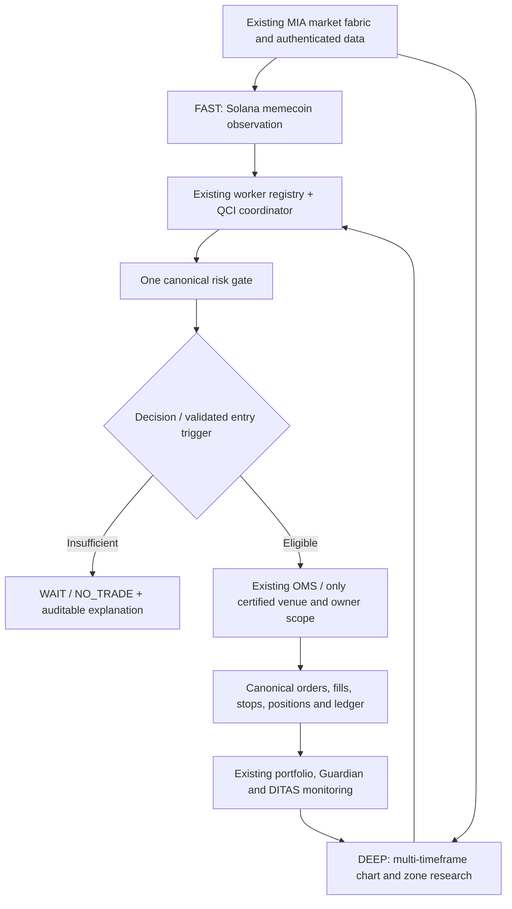

# MIA 5.0 — DEEP PRECISION INTELLIGENCE
## Complete Unified Master Document · Full-Fidelity Source + Architecture + TypeScript + Codex/Claude Prompt

**System:** MIA AI Trading Platform — existing 100-worker, QCI, risk, OMS and portfolio architecture  
**Focus:** FAST Solana memecoin intelligence; **DEEP PRECISION** technical/chart analysis for scalping and day trading across forex, crypto futures, listed futures, stocks and ETFs.  
**Status:** Planning/reference implementation **only**. No GitHub modification, production integration, trading permission, execution or deployment.  
**Document date:** 21 November 2026  
**Source provenance:** `Pasted text(20261121-124221).txt` — 16,899 UTF-8 bytes / 319 source lines.  
**Source SHA-256:** `13cd2400d32b63f72b837922c39c2005b9a9921c1f3ae44800efa05eb44e57fc`  
**Source-fidelity promise:** Every source word and character is preserved in full, without editing, in **Appendix D**, additionally included as the separate `MIA_DPI_ORIGINAL_SOURCE_VERBATIM.txt`. Other parts are new, labeled material.

---

## Navigation

1. [Scope and non-negotiable preservation](#1-scope-and-non-negotiable-preservation)
2. [Unified FAST/DEEP product architecture](#2-unified-fastdeep-product-architecture)
3. [Precise skills and evidence flow](#3-precise-skills-and-evidence-flow)
4. [Existing 100 workers and canonical ownership](#4-existing-100-workers-and-canonical-ownership)
5. [Entry-zone lifecycle, risk and monitoring](#5-entry-zone-lifecycle-risk-and-monitoring)
6. [Market-specific capabilities](#6-market-specific-capabilities)
7. [Delivery roadmap and acceptance](#7-delivery-roadmap-and-acceptance)
8. [Appendix A — Complete Codex × Claude master implementation prompt](#appendix-a--complete-codex--claude-master-implementation-prompt)
9. [Appendix B — Complete TypeScript reference source](#appendix-b--complete-typescript-reference-source)
10. [Appendix C — Full automated reference tests](#appendix-c--full-automated-reference-tests)
11. [Appendix D — Complete original attached text, unedited](#appendix-d--complete-original-attached-text-unedited)

---

## 1. Scope and non-negotiable preservation

**User instruction:** “Can you make a unified docs with typescript and master prompt don't remove any single word copy and paste it to the unified docs”.

- Appendix D contains **the exact full uploaded source**, including its formatting artifacts, original Markdown, punctuation, links, escaped characters and text. It is deliberately not paraphrased, shortened or normalized.
- Appendix A is **new** Codex/Claude implementation guidance. Appendix B is **new** standalone TypeScript. Neither replaces or rewrites the user’s original source.
- Appendix B is a pure decision/evidence *reference*: it **cannot** sign, place orders, reserve balance, adjust risk or call a real exchange. It is not an operational broker adapter.
- The supplied specification accurately says 100% chart prediction/win-rate cannot be guaranteed. Use **complete validation coverage as an engineering target**, not as a prediction-accuracy or live-profitable-performance claim.
- This package has no direct relationship to a production GitHub commit. Prior draft work may exist and must be inspected and reconciled before implementation; nothing here should be pasted over the current OMS or risk gate.

## 2. Unified FAST/DEEP product architecture

| Aspect | FAST / Solana Memecoin Intelligence | DEEP / Multi-Market Precision Intelligence |
| --- | --- | --- |
| Purpose | Spot new time-sensitive token opportunities, reject scams and unexecutable candidates | Read charts, identify high-quality intraday setups and position entry zones |
| Core market scope | Solana token mints/pools, token launch and liquidity events | Forex, crypto futures, listed futures, stocks, ETFs |
| Trading approach | Fast **evaluation**, with mandatory token safety and wallet/security checks | Deep analysis **before** the zone; event-driven confirmation only at the zone |
| Workers | Relevant existing 100-worker roles (no second registry) | Relevant existing structure/indicator/volume/risk/adversarial roles (no second registry) |
| Decision authority | Existing QCI and risk gate | Same existing QCI and risk gate |
| Execution | Existing, certified venue capabilities only | Existing OMS and certified market-specific adapters only |
| Metrics | Safety rejection quality, latency, actual price impact and slippage | Signal calibration, zone precision, expectancy net of costs, risk and drawdown |
| Conservative fallback | WATCH/INSUFFICIENT_DATA/NO_TRADE | OBSERVING/WAIT/NO_TRADE |

**Preserve the distinction:** DEEP chart observation and state transitions are **not** trade authorization. An event-driven trigger must still pass the same canonical risk, account, venue and owner authorization checks as an ordinary MIA order.

## 3. Precise skills and evidence flow

### 3.1 Chart-structure skill

Operate on confirmed native candles, trades, volume and order books where the source supplies them. Detect and explain trend, range, volatility, swing pivots, break of structure, failed breakout, supply/demand, market session context, VWAP and momentum. Mark calculations derived from confirmed closed bars and reject retrospective repainting. Never claim a visual chart screenshot proves order flow.

### 3.2 Institutional-style zone evidence — without false certainty

Emit bounded `[low, high]` candidate zones, direction, invalidation, provisional protective stop and target, expiry, snapshot ID, timeframes, evidence source, strategy ID, expected transaction costs and no-trade conditions. Use stable zone identity and produce a replayable record for later backtesting. A technical zone is a **probabilistic hypothesis**, not a guaranteed fill or trend reversal.

### 3.3 Scalp/day trading control

DEEP does not need to run 100-worker analysis on every tick. Build the chart thesis asynchronously before price reaches the zone. Subscribe to the relevant existing event source for quote/tick changes; once price enters the zone, require the predeclared structure-rejection/confirmation trigger, verify all evidence is unexpired, and request fresh canonical risk authorization **before** placing any eligible order. A stale confirmation or elevated spread cancels or invalidates the setup.

### 3.4 Evidence graph and independence

The 100-worker roster is an existing system of roles. Work allocation is conditional on instrument capabilities, data coverage and an enforced compute budget; do not demand all 100 evaluate each opportunity. Workers must declare `workerId`, domain, source/evidence identity, timestamp, coded reasoning, uncertain results and vetoes. Independent QCI analysis must reject duplicate workers and shared-source vote inflation.

### 3.5 Conservative result semantics

A successful TypeScript preflight result means **only that the proposed zone is structurally plausible under provided evidence**. The reference code always returns `canAuthorizeTrade: false` and `canSubmitOrder: false`. It must not be connected to live signing or a broker order path as an authority source.

## 4. Existing 100 workers and canonical ownership

| Existing canonical concern | Preserve / extend | Do not create |
| --- | --- | --- |
| Market data, sessions and source timestamps | Existing market fabric and provider validation | Second data fabric or imaginary volume |
| THINK adaptive route | Existing FAST/DEEP/AUTO router proposal, when actually integrated | Parallel unrelated reasoning controller |
| Worker membership and execution budget | Existing worker registry and scheduler | A second 100-worker registry |
| Consensus and adversarial challenge | Existing QCI coordinator and challenge pipeline | Duplicate majority vote or fake certainty |
| Signals and trading decisions | Existing decision engine and strategy-lab policy | AI-only permission to buy/sell |
| Individual and portfolio exposure | Existing risk gate, portfolio ledger, policy and correlation | Alternative sizing/ledger/position truth |
| Order creation, fills, protective stops | Existing OMS and certified venue adapters | Duplicate order engine or fabricated fills |
| Audit, failure recovery, emergency | Existing Guardian Shield, runtime lease and release gates | A bypass path via DEEP or model confidence |
| Outcome attribution and refinement | Existing DITAS and documented evaluation methodology | Self-modifying live strategy without approval |

**Implementation workflow:** Inventory exact repository files and open PR dependencies; identify `EXISTS / PARTIAL / DRAFT / GAP / NOT_CERTIFIED`; merge **only missing behavior** into the authoritative owner. Never erase source data or weaken core controls.

## 5. Entry-zone lifecycle, risk and monitoring

### 5.1 Suggested lifecycle

`OBSERVING → ZONE_IDENTIFIED → ARMED → TRIGGER_CONFIRMED → RISK_AUTHORIZED → SUBMISSION → ACKNOWLEDGED/FILLED → POSITION_MONITORING → CLOSED`

Exceptional states: `EXPIRED`, `INVALIDATED`, `RISK_DENIED`, `UNKNOWN_EXECUTION`, `RECONCILIATION_REQUIRED`. Receipt ACK does not mean FILLED. Paper and LIVE do not share account identities. No guessed fills or blind retries of unknown submissions.

### 5.2 Core invariants

1. Every zone references a point-in-time immutable snapshot and confirmed non-repainting bars.
2. Session, tick/lot, contract, short permission, margin and market halt rules are market-specific and enforced by the appropriate existing owner.
3. A QCI veto, expired consensus or stale quote cannot be converted into an ALLOW by a worker score.
4. A candidate zone is not an order; a trigger is not a fill; a simulated stop is not exchange-native protection.
5. Each authorization has explicit strategy, instrument, account, market, venue, capped spend/risk, expiry and audit identity. The account and risk owner perform last-moment revalidation.
6. Missing order book, absent session data, stale spread, uncertain volume or unknown broker capabilities require an honest RESEARCH_ONLY / NO_TRADE status.
7. Order and fill reconciliation must be based on authoritative broker/venue receipts and trade data, not synthetic DEEP outputs.
8. Capital, risk and position limits apply equally in DEMO/PAPER and any separately certified LIVE execution, with additional live signing, credential and venue safeguards.

### 5.3 Precision accuracy measurement

| Evaluation | Grounded measure |
| --- | --- |
| Data validation | Required field/source/age validation coverage; goal 100% of emitted decisions checked |
| Signal forecasting | Out-of-sample calibration, precision/recall, confidence reliability |
| Zone selection | Distance to entry, zone touches, trigger rate, no-trade and missed-entry rate |
| Execution realism | Broker spread, slippage, partial fill, volatility, fees, borrow/funding and market impact |
| Portfolio quality | Net expectancy, drawdown, risk-adjusted outcomes, correlation and regime stability |
| Model improvement | Walk-forward robustness, no future data leakage, post-trade DITAS reviews |

## 6. Market-specific capabilities

| Market | Additional must-have data and constraints |
| --- | --- |
| OTC forex | Session and holiday calendars, pip/pipette sizing, broker spread/markup, conversion rates, overnight swaps, economic events, leverage, broker execution semantics; no centralized OTC spot volume guarantee |
| Exchange-listed futures | Contract month, tick/multiplier, margin, exchange/maintenance session, roll/expiry, liquidity and settlement/delivery risk |
| Crypto futures | Mark/index price, liquidation, funding, open interest, risk tier, exchange margin and liquidation protection |
| Stocks | Trading halts, sessions, corporate actions, adjusted historical prices, borrow/short restrictions, earnings and liquidity |
| ETFs | Exchange rules plus underlying holdings, concentration, creation/redemption-related liquidity, premiums/discounts and correlated exposure |

**Capability rule:** A market may be visible for analysis before an actual authenticated and certified execution adapter exists. No design/type declaration alone proves live support.

## 7. Delivery roadmap and acceptance

**Phase 0 — Complete repository/PR inventory:** Read authoritative code and original 319-line source; identify existing, draft and missing coverage; record migration conflicts and negative interactions.

**Phase 1 — Read-only DEEP chart science:** Add point-in-time market-structure, timeframes, zone generation and explanations to existing owners without order authorization.

**Phase 2 — Worker/QCI coordination:** Extend current 100-worker roles with verified evidence attribution, source-independence checks and adversarial objections. Validate worker count/coverage in actual registry.

**Phase 3 — Replay, shadow, backtest:** Run systematic walk-forward tests, adverse event simulation, slippage and overfitting checks. Publish metrics, not promotional guarantees.

**Phase 4 — PAPER and asset-class adapters:** Only add certified market-specific capabilities, and share current risk logic with existing execution paths. Do not add artificial fills, concurrent ledgers or unsanctioned short/leverage behavior.

**Phase 5 — LIVE, separate authorization:** Secure signer/venue adapters, independent security review, audit integrity, all release gates, owner-bounded grants, reconciliation and canary tests. No auto-unlock.

**Acceptance:** Strict TypeScript compilation, deterministic offline tests, actual MIA integration tests (when separately authorized), data provenance checks, no lookahead, no duplicate worker influence, no model permission escalation, all existing functionality intact, and independent trading-risk acceptance before any LIVE activation.

---

## Appendix A — Complete Codex × Claude master implementation prompt

The entire standalone master prompt is copied below without omitting a line.

~~~~~markdown
# MIA DEEP PRECISION INTELLIGENCE — CODEX × CLAUDE MASTER IMPLEMENTATION PROMPT

**Status:** Planning and implementation instructions for future use. This prompt alone does not modify a repository or permit order execution.

## Assignment and non-negotiable source fidelity

You are a coordinated senior engineering team specializing in market microstructure, algorithmic trading, statistical research, market data infrastructure, software safety, TypeScript, testing, and secure deployment. Your task is to enhance the EXISTING MIA platform for two specialist intelligence lanes: FAST Solana memecoin discovery and DEEP PRECISION chart analysis for scalping/day trading in forex, traditional futures, crypto futures, stocks, and ETFs.

Read the **ENTIRE** accompanying source verbatim before proposing a change. Preserve EVERY original word in the archived source appendix. Do NOT paraphrase, delete, shorten, replace, or silently edit that original appendix. New designs, corrections, clarifications, code, and risk qualifications must appear in **separate, clearly identified sections**. A 100% trading-win-rate claim is neither feasible nor an acceptance criterion; the source explicitly calls for measured, out-of-sample accuracy and risk-adjusted performance.

Do not make unapproved GitHub, database, deployment, wallet, exchange, or live-account changes merely because this master prompt was provided. If a later task explicitly authorizes code changes, use a focused branch and a reviewable PR; respect the actual repository's tooling and CI.

## Priority order

1. **Safety and fidelity:** Preserve existing features and tests, existing G01–G14 release gates, credentials and risk authority. Never invent market data, fills, account balances or trading performance.
2. **Inventory before coding:** Inspect the current repository/branch/PR dependency graph and record `EXISTS`, `PARTIAL`, `DRAFT`, `GAP`, or `NOT_CERTIFIED` for every feature before opening a new file. Existing PRs are NOT shipped functionality.
3. **Canonical ownership:** Use MIA's current market data fabric, worker registry (100 existing roles), QCI coordinator, THINK router, decision engine, risk/gate.ts, policy, OMS, canonical ledger, Guardian Shield, DITAS and singleton runtime lease. Never write a second competing owner.
4. **DEEP precision skill:** Build truthful, testable chart structure and zone proposals using non-repainting native time-series data, not screenshots or hallucinated order flow.
5. **Multi-market realism:** Each adapter must be certified for its asset class and market, with its own calendar, tick size, price units, costs, margin/position rules, contract specifications and protections.
6. **Incremental deployment:** Deterministic read-only observability → research/shadow validation → DEMO/PAPER after authorization → internal isolated validation → LIVE only if all security and release evidence actually passes.

## Required feature identification matrix

For each item below, output: requirement ID; current path/PR; what it really does today; missing capabilities; authoritative owner; whether to EXTEND/REUSE/IMPLEMENT; test files; blockers; and risk of migration/merge conflicts:

- DPI-01 FAST versus DEEP routing (retain existing FAST Solana specialization).
- DPI-02 Native multi-market candle/quote/book ingestion and timestamp provenance.
- DPI-03 Confirmed non-repainting swing highs/lows, structure and trend changes.
- DPI-04 Session-aware support/resistance, supply/demand, liquidity zones and VWAP.
- DPI-05 Volatility, volume, momentum and order-flow evidence (where actually available).
- DPI-06 Multi-timeframe trend, conflict detection and deterministic challenge.
- DPI-07 Existing 100-worker assignment, reporting and independence de-duplication.
- DPI-08 Existing QCI synthesis, vetoes, uncertainty and missing-data outcomes.
- DPI-09 Validated precision-entry zone creation, trigger, invalidation and expiry.
- DPI-10 Existing canonical risk gate and aggregate multi-market exposure policy.
- DPI-11 Durable zone watch, event-driven trigger evaluation and audit state machine.
- DPI-12 Existing OMS/wallet/venue adapters, stops, execution receipts and unknown-state recovery.
- DPI-13 Forex pair/session/pip/currency-event/broker precision rules.
- DPI-14 Futures contract/tick/multiplier/expiry/roll/margin/liquidation rules.
- DPI-15 Crypto futures funding/mark-index/basis/open-interest/leverage rules.
- DPI-16 Equity/ETF corporate actions, holidays, market halts and holdings exposure.
- DPI-17 Point-in-time backtesting and walk-forward/out-of-sample validity.
- DPI-18 Calibration, entry-zone precision, expectancy, slippage and DITAS outcome attribution.
- DPI-19 Guardian emergency controls, owner approval, G01–G14 and LIVE certification.
- DPI-20 UI/portfolio/Trader Joe explanation of proposed zones and trade lifecycle.

Do not equate an indicator library with a complete verified strategy. Report status truthfully; never claim a provider or live brokerage integration is operational without observed evidence.

## Architecture: extend, do not replace

### Lane responsibilities

**FAST:** Scoped to Solana memecoin discovery, launch intelligence, liquidity/token-safety checks, time-sensitive watchlists and execution proposals. Retain required security and risk review. FAST is not an excuse to skip mandatory checks or sign real-money transactions.

**DEEP PRECISION:** Scoped to multi-market chart interpretation, scalping, intraday/day trading, liquidity/entry-zone analysis, multi-timeframe confluence, adversarial review, macro/asset-class context, durable watch states and execution-feasibility research. DEEP analysis occurs before a zone touch. An event-driven trigger can act quickly **only after** a valid, unexpired risk authorization and independent last-moment checks. DEEP does not guarantee latency or price accuracy.

### Existing 100-worker coordination

Reuse the existing registry, don't spawn a second 100-worker ensemble. For each request, select relevant existing specialist IDs; validate permissions and data requirements; ask workers for structured packets containing domain, non-duplicated source groups, event/closed-bar time, rationale, missing evidence, veto and uncertainty. Count **independent evidence domains**, not merely supportive workers. Required adversarial challenge must be represented. Existing QCI remains the only coordinator and consensus owner.

### Canonical price-zone workflow

`OBSERVING → ZONE_IDENTIFIED → ARMED → TRIGGER_CONFIRMED → RISK_AUTHORIZED → SUBMISSION → ACKNOWLEDGED/FILLED → POSITION_MONITORING → CLOSED`

Other states: `EXPIRED`, `INVALIDATED`, `RISK_DENIED`, `UNKNOWN_EXECUTION`, `RECONCILIATION_REQUIRED`. Never label an order filled merely because a trigger was detected or an API timed out. In LIVE, a state must be verified against venue receipts/trades with idempotent account-scoped keys.

A zone includes: instrument + venue + market, direction, strategy/timeframes, low/high boundary, closed-bar observation timestamp, snapshot ID, invalidation, stop, target, bid/ask execution requirement, expected cost, confidence/uncertainty (properly calibrated if probability), expiry and provenance. All amounts, tick rules and stop sides must follow market-specific capabilities; no synthetic long/short support is assumed.

### Market-specific adaptations

- **Forex:** session calendar (including holidays), pricing/pip convention, spread, FX conversion, leverage/broker limits and economic-event blackout policy; account for no centralized exchange book in spot OTC FX.
- **Listed futures:** contract month, exchange calendar and maintenance window, minimum tick/tick value/multiplier, contract rollover, price limits, fees, margin and expiration/delivery risk.
- **Crypto futures:** perpetual vs dated, index/mark price, funding and liquidation constraints, venue-specific margin and allowable leverage, and platform safety rules.
- **Stocks and ETFs:** adjusted corporate-action history, session/halts, exchange minimum increments, locate/shorting availability if applicable, ETF liquidity and concentrated/overlapping underlying exposures.

### Precision without fabricated accuracy

Do not target a purported 100% winning-trade model. Instead measure calibrated forecasts, threshold-adjusted signal precision/recall, zone touch and confirmation rates, expected vs actual entry slippage, R-multiple distribution, downside tail, drawdown, average net expectancy and degradation across market regimes. Use point-in-time provenance and strict chronological data separation to avoid look-ahead, overfitting and retrospective repainting.

An apparent high win rate is not proof of profitable trading. Verify transaction fees, borrow/funding costs, spreads, margin utilization, exposure and market impact.

## TypeScript reference integration rules

The accompanying `MIA_DPI_REFERENCE_ARCHITECTURE.ts` is a **pure reference** with deterministic evidence/zone validation and zero order authorization. It is not an import-ready replacement for MIA's production types, QCI, risk, worker registry, OMS or gateway.

When later authorized to code:

1. Audit existing canonical types and choose safe aliases/adapters. If equivalent fields exist, **map into the existing owner** rather than duplicate.
2. Extend the existing THINK route with DEEP multi-market strategy eligibility (the baseline FAST route for Solana remains intact). Keep NO_TRADE and adversarial veto paths.
3. Implement price-zone research using native confirmed candles/trades and immutable provenance; separate observation from actual broker order placement.
4. Reuse QCI decisions and existing `evaluateRisk()` for all account/risk decisions. An AI model has **no authority** to change risk limits, position size or order permissions.
5. Add only missing market-specific capability adapters; emit `UNSUPPORTED` when a contract, calendar, data feed, sell/short allowance, margin rule or signer is unavailable.
6. Add a durable, owned state transition/audit trail with crash-safe replay. For live, unknown execution outcome always requires reconciliation, never blind duplicate submission.
7. Integrate zone visibility into existing MIA chart/trading/portfolio pages, with accurate `PAPER` and `LIVE_LOCKED` labels and human-readable evidence/uncertainty.
8. Keep historic original text verbatim and document exact diffs/requirements matched; never overwrite the original prompt or TypeScript source.

## Mandatory tests

- Pure TypeScript strict compilation and deterministic state tests; incorrect directions, ticks, zones, stops or targets fail closed.
- Correct worker-ID validation against the existing registry; duplicated workers or common-source opinions cannot inflate quorum.
- No forward-dated bar, stale data, missing source or missing/contradictory multi-timeframe evidence passes.
- Existing canonical QCI/risk DENY is never transformed into ALLOW by chart confidence.
- Entry trigger must be confirmed, unexpired and tied to the exact snapshot/zone/strategy. A trigger cannot reuse stale authorization.
- Market-session halts, major economic-event restrictions, futures roll/expiry, funding/margin deficiency and shorting restrictions are enforced by the appropriate owner.
- Price-zone quality is tested with walk-forward splits, holdouts, transaction costs, slippage, regime-specific calibration and non-repainting signals.
- No orphaned order/fill/position/stop, no self-authorized signer or LIVE mode bypass, no duplicate client-order IDs, and no fabricated exit fills.
- Existing test suite, API authentication/step-up, Guardian pause, audit, ledger reconciliation, portfolio, and release gates remain green.
- Before a merge, pass the repository's actual CI and require independent financial/trading/security review for changes to live execution.

## Phased roadmap and acceptance

**P0 — Inventory and preservation:** Verify exact repo branches and features, archive the original complete source, map source→module ownership and identify migration overlap. No financial changes.

**P1 — Read-only research:** Add DEEP market/structure/timeframe/zone evidence through existing market fabric/decision routes; show zones in the current UI. No execution.

**P2 — 100-worker QCI extensions:** Map existing worker roles, add evidence/independence domain fields if missing, enforce uncertainty/adversarial challenge; test in shadow mode.

**P3 — Replay and DEMO:** Validate non-repainting zones and historical behavior; integrate with existing paper OMS only after account and execution semantics have been verified. Maintain FAST/DPI equivalence of core safety rules.

**P4 — Market-specific adapters:** Support forex, listed futures, crypto futures, equities and ETFs as their data, contract rules, broker and account integrations are actually certified. Unsupported markets remain observations.

**P5 — LIVE readiness (separate explicit release):** Only after isolated signer, venue adapter, full G01–G14, owner grants, security assessment, reconciliation and canary tests. Do NOT claim this master prompt certifies or unlocks live trading.

## Deliverables from a later approved coding task

A) Audit table of EXISTING/PARTIAL/DRAFT/GAP by exact canonical path and PR dependency.  
B) Minimal change plan preserving all current features and every original source word.  
C) TypeScript implementations integrated into existing owners only (no duplicate manager).  
D) Updated unit, integration, browser, backtesting and recovery/failure-mode tests.  
E) Documentation with source provenance, architecture, risk invariants and honest environment availability.  
F) Reviewable PR with exact build SHA and CI evidence; no merge or deployment absent user authorization and required safety acceptance.

## Final engineering standard

Build a unique, explainable **DEEP PRECISION** system through market structure, multi-timeframe evidence, relevant existing specialists, confirmable zone triggers, independent challenge, execution feasibility and a **single** canonical risk authority. Preserve FAST's original Solana memecoin specialization. Optimize for evidence quality and net risk-adjusted outcomes; abstain when uncertain. Make no claim that a model can predict or win 100% of trades.
~~~~~

---

## Appendix B — Complete TypeScript reference source

The entire standalone TypeScript source follows. It compiles strictly and **has no order/signing permissions**.

~~~~~typescript
/**
 * MIA 5.x — DEEP PRECISION INTELLIGENCE
 * Standalone, pure TypeScript design reference. NOT a trading engine.
 *
 * Intended integration: adapt into MIA's EXISTING THINK router, 100-worker
 * registry, canonical QCI, market fabric, risk gate, decision engine and OMS.
 * Do not install a competing risk authority or permit this module to trade.
 *
 * No financial returns, signal accuracy or fill prices are guaranteed.
 */

export type Market = 'FOREX' | 'CRYPTO_FUTURES' | 'LISTED_FUTURES' | 'STOCK' | 'ETF';
export type TradingStyle = 'SCALPING' | 'DAY_TRADING';
export type TradingLane = 'FAST' | 'DEEP' | 'NO_TRADE';
export type Bias = 'LONG' | 'SHORT' | 'NO_TRADE';
export type WorkerDomain =
  | 'STRUCTURE' | 'MULTITIMEFRAME' | 'LIQUIDITY_ZONES' | 'MOMENTUM'
  | 'VOLUME_FLOW' | 'VOLATILITY' | 'MACRO_SESSION' | 'FUTURES_CONTRACT'
  | 'EQUITY_ETF' | 'PORTFOLIO_RISK' | 'ADVERSARIAL';
export type SignalState = 'NO_TRADE' | 'OBSERVING' | 'ZONE_IDENTIFIED'
  | 'ARMED' | 'TRIGGER_CONFIRMED';
export type TradeLifecycle = 'OBSERVING' | 'ZONE_IDENTIFIED' | 'ARMED'
  | 'TRIGGER_CONFIRMED' | 'RISK_AUTHORIZED' | 'SUBMISSION'
  | 'ACKNOWLEDGED' | 'FILLED' | 'POSITION_MONITORING' | 'CLOSED'
  | 'EXPIRED' | 'INVALIDATED' | 'RISK_DENIED' | 'UNKNOWN_EXECUTION'
  | 'RECONCILIATION_REQUIRED';

export interface MarketCapability {
  market: Market;
  instrumentId: string;
  venueId: string;
  tickSize: number;
  sessionOpen: boolean;
  halted: boolean;
  /** Trusted backend provider, not browser input. */
  sourceVerified: boolean;
  /** A short setup cannot be sent if the venue cannot represent it. */
  supportsShort: boolean;
  /** Whether the real venue offers executable market/order-book evidence. */
  executableDepthAvailable: boolean;
  /** Broker/venue settlement and margin checks belong to canonical risk. */
  certifiedExecution: boolean;
}

export interface ChartSnapshot {
  snapshotId: string;
  asOfMs: number;
  lastConfirmedBarCloseMs: number;
  /** From trusted, native market data—not pixels inferred from a chart screenshot. */
  price: number;
  spreadBps: number | null;
  expectedSlippageBps: number | null;
  feedQuality: 'PASS' | 'REVIEW' | 'FAIL';
  sourceIds: readonly string[];
  sessionName?: string;
  timeframeAlignment: 'ALIGNED' | 'CONFLICT' | 'UNKNOWN';
  crossTimeframeTrend: 'UP' | 'DOWN' | 'RANGE' | 'UNKNOWN';
}

/** Candidate zones are hypotheses; none represents an authorized limit order. */
export interface PriceZone {
  zoneId: string;
  instrumentId: string;
  bias: Exclude<Bias, 'NO_TRADE'>;
  strategyId: string;
  style: TradingStyle;
  low: number;
  high: number;
  invalidationPrice: number;
  protectiveStop: number;
  proposedTarget: number;
  createdAtMs: number;
  expiresAtMs: number;
  /** Must be supported by closed bars and immutable market evidence. */
  observedOnConfirmedBars: boolean;
  evidenceSnapshotId: string;
}

export interface WorkerPacket {
  /** From existing registry, never construct another 100-member registry. */
  workerId: string;
  domain: WorkerDomain;
  independenceGroup: string;
  sourceIds: readonly string[];
  evidenceAtMs: number;
  view: 'SUPPORT' | 'CHALLENGE' | 'ABSTAIN';
  hardVeto: boolean;
  /** Only calibrated estimates may be called probabilities; no score here. */
  rationaleCode: string;
}

/** Must come from existing QCI coordinator—do not recalculate quorum here. */
export interface CanonicalQciEvidence {
  decisionId: string;
  state: 'PASS' | 'REVIEW' | 'VETO' | 'EXPIRED';
  version: string;
  expiresAtMs: number;
  hardVetoPresent: boolean;
  mandatoryDomainsCovered: boolean;
}

/** Actual risk permission must come from MIA's canonical risk/gate.ts. */
export interface CanonicalRiskEvidence {
  decision: 'ALLOW' | 'DENY' | 'NEEDS_REVIEW';
  policyVersion: number | null;
  reasonCodes: readonly string[];
  evaluatedAtMs: number;
  /** This is evidence, never trading authority granted by this module. */
}

export interface TriggerObservation {
  atMs: number;
  price: number;
  /** Confirmed closed-bar or native tick signal; must be independently sourced. */
  confirmed: boolean;
  sourceSnapshotId: string;
  /** Backend applies market-specific structure break/rejection rules. */
  canonicalTriggerPassed: boolean;
}

export interface DpiSettings {
  maxSnapshotAgeMs: number;
  maxWorkerEvidenceAgeMs: number;
  maxTriggerAgeMs: number;
  maxSpreadBps: number;
  maxExpectedSlippageBps: number;
  minimumIndependentDomains: number;
  /** Required worker identities MUST exist in MIA's own registry. */
  registeredWorkerIds: readonly string[];
  /** Whether this precise strategy is enabled in the existing strategy lab. */
  strategyEnabled: boolean;
}

export interface PrecisionInput {
  lane: TradingLane;
  nowMs: number;
  capability: MarketCapability;
  snapshot: ChartSnapshot;
  zone: PriceZone;
  packets: readonly WorkerPacket[];
  qci: CanonicalQciEvidence;
  risk: CanonicalRiskEvidence;
  trigger: TriggerObservation | null;
  settings: DpiSettings;
}

export interface PrecisionAssessment {
  version: 'mia-dpi-reference-v1';
  signalState: SignalState;
  zoneId: string;
  instrumentId: string;
  /** Advisory only; ALWAYS false, regardless of risk/trigger outcome. */
  canAuthorizeTrade: false;
  canSubmitOrder: false;
  reasons: readonly string[];
  observed: {
    zoneTouched: boolean;
    confirmedTrigger: boolean;
    independentDomains: number;
    seenWorkers: number;
    expectedRewardRiskAtWorstZoneEdge: number | null;
    spreadBps: number | null;
    quoteAgeMs: number | null;
  };
  nextStep: 'NO_TRADE' | 'WAIT' | 'REQUEST_CANONICAL_RECHECK';
}

const finitePositive = (value: number): boolean => Number.isFinite(value) && value > 0;
const within = (v: number, lo: number, hi: number): boolean => v >= lo && v <= hi;
const finiteAge = (ts: number, now: number): number | null =>
  Number.isSafeInteger(ts) && ts > 0 && Number.isSafeInteger(now) && now > 0 && ts <= now
    ? now - ts : null;

/** Strictly a deterministic evidence check: a passing result NEVER creates an order. */
export function assessPrecisionZone(input: Readonly<PrecisionInput>): PrecisionAssessment {
  const { zone, capability, snapshot, nowMs, settings, qci, risk, trigger, packets } = input;
  const reasons: string[] = [];
  const deny = (code: string) => { if (!reasons.includes(code)) reasons.push(code); };
  const quoteAge = finiteAge(snapshot.asOfMs, nowMs);
  let independentDomains = 0;

  if (input.lane !== 'DEEP') deny('DEEP_LANE_REQUIRED');
  if (zone.instrumentId !== capability.instrumentId) deny('INSTRUMENT_MISMATCH');
  if (!capability.sourceVerified) deny('UNVERIFIED_MARKET_PROVIDER');
  if (!capability.sessionOpen || capability.halted) deny('MARKET_CLOSED_OR_HALTED');
  if (zone.bias === 'SHORT' && !capability.supportsShort) deny('SHORT_NOT_SUPPORTED');
  if (!finitePositive(capability.tickSize)) deny('INVALID_TICK_SIZE');
  if (!finitePositive(zone.low) || !finitePositive(zone.high) || zone.low > zone.high)
    deny('INVALID_PRICE_ZONE');
  if (!finitePositive(zone.protectiveStop) || !finitePositive(zone.proposedTarget) ||
      !finitePositive(zone.invalidationPrice)) deny('INVALID_PROTECTION_OR_TARGET');
  if (zone.bias === 'LONG' &&
      (!(zone.protectiveStop < zone.low) || !(zone.proposedTarget > zone.high) ||
       !(zone.invalidationPrice < zone.low))) deny('INVALID_LONG_GEOMETRY');
  if (zone.bias === 'SHORT' &&
      (!(zone.protectiveStop > zone.high) || !(zone.proposedTarget < zone.low) ||
       !(zone.invalidationPrice > zone.high))) deny('INVALID_SHORT_GEOMETRY');
  if (!Number.isSafeInteger(zone.createdAtMs) || zone.createdAtMs > nowMs ||
      !Number.isSafeInteger(zone.expiresAtMs) || zone.expiresAtMs <= zone.createdAtMs ||
      nowMs >= zone.expiresAtMs) deny('ZONE_EXPIRED_OR_INVALID_TIME');
  if (!zone.observedOnConfirmedBars ||
      snapshot.lastConfirmedBarCloseMs > nowMs ||
      snapshot.lastConfirmedBarCloseMs <= 0 ||
      snapshot.lastConfirmedBarCloseMs > snapshot.asOfMs ||
      zone.evidenceSnapshotId !== snapshot.snapshotId)
    deny('UNCONFIRMED_OR_UNMATCHED_CHART_EVIDENCE');
  if (!finitePositive(snapshot.price)) deny('INVALID_MARKET_PRICE');
  if (quoteAge === null || quoteAge > settings.maxSnapshotAgeMs)
    deny('STALE_OR_FUTURE_DATED_MARKET_SNAPSHOT');
  if (snapshot.feedQuality !== 'PASS' || snapshot.sourceIds.length === 0)
    deny('INCOMPLETE_MARKET_EVIDENCE');
  if (snapshot.timeframeAlignment !== 'ALIGNED' || snapshot.crossTimeframeTrend === 'UNKNOWN')
    deny('MULTITIMEFRAME_CONFLICT_OR_UNKNOWN');
  if (snapshot.spreadBps === null || !Number.isFinite(snapshot.spreadBps) ||
      snapshot.spreadBps < 0 || snapshot.spreadBps > settings.maxSpreadBps)
    deny('UNACCEPTABLE_OR_UNKNOWN_SPREAD');
  if (snapshot.expectedSlippageBps === null || !Number.isFinite(snapshot.expectedSlippageBps) ||
      snapshot.expectedSlippageBps < 0 || snapshot.expectedSlippageBps > settings.maxExpectedSlippageBps)
    deny('UNACCEPTABLE_OR_UNKNOWN_SLIPPAGE');
  if (!settings.strategyEnabled) deny('STRATEGY_DISABLED');
  if (!Number.isSafeInteger(settings.minimumIndependentDomains) || settings.minimumIndependentDomains < 2)
    deny('INVALID_WORKER_QUORUM_POLICY');
  if (!Number.isSafeInteger(settings.maxSnapshotAgeMs) || settings.maxSnapshotAgeMs < 1 ||
      !Number.isSafeInteger(settings.maxWorkerEvidenceAgeMs) || settings.maxWorkerEvidenceAgeMs < 1 ||
      !Number.isSafeInteger(settings.maxTriggerAgeMs) || settings.maxTriggerAgeMs < 1 ||
      !Number.isFinite(settings.maxSpreadBps) || settings.maxSpreadBps < 0 ||
      !Number.isFinite(settings.maxExpectedSlippageBps) || settings.maxExpectedSlippageBps < 0)
    deny('INVALID_PRECISION_SETTINGS');

  const registered = new Set(settings.registeredWorkerIds);
  if (!registered.size) deny('MIA_WORKER_REGISTRY_UNAVAILABLE');
  const seenWorkers = new Set<string>();
  const acceptedDomains = new Set<WorkerDomain>();
  const independenceGroups = new Set<string>();
  let adversarialPresent = false;
  for (const p of packets) {
    if (seenWorkers.has(p.workerId)) { deny('DUPLICATED_WORKER_ID'); continue; }
    seenWorkers.add(p.workerId);
    if (!registered.has(p.workerId)) { deny('UNKNOWN_WORKER_ID'); continue; }
    const age = finiteAge(p.evidenceAtMs, nowMs);
    if (age === null || age > settings.maxWorkerEvidenceAgeMs ||
        !p.independenceGroup || !p.rationaleCode || !p.sourceIds.length) {
      deny('WORKER_EVIDENCE_INCOMPLETE_OR_STALE'); continue;
    }
    if (p.hardVeto) deny('WORKER_HARD_VETO');
    // Multiple workers sharing a common evidence source cannot inflate quorum.
    if (independenceGroups.has(p.independenceGroup)) continue;
    independenceGroups.add(p.independenceGroup);
    acceptedDomains.add(p.domain);
    if (p.domain === 'ADVERSARIAL') adversarialPresent = true;
  }
  independentDomains = acceptedDomains.size;
  if (independentDomains < settings.minimumIndependentDomains ||
      !acceptedDomains.has('STRUCTURE') || !acceptedDomains.has('MULTITIMEFRAME') ||
      !adversarialPresent) deny('INSUFFICIENT_INDEPENDENT_WORKER_COVERAGE');
  if (qci.state !== 'PASS' || qci.hardVetoPresent || !qci.mandatoryDomainsCovered ||
      !qci.decisionId || qci.expiresAtMs <= nowMs)
    deny('CANONICAL_QCI_NOT_APPROVED');
  if (risk.decision !== 'ALLOW' || risk.policyVersion === null ||
      risk.reasonCodes.length > 0 || finiteAge(risk.evaluatedAtMs, nowMs) === null)
    deny('CANONICAL_RISK_NOT_ALLOW');

  const reward = zone.bias === 'LONG'
    ? zone.proposedTarget - zone.high : zone.low - zone.proposedTarget;
  const loss = zone.bias === 'LONG'
    ? zone.high - zone.protectiveStop : zone.protectiveStop - zone.low;
  const rr = finitePositive(loss) && Number.isFinite(reward) && reward > 0
    ? Number((reward / loss).toFixed(6)) : null;
  if (rr === null) deny('REWARD_RISK_NOT_COMPUTABLE');
  const touched = finitePositive(snapshot.price) &&
    finitePositive(zone.low) && finitePositive(zone.high) &&
    within(snapshot.price, zone.low, zone.high);
  let triggerConfirmed = false;
  if (trigger) {
    const triggerAge = finiteAge(trigger.atMs, nowMs);
    triggerConfirmed = trigger.confirmed && trigger.canonicalTriggerPassed &&
      trigger.sourceSnapshotId === snapshot.snapshotId && triggerAge !== null &&
      triggerAge <= settings.maxTriggerAgeMs && touched;
    if (trigger.canonicalTriggerPassed && !triggerConfirmed)
      deny('UNVERIFIED_OR_STALE_TRIGGER');
  }
  const state: SignalState = reasons.length ? 'NO_TRADE'
    : triggerConfirmed ? 'TRIGGER_CONFIRMED'
      : touched ? 'ARMED' : 'ZONE_IDENTIFIED';
  return {
    version: 'mia-dpi-reference-v1', signalState: state,
    zoneId: zone.zoneId, instrumentId: zone.instrumentId,
    canAuthorizeTrade: false, canSubmitOrder: false, reasons,
    observed: {
      zoneTouched: touched, confirmedTrigger: triggerConfirmed,
      independentDomains, seenWorkers: seenWorkers.size,
      expectedRewardRiskAtWorstZoneEdge: rr,
      spreadBps: snapshot.spreadBps, quoteAgeMs: quoteAge,
    },
    nextStep: reasons.length ? 'NO_TRADE'
      : triggerConfirmed ? 'REQUEST_CANONICAL_RECHECK' : 'WAIT',
  };
}

/** Explicitly abstains if automated order authorization has not been separately certified. */
export function describeExecutionBoundary(input: Readonly<PrecisionAssessment>) {
  return {
    chartAssessment: input.signalState,
    recommendedNextStep: input.nextStep,
    policy: 'CANONICAL_MIA_DECISION_QCI_RISK_OMS_AND_OWNER_AUTHORITY_ONLY' as const,
    canSign: false as const,
    canPlaceLiveOrder: false as const,
    canPlaceDemoOrder: false as const,
    note: 'This architecture reference observes and proposes; it neither allocates funds nor submits orders.' as const,
  };
}
~~~~~

---

## Appendix C — Full automated reference tests

This standalone Node test suite covers 15 safe reference conditions. It is not a MIA integration test.

~~~~~javascript
'use strict';
const assert = require('node:assert/strict');
const { test } = require('node:test');
const {assessPrecisionZone, describeExecutionBoundary} = require('./build/MIA_DPI_REFERENCE_ARCHITECTURE.js');
const now = 1800000000000;
function fixture() {
 const worker = (workerId,domain,independenceGroup) => ({workerId,domain,independenceGroup,sourceIds:['independent:'+independenceGroup],evidenceAtMs:now-100,view:'SUPPORT',hardVeto:false,rationaleCode:'SOURCED'});
 return {
  lane:'DEEP', nowMs:now,
  capability:{market:'FOREX',instrumentId:'FX:EURUSD',venueId:'broker-practice',tickSize:0.0001,sessionOpen:true,halted:false,sourceVerified:true,supportsShort:true,executableDepthAvailable:true,certifiedExecution:false},
  snapshot:{snapshotId:'snap-1',asOfMs:now-200,lastConfirmedBarCloseMs:now-1500,price:1.0842,spreadBps:1,expectedSlippageBps:2,feedQuality:'PASS',sourceIds:['quote+bar'],timeframeAlignment:'ALIGNED',crossTimeframeTrend:'UP'},
  zone:{zoneId:'zone-1',instrumentId:'FX:EURUSD',bias:'LONG',strategyId:'intraday-pullback',style:'DAY_TRADING',low:1.084,high:1.0845,invalidationPrice:1.0838,protectiveStop:1.0835,proposedTarget:1.087,createdAtMs:now-100000,expiresAtMs:now+100000,observedOnConfirmedBars:true,evidenceSnapshotId:'snap-1'},
  packets:[worker('w1','STRUCTURE','source-a'),worker('w2','MULTITIMEFRAME','source-b'),worker('w3','ADVERSARIAL','source-c')],
  qci:{decisionId:'d1',state:'PASS',version:'x',expiresAtMs:now+10000,hardVetoPresent:false,mandatoryDomainsCovered:true},
  risk:{decision:'ALLOW',policyVersion:1,reasonCodes:[],evaluatedAtMs:now-100},
  settings:{maxSnapshotAgeMs:5000,maxWorkerEvidenceAgeMs:5000,maxTriggerAgeMs:1000,maxSpreadBps:5,maxExpectedSlippageBps:10,minimumIndependentDomains:3,registeredWorkerIds:['w1','w2','w3'],strategyEnabled:true},
  trigger:null,
 };
}
const withChanges = fn => {const f=fixture();fn(f);return assessPrecisionZone(f);};
test('inside zone, no confirmation => ARMED, no execution permission',()=>{
 const r=assessPrecisionZone(fixture());assert.equal(r.signalState,'ARMED');assert.equal(r.nextStep,'WAIT');assert.equal(r.canAuthorizeTrade,false);assert.equal(r.canSubmitOrder,false);
});
test('confirmed, fresh trigger => advisory only',()=>{const r=withChanges(f=>{f.trigger={atMs:now-50,price:1.0842,confirmed:true,canonicalTriggerPassed:true,sourceSnapshotId:'snap-1'};});assert.equal(r.signalState,'TRIGGER_CONFIRMED');assert.equal(r.nextStep,'REQUEST_CANONICAL_RECHECK');assert.equal(describeExecutionBoundary(r).canPlaceLiveOrder,false);});
test('FAST path cannot masquerade as DEEP chart authorization',()=>{const r=withChanges(f=>{f.lane='FAST';});assert.ok(r.reasons.includes('DEEP_LANE_REQUIRED'));});
test('stale quotes are rejected',()=>{const r=withChanges(f=>{f.snapshot.asOfMs=now-60000;});assert.ok(r.reasons.includes('STALE_OR_FUTURE_DATED_MARKET_SNAPSHOT'));});
test('no chart lookahead',()=>{const r=withChanges(f=>{f.snapshot.lastConfirmedBarCloseMs=now+100;});assert.ok(r.reasons.includes('UNCONFIRMED_OR_UNMATCHED_CHART_EVIDENCE'));});
test('canonical QCI veto cannot be upgraded',()=>{const r=withChanges(f=>{f.qci.state='VETO';});assert.equal(r.signalState,'NO_TRADE');assert.ok(r.reasons.includes('CANONICAL_QCI_NOT_APPROVED'));});
test('canonical risk DENY cannot be upgraded',()=>{const r=withChanges(f=>{f.risk.decision='DENY';});assert.ok(r.reasons.includes('CANONICAL_RISK_NOT_ALLOW'));});
test('unknown registered worker ID fails',()=>{const r=withChanges(f=>{f.packets[0].workerId='unregistered';});assert.ok(r.reasons.includes('UNKNOWN_WORKER_ID'));});
test('shared worker evidence cannot inflate independent domains',()=>{const r=withChanges(f=>{f.packets[1].independenceGroup='source-a';});assert.ok(r.reasons.includes('INSUFFICIENT_INDEPENDENT_WORKER_COVERAGE'));});
test('missing adversarial challenge worker fails',()=>{const r=withChanges(f=>{f.packets[2].domain='MOMENTUM';});assert.ok(r.reasons.includes('INSUFFICIENT_INDEPENDENT_WORKER_COVERAGE'));});
test('short geometry on a long-only account fails',()=>{const r=withChanges(f=>{f.zone.bias='SHORT';f.capability.supportsShort=false;});assert.ok(r.reasons.includes('SHORT_NOT_SUPPORTED'));});
test('market halt blocks zone even when price touched',()=>{const r=withChanges(f=>{f.capability.halted=true;});assert.ok(r.reasons.includes('MARKET_CLOSED_OR_HALTED'));});
test('valid signal outside zone waits with ZONE_IDENTIFIED',()=>{const r=withChanges(f=>{f.snapshot.price=1.09;});assert.equal(r.signalState,'ZONE_IDENTIFIED');assert.equal(r.nextStep,'WAIT');});
test('fake trigger with different snapshot is denied',()=>{const r=withChanges(f=>{f.trigger={atMs:now-10,price:1.0842,confirmed:true,canonicalTriggerPassed:true,sourceSnapshotId:'other'};});assert.ok(r.reasons.includes('UNVERIFIED_OR_STALE_TRIGGER'));});
test('expired setup never creates trade permission',()=>{const r=withChanges(f=>{f.zone.expiresAtMs=now-1;});assert.equal(r.canSubmitOrder,false);assert.ok(r.reasons.includes('ZONE_EXPIRED_OR_INVALID_TIME'));});
~~~~~

---

## Appendix D — Complete original attached text, unedited

**Verbatim-source guarantee:** The following code-fenced block contains the complete 319-line attachment as UTF-8 text, without modification, deletion, paraphrase, spelling repair, normalization, or replacements. Even its source formatting artifacts remain intact. The separate text file is an exact byte copy.

<!-- VERBATIM_SOURCE_START -->
~~~~~text
I recommend evolving MIA into **two specialized intelligence systems that share the same 100-worker architecture, risk engine, trading infrastructure, and portfolio management**.

FAST would specialize in rapid Solana memecoin discovery and evaluation. DEEP would become an advanced market-analysis system dedicated to **scalping, day trading, technical analysis, and precision entry timing** across crypto futures, forex, stocks, ETFs, and traditional futures.

**One important distinction:** No AI can guarantee 100% chart-prediction accuracy or identify the exact profitable entry every time. We can instead design MIA to pursue highly selective, statistically validated entries, detect uncertainty, and refuse trades without sufficient evidence. Research on backtest overfitting also shows why impressive historical accuracy can fail in real trading.&#x20;

[image](https://www.google.com/s2/favicons?domain=https://papers.ssrn.com\&sz=32)

papers.ssrn.com+1

## **Revised FAST and DEEP responsibilities**

| Capability      | FAST Intelligence                        | DEEP Precision Intelligence                                               |
| --------------- | ---------------------------------------- | ------------------------------------------------------------------------- |
| Primary purpose | Memecoin opportunity hunting             | Precision chart analysis                                                  |
| Markets         | Solana, Pump.fun, emerging tokens        | Forex, crypto futures, traditional futures, stocks, ETFs                  |
| Trading styles  | Short-duration opportunity assessment    | Scalping, day trading, intraday strategies                                |
| Analysis        | Rapid safety, liquidity, momentum checks | Multi-timeframe structure, price action, volume, order flow and scenarios |
| 100 workers     | Relevant rapid-response specialists      | Coordinated analytical specialists                                        |
| Entry approach  | Time-sensitive, risk-validated           | Wait for an identified price zone and confirmation                        |
| Monitoring      | Launches, wallets, liquidity             | Chart structure, positions, risk, news, market regimes                    |

DEEP doesn't need memecoin-style transaction speed. However, **scalping still requires timely execution**. The ideal architecture performs deep analysis beforehand, then uses an efficient event-driven trigger when price reaches a validated zone.

## **MIA DEEP PRECISION — Proposed master feature specification**

# MIA 5.0 — DEEP PRECISION INTELLIGENCE

## Multi-Market Chart Understanding, Institutional-Style Analysis and Precision Entry Engine

**Project:** MIA AI Trading Platform\
**Status:** Architecture and feature proposal only\
**Integration strategy:** Enhance existing systems. Preserve all implemented features, data, strategies, workers, security controls and execution infrastructure.

### 1. Core mission

Transform MIA's DEEP Thinking capability into a coordinated, multi-layer trading intelligence system that analyzes market structure, identifies high-quality trading zones, evaluates potential price movements and produces evidence-backed trading decisions.

DEEP should behave like a disciplined team of technical analysts, quantitative researchers, risk managers and execution specialists working collaboratively.

Its objectives are to:

- Discover promising scalping and intraday opportunities across supported markets.
- Interpret price charts through deterministic market data and explainable AI-assisted analysis.
- Identify support, resistance, liquidity, supply and demand, breakouts, reversals and continuation structures.
- Detect potential entry zones before price reaches them.
- Wait for confirmation rather than chase movements.
- Evaluate whether the expected opportunity justifies fees, slippage and risk.
- Monitor existing positions and recommend adjustments using fresh evidence.
- Learn from historical outcomes without changing trading rules automatically.
- Avoid trading when evidence is incomplete, contradictory or unreliable.

**Accuracy objective:** Maximize validated, risk-adjusted decision quality. Never claim guaranteed price predictions, perfect win rates or risk-free trading.

### 2. Two specialized intelligence pathways

**FAST THINKING — Solana Memecoin Intelligence**

Retain FAST for the Solana ecosystem: token discovery, launch monitoring, token safety, wallet activity, liquidity, on-chain events and time-sensitive trading proposals.

**DEEP THINKING — Multi-Market Precision Trading**

Dedicate DEEP to forex, cryptocurrency futures, conventional futures, stocks and ETFs, with a focus on scalping, day trading, sophisticated technical analysis and risk-aware execution timing.

Both pathways must reuse MIA's existing decision engine, QCI, market data, worker registry, Guardian Shield, risk policy, execution infrastructure, portfolio ledger and DITAS.

DEEP does not create a competing trading bot.

### 3. Unique skill: MIA Chart Intelligence

Develop a chart-understanding capability that interprets not only individual indicators but the complete market context surrounding price movements.

The engine should analyze:

**Market structure**

- Higher highs, higher lows, lower highs and lower lows
- Break of structure and potential changes of character
- Trend continuation versus exhaustion
- Consolidation, expansion, rejection and failed breakouts
- Confirmed swing points without repainting historical signals
- Market regime: trending, ranging, volatile, illiquid or structurally uncertain

**Price zones and liquidity**

- Confirmed support and resistance zones
- Supply and demand areas
- Previous session highs and lows
- Potential liquidity sweeps and stop runs
- Fair-value-gap and imbalance patterns as hypotheses, not guaranteed signals
- Volume-profile value areas and points of control where reliable volume data exists
- Session VWAP and anchored VWAP
- Repeatedly tested and weakened price levels

**Momentum and volatility**

- RSI, MACD, moving averages and their derivatives
- ATR and volatility-adjusted stop placement
- ADX and trend-strength measures
- Relative volume, realized volatility and volatility expansion
- Momentum divergence evaluated against confirmed, non-repainting data

**Order flow and execution evidence**

- Bid/ask spread
- Actual order-book liquidity when available
- Trade aggressor imbalance and delta when supported by the source
- Price impact and estimated slippage
- Liquidity changes around the planned entry zone

Never infer unavailable order-flow measurements from candle images or fabricated data.

### 4. Unique skill: Precision Entry Zone Intelligence

Instead of declaring one perfect entry price, MIA identifies a **validated entry zone**, the conditions required for an entry, and a precise invalidation level.

The engine must determine:

1. **Directional thesis:** Why a long, short or no-trade position is appropriate.
2. **Entry zone:** A bounded price interval supported by market structure.
3. **Confirmation trigger:** A specific event that must occur before execution.
4. **Invalidation:** The price movement or evidence change that invalidates the trade.
5. **Protective stop:** An instrument-valid stop incorporating volatility, fees, tick sizes and risk limits.
6. **Profit objectives:** Targets supported by opposing liquidity, price structure and projected reward-to-risk.
7. **Expiry:** The time or event after which the setup becomes invalid.
8. **Execution feasibility:** Whether the expected fill, spread, depth and costs preserve the strategy's estimated edge.

Example of a hypothetical zone setup:

- Instrument: EUR/USD
- Strategy: Intraday pullback continuation
- Higher timeframe: Bullish structure confirmed
- Entry zone: 1.0840–1.0845
- Trigger: Rejection followed by a confirmed short-timeframe structure break
- Invalidation: Price closes below the designated support structure
- Order policy: Place only if the live spread and risk requirements remain acceptable
- Outcome: Wait, authorize through existing risk controls, or reject

These are illustrative prices, not market forecasts.

MIA should continuously invalidate stale setups rather than treating previous analysis as permanently valid.

### 5. Coordinate the existing 100 workers

Do not create another set of 100 workers.

Use the current worker registry as a coordinated analytical council, assigning relevant work dynamically across these domains:

- Market structure and price-action specialists
- Multi-timeframe trend specialists
- Support, resistance and liquidity-zone specialists
- Momentum and indicator specialists
- Volume and order-flow specialists
- Volatility and market-regime specialists
- Forex and macroeconomic-event specialists
- Futures contract and margin specialists
- Stock and ETF market-structure specialists
- Risk and portfolio-correlation specialists
- Adversarial reviewers and signal-quality challengers

Each worker must report structured evidence, source freshness, an assessment, uncertainty and applicable vetoes.

The existing QCI coordinator consolidates the reports. Duplicate indicators or closely related evidence must not be counted as independent confirmation.

Not every worker needs to run on every chart. Relevant specialists should be selected according to the asset, strategy and data availability, reducing unnecessary latency and computing costs.

**The objective is coordinated intelligence—not 100 identical opinions or a simple majority vote.**

### 6. Multi-Timeframe Confluence Engine

MIA should examine multiple timescales before identifying a trade.

For example:

| Analysis layer   | Example timeframe | Purpose                                        |
| ---------------- | ----------------- | ---------------------------------------------- |
| Higher timeframe | 4H / 1H           | Determine market context and directional bias  |
| Intermediate     | 30m / 15m         | Identify structures and relevant trading zones |
| Setup timeframe  | 5m                | Validate the setup                             |
| Entry timeframe  | 1m / tick data    | Confirm the planned trigger where supported    |

Timeframe configurations must vary by market and strategy.

A conflict between the higher timeframe and a shorter-term signal must be explained. Significant contradictions may require DEEP review or a no-trade decision.

### 7. Market-specific intelligence

**Forex**

Include major-session behavior, economic calendars, spread variation, pip-value calculations, currency correlations, broker-specific execution conditions and leverage constraints.

**Traditional futures**

Include contract multiplier, tick value, trading calendar, contract expiry, rollover, exchange margin, session breaks and contract liquidity.

**Cryptocurrency futures**

Include perpetual funding, mark/index price divergence, liquidation risk, open interest, basis and venue-specific margin requirements.

**Stocks and ETFs**

Include exchange hours, corporate actions, adjusted history, earnings events, ETF liquidity, underlying holdings exposure, halts, and applicable brokerage or regulatory trading restrictions.

All market-specific capabilities must be marked as unavailable until the necessary data and execution adapters are verified.

### 8. Deep Scenario and Adversarial Thinking

Before proposing an entry, DEEP must construct alternative explanations for the chart.

**Scenario A — Expected continuation:** Evidence supporting the preferred thesis.

**Scenario B — Reversal or failed breakout:** Evidence that the pattern may fail or trap participants.

**Scenario C — No-trade environment:** Conditions under which expected returns are insufficient after costs or uncertainty is too high.

MIA must challenge its own preferred setup rather than simply looking for confirmation.

Adversarial workers can veto or demand additional evidence, but cannot authorize trades independently.

### 9. Trade State Machine

Every DEEP trading opportunity should progress through an auditable lifecycle:

`OBSERVING → ZONE_IDENTIFIED → ARMED → TRIGGER_CONFIRMED → RISK_AUTHORIZED → SUBMISSION → ACKNOWLEDGED/FILLED → POSITION_MONITORING → CLOSED`

Alternative paths include:

`EXPIRED`, `INVALIDATED`, `RISK_DENIED`, `UNKNOWN_EXECUTION` and `RECONCILIATION_REQUIRED`.

A zone being identified does not mean the trade should execute immediately.

At the trigger, the existing canonical OMS and risk gate must recheck all critical data, authorization, capital, liquidity and position limits.

### 10. Monitoring and continuous improvement

MIA must measure the effectiveness of its chart interpretation using actual outcomes.

Record:

- Signal precision, recall and false-positive rate
- Probability calibration and confidence reliability
- Win rate and expectancy after fees
- Realized reward-to-risk
- Maximum drawdown
- Entry-zone distance and missed-entry frequency
- Spread, slippage and order-fill quality
- Performance by market, timeframe, strategy and regime
- Performance degradation between backtesting, paper trading and live trading

Require point-in-time data, walk-forward testing, out-of-sample evaluation, realistic execution costs and checks against overfitting.

DITAS should store the outcomes and recommend research improvements. Strategy changes should require the existing promotion and approval process.

### 11. Mandatory implementation rules

1. Never delete or replace the existing 100-worker architecture.
2. Reuse QCI, market data, indicators, decision engine and portfolio ledger.
3. Reuse the existing FAST/DEEP/AUTO routing proposals rather than constructing a second router.
4. Preserve all security, Guardian Shield, policy, emergency and release controls.
5. Apply the same core analytical and risk rules to DEMO and future certified LIVE execution.
6. Allow market-specific behavior only through validated capability adapters.
7. Prevent look-ahead bias, data leakage, unverified indicators and retrospective chart repainting.
8. Do not treat chart imagery as authoritative when native candle, trade and order-book records are available.
9. Do not promise 100% trading accuracy or autonomous certainty.
10. Do not bypass G01–G14, owner authorization, signing isolation, venue reconciliation or execution safeguards.
11. Do not automatically increase risk or leverage based on recent profitability.
12. Preserve every existing feature and organize extensions under the current canonical system owners.

### 12. Long-term product vision

**MIA DEEP PRECISION** should become an explainable multi-market trading research and execution-intelligence platform capable of identifying favorable zones, challenging its own analysis, waiting for valid entry conditions and managing exposure with rigorous controls.

Its differentiator is not simply having more indicators or more AI workers.

Its differentiator is the ability to connect market structure, multi-timeframe evidence, quantitative validation, uncertainty, execution feasibility and portfolio risk into one coherent, measurable decision.

**Final design principle: MIA does not need to trade every opportunity. It needs to recognize when a trade has enough verified evidence to justify its risk—and when waiting is the better decision.**

## **How I would measure your accuracy goal**

Instead of advertising 100% prediction accuracy, I would give DEEP a measurable quality framework:

**Data integrity target**

100% validation coverage

Every decision checks the presence, provenance and freshness of required data. This is an engineering target, not a claim of infallible market data.

**Chart prediction performance**

Measured, not guaranteed

Evaluate out-of-sample forecasts and probability calibration by asset and market regime.

**Entry-zone precision**

Tracked per trade

Measure zone-touch frequency, triggered entries, missed entries, adverse movement and realized slippage.

**Risk-adjusted performance**

After all trading costs

Focus on validated expectancy, drawdown and consistency rather than win rate alone.

This distinction matters particularly for forex leverage and futures contracts, where margin, tick value, expiration and execution conditions vary substantially.&#x20;

[image](https://www.google.com/s2/favicons?domain=https://www.cftc.gov\&sz=32)

cftc.gov+2

**My recommended name is MIA DEEP PRECISION INTELLIGENCE (DPI).** It communicates what you want more clearly than “deep monitoring”: an analytical system that reads market structure, coordinates specialists, anticipates potential entry zones, and waits for evidence-based execution opportunities.

**No files, GitHub branches, PRs, or trading settings were modified in this response.** This is the revised proposal for review before implementation.
~~~~~
<!-- VERBATIM_SOURCE_END -->

---

### Fidelity verification

- Original source: `16,899` bytes, `319` lines.
- SHA-256 original: `13cd2400d32b63f72b837922c39c2005b9a9921c1f3ae44800efa05eb44e57fc`.
- Standalone original in package: `MIA_DPI_ORIGINAL_SOURCE_VERBATIM.txt` (exact byte copy).
- Appendix D source block checked by exact string equality to the original decoded file.
- Appendix A/B/C each compared to the entire standalone file content.
- No GitHub repository or live/demo trading configuration was altered to produce this document.
