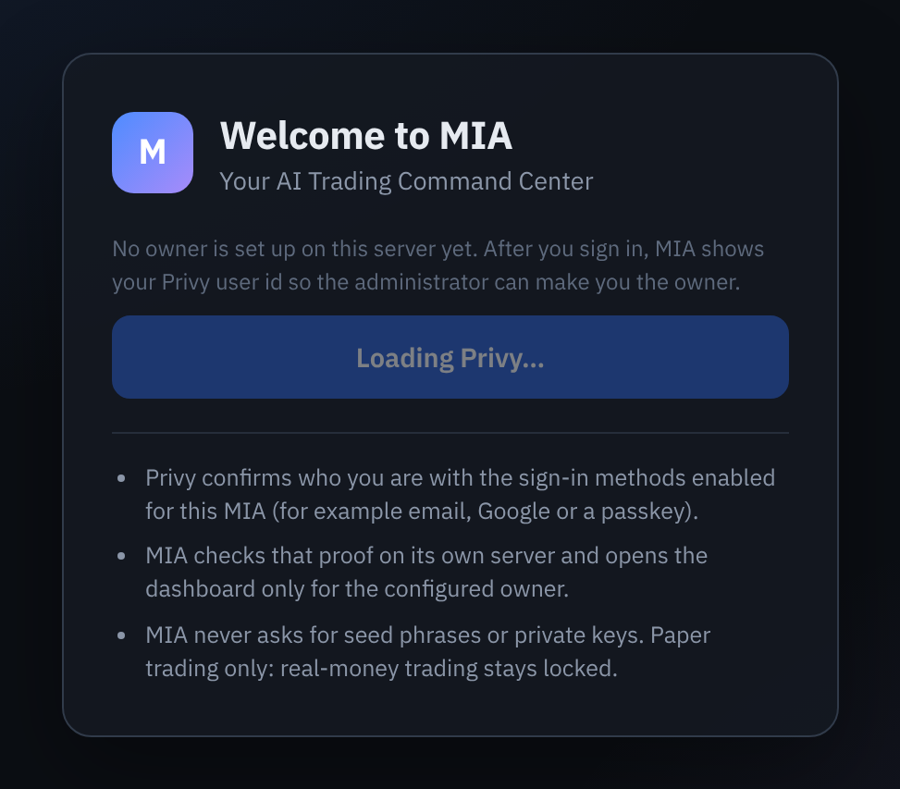

# Privy sign-in

Status: **implemented and offline-tested; not yet tried with a real Privy app.**
- Server tests sign tokens with a locally generated key and run the same checks used for real Privy tokens.
- Browser tests check MIA's own sign-in screen.
- A live sign-in needs your Privy App ID and a browser where you complete Privy's hosted login.

## What changed (Privy is now the sign-in)

- **Privy is the only sign-in screen by default.** Opening MIA without a session shows **Welcome to MIA → Continue with Privy**. The old "Owner setup / create a passphrase" form is gone from the normal flow.
- **The original passphrase sign-in is off.** It exists only if the administrator sets `MIA_AUTH_MODE=passphrase`, which is meant for offline development, the automated tests, or emergency recovery. In Privy mode the server refuses passphrase setup, passphrase login and passphrase change, so this is not just hidden in the UI.
- **Sensitive actions use an authenticator app.** These are risk policy, mode changes, resuming after a pause or emergency, re-enabling or promoting strategies, wallet-address verification, withdrawal preview, lifting a withdrawal freeze, releasing a quarantined worker, and the Privy link and embedded-wallet actions. Each asks for a fresh 6-digit code from an authenticator app (TOTP, verified on the MIA server).
- **A Privy session alone never allows a sensitive action.** Privy refreshes its token silently, so a valid token does not prove someone just passed a challenge.



## How it works

1. You press **Continue with Privy**. Privy's own window signs you in with the methods enabled in your Privy dashboard.
2. The browser sends Privy's access token to `POST /api/auth/privy/login`. The token is never logged or put in a URL.
3. The MIA server verifies the token:
   - signature (ES256);
   - issuer `privy.io`;
   - audience = your App ID;
   - expiry;
   - subject format (`did:privy:...`).
4. The verified Privy user must be **the MIA owner** (see below). Anyone else is refused.
5. MIA opens its normal session: an HttpOnly, SameSite=Strict cookie, Secure in production. Every existing API, the CSRF rule and the live event stream (SSE) work exactly as before.
6. **Sign out** ends the MIA session on the server first, then the Privy browser session. If the server can't confirm, MIA says so and keeps you signed in rather than pretending.

Failed Privy sign-ins share the same brute-force limit as before. No Privy secret is needed: MIA uses only the public App ID and Privy's public verification key.

## Who is the owner

Exactly one Privy user (`did:privy:...`) is bound to the MIA owner. **Signing in with Privy never creates an owner by itself.** The first visitor cannot claim the account, and the browser cannot declare itself the owner.

| Situation | How the owner is bound |
|---|---|
| New install | Set `MIA_PRIVY_OWNER_ID=did:privy:...` on the server. On that user's first sign-in, MIA backs up the database and then binds them. If the backup fails, nothing is bound. |
| Don't know your Privy id yet | Sign in once. MIA refuses, but shows *your* Privy id so you can put it in `MIA_PRIVY_OWNER_ID`. |
| Existing install that already linked Privy (PR #18 flow) | Nothing to do: the existing link is kept. |
| Existing install, passphrase only | Set `MIA_PRIVY_OWNER_ID` as for a new install. Your data, trades and audit history are untouched; the passphrase hash is kept for recovery. |
| Move ownership to another Privy account | Signed in: Security Center → Privy account → **Re-link** (needs step-up). On the server: `npm run owner -- bind-privy <did> --replace`. Either way, every session ends. |
| Lost access to the Privy account | On the server: `npm run owner -- bind-privy <new did> --replace`. |

Once an owner is bound, **the database wins**. Changing `MIA_PRIVY_OWNER_ID` later cannot take the account over; the server log warns about the mismatch instead.

Server commands (they run on the server machine; each takes a verified backup first and ends all sessions):

```bash
npm run owner -- status
```

```bash
npm run owner -- bind-privy did:privy:xxxxxxxx --replace
```

```bash
npm run owner -- reset-2fa
```

## Authenticator app (step-up)

Set it up in **Security Center → Two-factor step-up**.

- **The first setup needs independent proof that you control this MIA**, one of:
  - the one-time code MIA prints in the **server console** when you press *Set up authenticator*;
  - your old MIA passphrase (existing installs);
  - opening MIA on the server machine itself.

  A stolen browser session alone cannot set up or replace the owner's second factor.
- **Replacing the authenticator needs a current code.**
- **Each code works once.** Guesses hit the brute-force limit.
- **Existing installs:** until you set it up, your old passphrase still confirms sensitive actions. Afterwards only the authenticator does.
- **New installs:** until you set it up, sensitive actions are **refused** (fail closed). Viewing, scanning, paper monitoring and risk-reducing actions such as *Pause new orders* keep working.
- **Lost the device:** run `npm run owner -- reset-2fa` on the server, then set it up again.

## Turning it on

1. Create an app at dashboard.privy.io. Copy the **App ID** (25 characters). It is public, not a secret.
2. In the Privy dashboard:
   - **Login methods:** enable what you want (e.g. email, Google, passkey). Consider turning on Privy MFA for your account.
   - **Allowed origins:** add every address you open MIA at:
     - `http://localhost:8787` (`npm start`);
     - `http://localhost:5173` (`npm run dev`);
     - your HTTPS domain (e.g. `https://mia.example.com`).
   - **Embedded wallets:** leave automatic creation off. MIA never needs it.
3. Privy requires **HTTPS**, except on `localhost`. For a free HTTPS address, follow `TAILSCALE_FUNNEL.md`; for your own server see `DEPLOYMENT_GUIDE.md`.
4. Set these in the **server** environment and restart MIA:
   - `MIA_PRIVY_APP_ID=<your app id>` (required).
   - `MIA_PRIVY_OWNER_ID=did:privy:...` (the owner; see above).
   - Optional: `MIA_PRIVY_VERIFICATION_KEY` set to the PEM public key from the dashboard. Without it, MIA fetches Privy's public key set from `auth.privy.io`, so the server must be able to reach that host.
   - For `npm start`, export the variables in the shell that starts MIA. The bundled systemd unit reads `/etc/mia/mia.env`.
5. Open MIA → **Continue with Privy** → you land on the dashboard.
6. Go to **Security Center → Two-factor step-up** and set up your authenticator app.

The server log explains a wrong App ID (not 25 characters), a malformed owner id, an owner id that differs from the bound owner, and "Privy mode but no App ID".

## Troubleshooting

| What you see | Meaning | Fix |
|---|---|---|
| "Sign-in isn't configured on this MIA server yet." | `MIA_PRIVY_APP_ID` is missing | Set it and restart. |
| "Can't reach the MIA server." | The page loaded but the API did not answer | Start MIA (`npm start`, port 8787). With `npm run dev`, the 5173 page proxies to 8787. |
| "The MIA server answered with an error." | The API is up but failed | Check the server log; the message shows the detail. |
| "Privy is taking unusually long to load." | Privy's SDK could not start | Check the internet connection, that this address is in **Allowed origins**, and the App ID. |
| "The Privy verification service is unavailable." | The MIA server could not retrieve Privy's public verification keys | Retry after the service recovers. Check the server's outbound HTTPS access to `auth.privy.io` if it persists. |
| "MIA could not load its configured Privy verification key." | The configured public key could not be read | Set `MIA_PRIVY_VERIFICATION_KEY` to the dashboard's ES256 public verification key in PEM format, then restart MIA. |
| "…no MIA owner has been set up yet… MIA_PRIVY_OWNER_ID=did:privy:…" | Privy verified you, but no owner is bound | Put that id in `MIA_PRIVY_OWNER_ID` on the server and restart. |
| "this Privy account is not the MIA owner" | You signed in with a different Privy account | Press **Use a different Privy account**. |
| "Too many sign-in attempts." | Brute-force limit | Wait and retry. |
| "set up an authenticator app" on a protected action | No step-up method yet | Security Center → Two-factor step-up. |

## Still locked (unchanged)

- Live trading, withdrawals and real-money execution.
- Privy wallet signing, sending, funding, export and delegation. A CI test fails if MIA's Privy code ever uses those Privy APIs.

## Dependency note

`@privy-io/react-auth` pulls in wallet libraries that pin an old `zod` 3.x with a high-severity advisory (GHSA-mrhx-c7xc-m3w5). An npm `overrides` entry forces the patched `zod` 4.6.7; both libraries' schemas were checked under it. The audit gate was not weakened. Remove the override once Privy ships a fixed release.

## Combined with Codex's sign-in work

- **A Privy failure stays contained (Codex).**
  - In passphrase mode, a bad App ID or a blocked network breaks only the Privy card, never the passphrase login.
  - A Privy session is issued in the same database step that re-reads the owner link, so a link changed during token verification cannot open a session for the old identity.
- **Google sign-in (Codex #25).** The direct Google button is offered **only in passphrase mode** (`MIA_AUTH_MODE=passphrase`) with the `MIA_GOOGLE_*` settings. In Privy mode, enable Google as a login method in the Privy dashboard instead, so there is only one owner identity to bind.
- **First-time setup (passphrase mode)** always needs the one-time code printed in the server console, even from the same machine (Codex hardening: a loopback connection can come from a forwarder).

